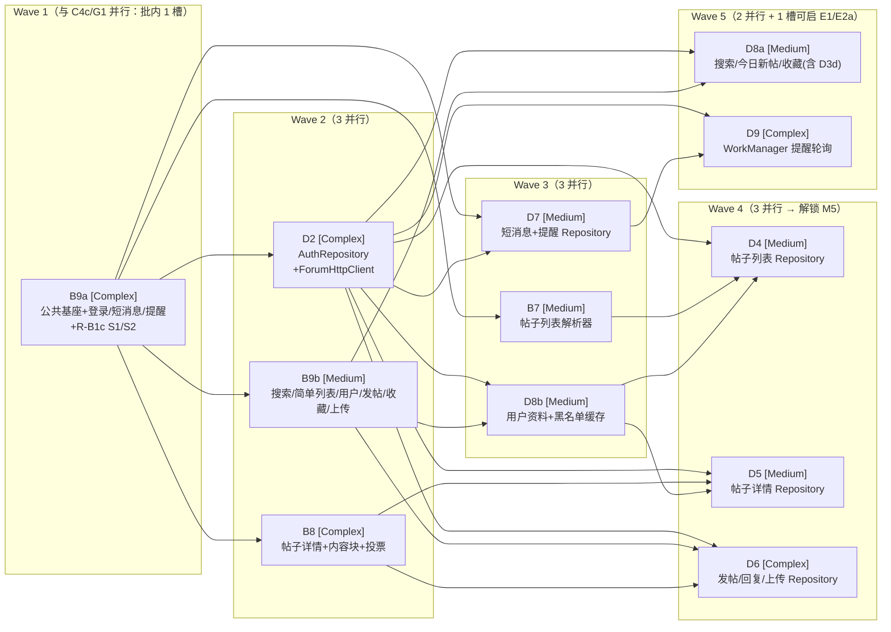

# 第四批任务计划（BATCH-4）：解析器安全网（M2）与数据层（M3）

> 状态：计划草案（先定计划与拆分，暂不起草单张卡）。基线：`origin/main` @ `d5ed2ce`（16 个真机脱敏样本 + `manifest.json` 已入仓，M1 验收通过）。
> 依据：`docs/design/backlog.md`（v0.3）、`docs/design/tech-plan.md`（v0.3）、`docs/design/product-design.md`（v0.3）、`docs/agents/DISPATCH.md`（§2–§5）、`docs/agents/handoff.md`、`docs/agents/lesson.md`、`_reports/D-3pane.md`（第五节卡 3）、`team-lead` skill `references/planning.md`。

---

## 一、范围、第一性原理拆分与合并结论

### 1.1 本批覆盖与目标终态
本批完成 **M2（解析器样本回归 + `:core-parser` 纯 JVM 解析层）** 与 **M3（Kotlin 数据层 Repository + WorkManager 提醒轮询）**，并顺带闭合 **R-B1c 建议 S1 / S2**，打通整个 **M5 / M6（E 线全部页面，含三栏适配）** 的上游数据依赖。

### 1.2 第一性原理拆合决策（遵循 `DISPATCH.md` §5 与 `planning.md`）
原 `backlog.md` 涉及 B2–B9（8 张）、D2 + D3d + D4–D9（8 张）加 R-B1c S1/S2（1 项小修）共 17 项。按四个第一性原理问题收拢为 **12 张卡（4 张 B 线 + 8 张 D 线）**，省去 5 张纯固定开销卡（按第三批实测 45 分钟/卡计，节约约 3.75 小时）：

| 拆合决策 | 原条目 | 合并/拆分后 | 第一性原理理由 |
|---|---|---|---|
| **合并旧回归与新解析** | `B2 + B7`、`B3 + B8`、`B4+B6(登录) + B9a`、`B5+B6(发帖/收藏) + B9b` | `B7`、`B8`、`B9a`、`B9b`（共 4 张） | 1. **不解锁并行**：旧代码 `HiParser*` 在 M7-2 前只读不改（不可变神谕），`B2` 只喂给 `B7`、`B3` 只喂给 `B8`、`B4–B6` 只喂给 `B9`，单拆零收益； 2. **同验证方式**：每张新解析卡本来就必须跑两层单测（`:core-parser:test` 纯 JVM + `:hipda:testDebugUnitTest` Robolectric 新旧等价对比），把旧版基线断言直接纳入同一张卡的 TDD 第一步，同一组单测即可判定； 3. **消除串行瓶颈**：若把 `B2–B6` 合成 1 张前置回归卡，会阻塞全部 `B7/B8/B9` 一整轮。 |
| **将原 `B9` 按关键路径一分为二** | `B9`（覆盖 ~2200 行旧代码、10 类页面） | **`B9a`**（公共基座 + 登录 + 短消息 + 提醒）+ **`B9b`**（搜索 + 简单列表 + 用户/黑名单 + 发帖表单/收藏/上传） | 1. **解锁关键路径并行**：全 D 线（`D4–D8b`）都依赖 `D2`（`AuthRepository`），而 `D2` 只需要登录与 `#umenu`/formhash 解析；先做 `B9a` 可立刻解锁 `D2`、`D7`、`B7`、`B8`、`B9b` 并行，同时一次定型 `:core-parser` 公共不可逆基座（`DiscuzPageMeta`、`DiscuzTextDecoder`、`SampleFixtures`、`LegacyTestSupport`），避免 `B7`/`B8`/`B9b` 重复造轮子或改同一文件； 2. **控审查状态量**：原 B9 单卡跨 10 个 Discuz! 页面，拆成两张后单卡审查负荷清晰可控。 |
| **合并 `D3d` 入 `D8a`** | `D3d` + `D8a` | **`D8a`**（含搜索历史与收藏 `tid` 缓存 DataStore） | `D3d`（~120–150 行）只喂给 `D8a`，不解锁任何其他线；且其收藏缓存模型正对应 `B9b` 的收藏解析结果，合并消除一张小卡固定开销，且使用独立 DataStore 文件，零碰 `data/settings/`。 |
| **并入 R-B1c S1/S2 入 `B9a`** | R-B1c S1 + S2（~30 行生产代码） | **并入 `B9a`** | 同属 `:core-parser` 模块与 `:core-parser:test` 判定，改动量远低于 ~120 行单卡门槛；放在 Wave 1 第一张卡里第一时间收口脱敏扫描器边界，避免单开碎卡。 |
| **保留 `D8b` 独立并前置** | `D8b`（用户资料 + 黑名单） | **`D8b`**（Wave 3，早于 `D4`/`D5`） | 查实 `AppSettings.kt`（D3a）与 `HiDatabase.kt`（D1）均未存黑名单；`D4`（帖子列表黑名单过滤补页）与 `D5`（帖子详情黑名单楼层过滤）均须消费黑名单 `StateFlow`，故 `D8b` 独立前置以解锁 `D4`、`D5`、`E12`、`E13`。 |

### 1.3 真机样本实测盘点与合成夹具补齐清单（已逐文件核实 `hipda/src/test/resources/samples/`）
16 个真机样本中有 **3 项关键事实** 须写进后续任务卡背景，避免实现者踩坑：
1. **双重转义补充平面 Emoji 已在真机样本中证实**（闭合 `lesson.md` / `handoff.md` A1 S4 待确认项）：`thread_list/forum_2_p1_lastpost.html`、`forum_2_p2_lastpost.html`、`thread_detail/thread_p2.html`、`search/search_result.html` 均实测含 `&amp;#\d{5,6};`。`B9a` 建统一 `DiscuzTextDecoder` 做二次十进制实体解码，供 `B7`/`B8`/`B9b` 共用。
2. **两个真机样本为特殊态，必须补合成夹具**：
   - `notify/notify_list.html` 为**空列表态**（`
暂无数据
`，含完整 `div.promptcontent` 计数区，无 `ul.feed` 条目）→ `B9a` 用真样本测空态 + `promptcontent`，另补合成 `ul.feed` 夹具覆盖 `f_buddy`/`f_manage`/`f_thread`/`f_quote`/`f_reply` 四种提醒；
   - `login/login_page.html` 为**已登录态回跳页**（含 `#umenu` 与“欢迎您回来，HiUser”，无登录表单字段）→ `B9a` 用真样本测 `isLoggedIn`/退出链接 `formhash`，另补合成未登录表单页 + 登录提交 XML 响应（成功/密码错误含剩余次数/未知错误）。
3. **其余未入真样本的分支须用合成夹具补齐**：
   - `thread_list/` 无 `pin_` 置顶帖（`B7` 补合成置顶/投票/彩色标题夹具）；
   - `thread_detail/` 无 `form#poll` 1 楼投票与锁定/警告楼层（`B8` 补合成单选/多选投票、锁定楼层、警告标记夹具）；
   - `search/search_result.html` 为标题搜索（`B9b` 补全文搜索 `spctrl`、黑名单 `div.blacklist`、编辑/回复/引用 `PrePost`、收藏增删 XML、`DISCUZUPLOAD` 响应夹具）；
   - `sms/` 缺发送短消息后的 XML 响应（`B9a` 补合成 XML 夹具）。

### 1.4 面向三栏（E 线接入，见 `_reports/D-3pane.md` 第五节卡 3）的数据契约要求
为免 E 线接入三栏时返工，本批数据层在建卡时即对齐以下接口：
- **`D2`**：`AuthRepository` 暴露 `currentAccount: StateFlow<SavedAccount?>`（供左栏顶/底头像与账号入口消费）；新增 `ForumHttpClient` 统一封装 `SiteAccessGateway` + `SiteCharset` + `GbkForm` + `forumServer` + 单飞静默重登一次，供 `D4–D8b` 复用；
- **`D7`**：`smsUnreadCount: StateFlow<Int>` 与 `notifyUnreadCount: StateFlow<Int>` **严格分开暴露**（三栏左栏两行各自消费角标；窄屏底栏 `消息` 自行求和）；
- **`D8a`**：承接 **`今日新帖`**（复用 `SearchParser`），使三栏左栏 5 个功能入口全部有唯一归属；
- **`D4` / `D5`**：输出带稳定 `tid`/`pid` 键的不可变模型，支持按版块/帖子独立流与状态保活，方便 `E1`/`E2a`/`E3` 在单栏↔图标轨单栏↔三栏↔铰链双栏间通过 `movableContentOf` 零重拉迁移；
- **`D8b`**：`blockedUsernames: StateFlow<Set<String>>` 响应式提供给 `D4`/`D5`，黑名单变动即时重过滤。

---

## 二、本批 12 张卡清单（目标、依据、样本、文件集合、验证、风险档、依赖）

> 风险档严格按 `team-lead` skill `references/planning.md` 复杂度表定级（取最高触发信号）：
> - **Complex**（不可逆决策/跨模块契约/并发状态机/共享文件接线）：**Carbon 独立审查 + Hydrogen 独立探针验证**（同 commit 并行派发）；
> - **Medium**（已知技术栈内的新接口，或位于 `DISPATCH.md` §4 敏感区）：**Carbon 只读代码审查**（无额外探针卡）；
> - 本批无 **Simple** 卡（所有 B 线均在 `DISPATCH.md` §4 `HiParser*` 敏感区，所有 D 线均引入供 E 线消费的新公共接口）。

### Wave 1（可立即开工，与进行中的 `C4c`、`G1` 并发；总活跃实现卡 = 3）

#### 1. `B9a` — `:core-parser` 公共基座 + 登录/短消息/提醒解析（含旧回归与 R-B1c S1/S2）
- **目标**：建立 `:core-parser` 公共解析基础设施与不可变页头模型，实现登录、短消息、提醒及通知计数的纯 JVM 解析器（附旧代码样本回归与新旧等价测试），并收口 R-B1c S1/S2 脱敏扫描边界。
- **依据**：`backlog.md` B4、B6（登录）、B9（部分）；`tech-plan.md` §5（T2）、§8（M2）；`handoff.md` §4（A1 S4 双重转义、B1a `firstMatch`）；旧代码 `LoginHelper.java`、`HiParser.java:212-523,786-804`、`PostSmsAsyncTask.java:52-109`、`NotiHelper.java:84-93`；R-B1c S1/S2（见第四节）。
- **用到样本**：`login/login_page.html`、`sms/sms_list.html`、`sms/sms_detail.html`、`notify/notify_list.html`（+ 合成未登录表单、登录 XML、SMS 发送 XML、`ul.feed` 四类提醒夹具）。
- **改动文件集合**：
  - 生产（`:core-parser`）：
    - `core-parser/src/main/kotlin/net/jejer/hipda/parser/sanitize/SanitizeSelectors.kt`（S1）
    - `core-parser/src/main/kotlin/net/jejer/hipda/parser/sanitize/SampleLeakScanner.kt`（S2）
    - `core-parser/src/main/kotlin/net/jejer/hipda/parser/common/{DiscuzCommonModels,DiscuzCommonParser,DiscuzTextDecoder,DiscuzUrlHelper}.kt`（公共页头 `DiscuzPageMeta`、`#umenu`、`formhash`、`alert_error/info`、`promptcontent` 计数、双重转义解码 `decodeHtmlEntities`、`firstMatch`）
    - `core-parser/src/main/kotlin/net/jejer/hipda/parser/auth/{LoginModels,LoginParser}.kt`
    - `core-parser/src/main/kotlin/net/jejer/hipda/parser/message/{SmsModels,SmsParser,NotifyModels,NotifyParser}.kt`
  - 测试：
    - `core-parser/src/test/kotlin/net/jejer/hipda/parser/SampleFixtures.kt`（供 `B7`/`B8`/`B9b` 复用的只读样本加载器）
    - `core-parser/src/test/kotlin/net/jejer/hipda/parser/sanitize/HtmlSanitizerTest.kt`（补 S1 `%3D`/`%20`/`%22` 与 S2 非法 `selfUid` fail-closed 单测）
    - `core-parser/src/test/kotlin/net/jejer/hipda/parser/common/DiscuzCommonParserTest.kt`
    - `core-parser/src/test/kotlin/net/jejer/hipda/parser/auth/LoginParserTest.kt`
    - `core-parser/src/test/kotlin/net/jejer/hipda/parser/message/{SmsParserTest,NotifyParserTest}.kt`
    - `hipda/src/test/java/net/jejer/hipda/parser/LegacyTestSupport.kt`（含 `HiParserThreadList.holdFetchNotify()` 抑制旧解析器后台线程发真实请求，供 `B7`/`B8`/`B9b` 复用）
    - `hipda/src/test/java/net/jejer/hipda/parser/AuthAndMessageParserEquivalenceTest.kt`
- **验证方法**：`:core-parser:test`（JUnit 5）+ `:hipda:testDebugUnitTest --tests "net.jejer.hipda.parser.*"`（Robolectric 旧回归 + 新旧等价 + 单行变异自证）；**Carbon 审查 + Hydrogen 探针**（重点核实 S1/S2 边界、`&amp;#128512;` 解码、畸形 HTML/XML 与旧版异常兼容）。
- **风险档**：**Complex**（不可逆跨模块公共契约 `DiscuzPageMeta`/`DiscuzTextDecoder` + 敏感区 `LoginHelper`/`HiParser*` + 脱敏门禁 fail-closed）。
- **依赖**：无未满足前置（基于 `main @ d5ed2ce`）；**解锁** `B7`、`B8`、`B9b`、`D2`、`D7`。

---

### Wave 2（`B9a` 合入且 `C4c`/`G1` 腾出槽位后，3 张并行）

#### 2. `D2` — `AuthRepository` 与统一已鉴权网络执行器 `ForumHttpClient`
- **目标**：实现表单登录（旧版密码转义 + MD5）、多账号切换、基于 `@RecoveryHttpClient` 的单飞静默重登一次、手动退出禁止自动重登，并提供供全部 Repository 复用的 `ForumHttpClient`。
- **依据**：`backlog.md` D2；`tech-plan.md` §6（T5 独立恢复 Dispatcher）；`product-design.md` §7.1、§7.11；旧代码 `LoginHelper.java:105-182`（注意 L175-177 密码转义细节：`\\` 与 `\"` 有反斜杠，而 `"\'"` 在 Java 中等价于不转义单引号，须写对照测试锁死语义）。
- **用到样本**：`login/login_page.html`（MockWebServer 模拟未登录登录页、登录成功/失败 XML、会话过期触发静默重登、Cloudflare 403 交互）。
- **改动文件集合**：
  - 生产：`hipda/src/main/java/net/jejer/hipda/data/auth/{AuthModels,AuthRepository,DefaultAuthRepository,ForumHttpClient,PasswordMd5}.kt`、`hipda/src/main/java/net/jejer/hipda/di/AuthModule.kt`
  - 测试：`hipda/src/test/java/net/jejer/hipda/data/auth/{AuthRepositoryTest,ForumHttpClientTest,PasswordMd5Test}.kt`
- **验证方法**：`:hipda:testDebugUnitTest --tests "net.jejer.hipda.data.auth.*"`（MockWebServer + 假 `CredentialsStore`/`SiteCookieStore`/`SiteAccessGateway` + 协程并发测试）；**Carbon 审查 + Hydrogen 探针**（并发失效请求合并为单次重登、`manuallyLoggedOut=true` 严格禁止静默重登、切换账号清旧 Cookie 与取消在途状态、`@RecoveryHttpClient` 线程隔离不死锁）。
- **风险档**：**Complex**（并发单飞重登状态机 + 全 D 线公共接口 `ForumHttpClient` + DISPATCH §4 登录/Cookie 敏感区）。
- **依赖**：`A4` ✅、`D3c` ✅、`B9a`；**解锁** `D4`、`D5`、`D6`、`D7`、`D8a`、`D8b`、`D9`、`E15`。

#### 3. `B8` — 帖子详情样本回归与 `:core-parser` 新详情解析器（含内容块与 1 楼投票）
- **目标**：以样本回归锁定旧 `HiParserThreadDetail` 行为，并在 `:core-parser` 实现无副作用的帖子详情、结构化内容块（含 `C1b#2` 表情键归一化、双重转义 Emoji 解码、文字颜色保留原始值至渲染期）与 1 楼投票解析器，断言新旧等价。
- **依据**：`backlog.md` B3、B8；`tech-plan.md` §5（T2、T6 原生正文渲染、颜色可读性后移）；`handoff.md` §4（A1 S4、C1b#2 表情键归一化）；旧代码 `HiParserThreadDetail.java`（664 行）、`TextViewWithEmoticon.java:86-89`。
- **用到样本**：`thread_detail/thread_p1.html`、`thread_detail/thread_p2.html`、`thread_detail/thread_author_only.html`（+ 合成 1 楼单选/多选投票、锁定楼层、警告楼层、嵌套引用、未知标签夹具）。
- **改动文件集合**：
  - 生产（`:core-parser`）：`core-parser/src/main/kotlin/net/jejer/hipda/parser/threaddetail/{ThreadDetailModels,ContentBlock,PollModels,ThreadDetailParser}.kt`
  - 测试：`core-parser/src/test/kotlin/net/jejer/hipda/parser/threaddetail/{ThreadDetailParserTest,ContentBlockParserTest,PollParserTest}.kt`、`hipda/src/test/java/net/jejer/hipda/parser/ThreadDetailParserEquivalenceTest.kt`
- **验证方法**：`:core-parser:test` + `:hipda:testDebugUnitTest --tests "net.jejer.hipda.parser.ThreadDetailParserEquivalenceTest"`（含变异自证 + 核对表情键与 `:emoji` `EmojiMap` 一致）；**Carbon 审查 + Hydrogen 探针**（深层嵌套引用/混排图文、双重转义 Emoji、畸形附件/投票容错）。
- **风险档**：**Complex**（不可逆跨模块契约 `ContentBlock` 密封类供给 `E2a` Compose 渲染 + 递归 DOM 遍历 + DISPATCH §4 `HiParser*` 敏感区）。
- **依赖**：`B9a`；**解锁** `D5`、`D6`、`E2a`。

#### 4. `B9b` — 搜索/简单列表/用户资料/黑名单/发帖表单/收藏/上传回归与新解析器
- **目标**：以样本回归锁定旧 `HiParser` 其余分支与 `PrePostAsyncTask`/`FavoriteHelper`/`UploadImgHelper` 解析逻辑，并在 `:core-parser` 实现对应纯 JVM 解析器与不可变模型，断言新旧等价。
- **依据**：`backlog.md` B5、B6（发帖表单/收藏）、B9（其余）；`tech-plan.md` §5（T2）、§8（M2）；旧代码 `HiParser.java:57-211,525-785,806-825`、`PrePostAsyncTask.java:86-229`、`FavoriteHelper.java:104-133,218-257`、`UploadImgHelper.java:210-227`。
- **用到样本**：`search/search_result.html`、`simple_list/my_threads.html`、`simple_list/my_posts.html`、`simple_list/my_favorites.html`、`user_info/user_profile.html`、`post_form/newthread_fid2.html`（+ 合成全文搜索 `spctrl`、黑名单页、编辑/回复/引用 `PrePost`、收藏增删 XML、`DISCUZUPLOAD` 响应夹具）。
- **改动文件集合**：
  - 生产（`:core-parser`）：
    - `core-parser/src/main/kotlin/net/jejer/hipda/parser/search/{SearchModels,SearchParser}.kt`
    - `core-parser/src/main/kotlin/net/jejer/hipda/parser/simplelist/{SimpleListModels,SimpleListParser}.kt`
    - `core-parser/src/main/kotlin/net/jejer/hipda/parser/user/{UserModels,UserParser}.kt`
    - `core-parser/src/main/kotlin/net/jejer/hipda/parser/post/{PrePostModels,PrePostParser,FavoriteParser,UploadResponseParser}.kt`
  - 测试：
    - `core-parser/src/test/kotlin/net/jejer/hipda/parser/{search,simplelist,user,post}/*Test.kt`
    - `hipda/src/test/java/net/jejer/hipda/parser/{SearchAndSimpleListEquivalenceTest,UserAndPostFormEquivalenceTest}.kt`
- **验证方法**：`:core-parser:test` + `:hipda:testDebugUnitTest --tests "net.jejer.hipda.parser.*EquivalenceTest"`（样本等价 + 变异自证）；**Carbon 只读代码审查**。
- **风险档**：**Medium**（沿用 `B9a` 既定模式的多组扁平 HTML/XML 解析器；DISPATCH §4 `HiParser*` 敏感区）。
- **依赖**：`B9a`；**解锁** `D6`、`D8a`、`D8b`。

---

### Wave 3（`D2` 与 `B9b` 合入后，3 张并行）

#### 5. `B7` — 帖子列表样本回归与 `:core-parser` 新列表解析器
- **目标**：以样本回归锁定旧 `HiParserThreadList` 行为，并在 `:core-parser` 实现无副作用的纯 JVM 帖子列表解析器（含置顶/投票/附图/多页/标题色/双重转义 Emoji，过滤交由上层 `D4`），断言新旧等价。
- **依据**：`backlog.md` B2、B7；`tech-plan.md` §5（T2）、§8（M2）；旧代码 `HiParserThreadList.java`（227 行）。
- **用到样本**：`thread_list/forum_2_p1_lastpost.html`、`thread_list/forum_2_p2_lastpost.html`、`thread_list/forum_2_p1_dateline.html`（+ 合成置顶 `pin_`、投票图标、彩色标题、空版块夹具）。
- **改动文件集合**：
  - 生产（`:core-parser`）：`core-parser/src/main/kotlin/net/jejer/hipda/parser/threadlist/{ThreadListModels,ThreadListParser}.kt`
  - 测试：`core-parser/src/test/kotlin/net/jejer/hipda/parser/threadlist/ThreadListParserTest.kt`、`hipda/src/test/java/net/jejer/hipda/parser/ThreadListParserEquivalenceTest.kt`
- **验证方法**：`:core-parser:test` + `:hipda:testDebugUnitTest --tests "net.jejer.hipda.parser.ThreadListParserEquivalenceTest"`（样本等价 + 变异自证）；**Carbon 只读代码审查**。
- **风险档**：**Medium**（沿用 `B9a` 模式的新接口；DISPATCH §4 `HiParser*` 敏感区）。
- **依赖**：`B9a`（可提前在 Wave 2 补位，也可放 Wave 3）；**解锁** `D4`。

#### 6. `D8b` — 用户资料与黑名单 Repository（含本地黑名单 DataStore 缓存）
- **目标**：实现用户资料与“TA 的帖子”加载，以及黑名单拉取/同步/添加/移除与本地 `StateFlow<Set<String>>` 持久化缓存（作为 `D4`/`D5` 过滤的唯一事实源）。
- **依据**：`backlog.md` D8b；`product-design.md` §7.1、§7.8、§7.10；旧代码 `BlacklistHelper.java`。
- **用到样本**：`user_info/user_profile.html`、`search/search_result.html`（MockWebServer；+ 合成黑名单页与增删回包）。
- **改动文件集合**：
  - 生产：`hipda/src/main/java/net/jejer/hipda/data/user/{UserRepository,DefaultUserRepository,BlacklistStore,BlacklistRepository,DefaultBlacklistRepository}.kt`、`hipda/src/main/java/net/jejer/hipda/di/UserModule.kt`（独立 DataStore `blacklist_cache.preferences_pb`，**不碰 `data/settings/`**）
  - 测试：`hipda/src/test/java/net/jejer/hipda/data/user/{UserRepositoryTest,BlacklistRepositoryTest}.kt`
- **验证方法**：`:hipda:testDebugUnitTest --tests "net.jejer.hipda.data.user.*"`（MockWebServer + DataStore 损坏回退 + 增删撤销同步）；**Carbon 只读代码审查**。
- **风险档**：**Medium**（新公共接口 + 独立非加密 DataStore 持久化，供 `D4`/`D5`/`E12`/`E13` 消费）。
- **依赖**：`A4` ✅、`D3a` ✅、`D2`、`B9b`；**解锁** `D4`、`D5`、`E12`、`E13`。

#### 7. `D7` — 短消息与提醒 Repository（含 15 秒冷却与分离未读数）
- **目标**：实现短消息列表/对话加载、15 秒冷却发送（formhash + GBK POST + XML 校验）、提醒列表加载、分离的 `smsUnreadCount`/`notifyUnreadCount` 流及本地按条/全部已读状态持久化。
- **依据**：`backlog.md` D7；`product-design.md` §3.2、§7.1、§7.5、§7.6；`_reports/D-3pane.md` §5 卡 3；旧代码 `PostSmsAsyncTask.java`、`NotiHelper.java`。
- **用到样本**：`sms/sms_list.html`、`sms/sms_detail.html`、`notify/notify_list.html`（MockWebServer；+ 合成 SMS 发送 XML 与 `ul.feed` 提醒页）。
- **改动文件集合**：
  - 生产：`hipda/src/main/java/net/jejer/hipda/data/message/{SmsRepository,DefaultSmsRepository,NotifyRepository,DefaultNotifyRepository,NotifyReadStateStore}.kt`、`hipda/src/main/java/net/jejer/hipda/di/MessageModule.kt`（独立 DataStore `notify_read_state.preferences_pb`，**不碰 `data/settings/`**）
  - 测试：`hipda/src/test/java/net/jejer/hipda/data/message/{SmsRepositoryTest,NotifyRepositoryTest}.kt`
- **验证方法**：`:hipda:testDebugUnitTest --tests "net.jejer.hipda.data.message.*"`（MockWebServer + 虚拟时钟 15s 冷却 + 单条/全部已读 + 双角标流）；**Carbon 只读代码审查**。
- **风险档**：**Medium**（新公共接口 + 15s 冷却与已读状态存储）。
- **依赖**：`A4` ✅、`D2`、`B9a`；**解锁** `D9`、`E8`、`E9`。

---

### Wave 4（`B7`、`B8`、`D8b` 合入后，3 张并行 — 完成后即解锁 M5 阅读核心 `E1`/`E2a`）

#### 8. `D4` — 帖子列表 Repository（已读、置顶/黑名单过滤、不足一屏自动补页）
- **目标**：实现按版块与排序方式加载帖子列表，结合 `AppSettings.showStickyThreads`、`BlacklistRepository` 与 `BrowseHistoryDao` 完成过滤与已读标记，过滤后不足一屏自动连续补页（取消旧版 5 页报错，保留末页/空页/安全上限防死循环）。
- **依据**：`backlog.md` D4；`product-design.md` §6.3、§7.1（自动补页）；`D-3pane.md` §5 卡 3。
- **用到样本**：`thread_list/forum_2_p1_lastpost.html`、`forum_2_p2_lastpost.html`、`forum_2_p1_dateline.html`（MockWebServer）。
- **改动文件集合**：
  - 生产：`hipda/src/main/java/net/jejer/hipda/data/threadlist/{ThreadListRepository,DefaultThreadListRepository}.kt`、`hipda/src/main/java/net/jejer/hipda/di/ThreadListModule.kt`、`hipda/src/main/java/net/jejer/hipda/data/local/BrowseHistory.kt`（**仅新增只读 `@Query("SELECT tid FROM browse_history") fun observeVisitedTids(): Flow<List<String>>`**，不改表结构/Schema 版本）
  - 测试：`hipda/src/test/java/net/jejer/hipda/data/threadlist/ThreadListRepositoryTest.kt`（不改 `HiDatabaseDaoTest.kt`）
- **验证方法**：`:hipda:testDebugUnitTest --tests "net.jejer.hipda.data.threadlist.*"`（MockWebServer + 内存 Room + 自动补页/防死循环/置顶与黑名单过滤/已读响应测试）；**Carbon 只读代码审查**。
- **风险档**：**Medium**（新接口 + 补页终止条件与多数据源组合）。
- **依赖**：`A4` ✅、`D1` ✅、`D3a` ✅、`D2`、`B7`、`D8b`；**解锁** `E1`。

#### 9. `D5` — 帖子详情 Repository（浏览历史、阅读位置、1 楼投票、黑名单过滤）
- **目标**：实现帖子详情分页加载（全帖/只看楼主/只看此人）、打开时自动写入并裁剪 `BrowseHistoryDao`、读写 `ReadingPositionDao`、按 `BlacklistRepository` 遮蔽黑名单楼层，以及 1 楼投票提交与结果刷新。
- **依据**：`backlog.md` D5；`product-design.md` §7.1、§7.3（读帖/只看过滤/投票）；旧代码 `PostHelper.java:115-118,171-177`。
- **用到样本**：`thread_detail/thread_p1.html`、`thread_detail/thread_p2.html`、`thread_detail/thread_author_only.html`（MockWebServer；+ 合成投票页与投票提交响应）。
- **改动文件集合**：
  - 生产：`hipda/src/main/java/net/jejer/hipda/data/threaddetail/{ThreadDetailRepository,DefaultThreadDetailRepository}.kt`、`hipda/src/main/java/net/jejer/hipda/di/ThreadDetailModule.kt`（只调用现有 `BrowseHistoryDao`/`ReadingPositionDao` 方法，不改 `data/local/*`）
  - 测试：`hipda/src/test/java/net/jejer/hipda/data/threaddetail/ThreadDetailRepositoryTest.kt`
- **验证方法**：`:hipda:testDebugUnitTest --tests "net.jejer.hipda.data.threaddetail.*"`（MockWebServer + 内存 Room + 投票提交表单断言）；**Carbon 只读代码审查**。
- **风险档**：**Medium**（新接口 + Room 联动 + 投票提交）。
- **依赖**：`A4` ✅、`D1` ✅、`D2`、`B8`、`D8b`；**解锁** `E2a`、`E4a`。

#### 10. `D6` — 发帖、回复、编辑与图片上传 Repository（草稿、小尾巴、30 秒冷却）
- **目标**：实现 `PrePost` 预取、6 种提交模式（发新帖/回复主题/回复楼层/引用/编辑/删除）、Emoji 十进制实体与 GBK 提交、非编辑态小尾巴拼接、30 秒冷却计时、`DraftDao` 读写与成功自动清草稿（失败保留），以及不依赖旧 `Compressor` 的图片缩放压缩与 multipart 上传进度流。
- **依据**：`backlog.md` D6；`tech-plan.md` §9（风险 4 Emoji 实体）；`product-design.md` §7.1–§7.4；旧代码 `PostHelper.java`、`PrePostAsyncTask.java`、`UploadImgHelper.java`。
- **用到样本**：`post_form/newthread_fid2.html`、`thread_detail/thread_p1.html`（MockWebServer；+ 合成编辑表单、上传 `DISCUZUPLOAD`、302 回跳与 `div.alert_info` 失败页）。
- **改动文件集合**：
  - 生产：`hipda/src/main/java/net/jejer/hipda/data/post/{PostModels,PostRepository,DefaultPostRepository,ImageCompressor,ImageUploadRepository,DefaultImageUploadRepository}.kt`、`hipda/src/main/java/net/jejer/hipda/di/PostModule.kt`（只调用现有 `DraftDao`，不改 `data/local/*`）
  - 测试：`hipda/src/test/java/net/jejer/hipda/data/post/{PostRepositoryTest,ImageUploadRepositoryTest}.kt`
- **验证方法**：`:hipda:testDebugUnitTest --tests "net.jejer.hipda.data.post.*"`（MockWebServer + Robolectric Bitmap 压缩 + 内存 Room + 虚拟时钟 30s 冷却 + GBK/Emoji 请求体字节断言）；**Carbon 审查 + Hydrogen 探针**（编辑不拼小尾巴、提交失败保留草稿、多图并发/取消上传、30s 冷却并发边界、GBK+补充平面 Emoji 编码）。
- **风险档**：**Complex**（DISPATCH §4 敏感区 `PostHelper` + 图片压缩与 multipart 上传 + 30s 冷却状态 + 6 种写操作与草稿一致性）。
- **依赖**：`A4` ✅、`D1` ✅、`D3a` ✅、`D2`、`B9b`、`B8`；**解锁** `E5`、`E6`。

---

### Wave 5（收尾 2 张并行；另空出 1 槽位可同时启动 M5 的 `E1` 或 `E2a`）

#### 11. `D8a` — 搜索、今日新帖、收藏与关注 Repository（合并 `D3d` 缓存存储）
- **目标**：实现标题/全文搜索、站内链接识别、“今日新帖 / 我的帖子 / 我的回复 / 收藏 / 关注”列表加载、收藏与关注增删（同步维护本地 `tid` 集合缓存），以及搜索历史（增/删/撤销/去重上限）与收藏缓存独立 DataStore 存储。
- **依据**：`backlog.md` D3d、D8a；`product-design.md` §3.2、§7.1、§7.7；`handoff.md` §2（D3d 暂缓原因已由 `B9b` 解除）。
- **用到样本**：`search/search_result.html`、`simple_list/my_threads.html`、`simple_list/my_posts.html`、`simple_list/my_favorites.html`（MockWebServer；+ 合成收藏增删 XML）。
- **改动文件集合**：
  - 生产：`hipda/src/main/java/net/jejer/hipda/data/search/{SearchHistoryStore,SearchRepository,DefaultSearchRepository,ForumLinkResolver}.kt`、`hipda/src/main/java/net/jejer/hipda/data/favorite/{FavoriteCacheStore,FavoriteRepository,DefaultFavoriteRepository}.kt`、`hipda/src/main/java/net/jejer/hipda/di/SearchAndFavoriteModule.kt`（独立 DataStore `search_history.preferences_pb`、`favorite_cache.preferences_pb`，**不碰 `data/settings/`**）
  - 测试：`hipda/src/test/java/net/jejer/hipda/data/search/{SearchHistoryStoreTest,SearchRepositoryTest}.kt`、`hipda/src/test/java/net/jejer/hipda/data/favorite/{FavoriteCacheStoreTest,FavoriteRepositoryTest}.kt`
- **验证方法**：`:hipda:testDebugUnitTest --tests "net.jejer.hipda.data.search.*" --tests "net.jejer.hipda.data.favorite.*"`（MockWebServer + DataStore 损坏回退 + 收藏乐观更新/撤销）；**Carbon 只读代码审查**。
- **风险档**：**Medium**（新接口 + 独立非加密 DataStore 持久化）。
- **依赖**：`A4` ✅、`D3a` ✅、`D2`、`B9b`；**解锁** `E10`、`E11`（及左栏 `今日新帖`）。

#### 12. `D9` — 提醒轮询（`WorkManager` + `HiltWorker` + 免打扰 + 遇验证直接放弃）
- **目标**：实现基于 `WorkManager` 的 15 分钟周期提醒轮询 Worker 与调度器：遵循 `notificationsEnabled` 与免打扰时段（含跨午夜如 `22:00–08:00`）、未登录/手动退出时跳过、以 `AccessPriority.BackgroundSilent` 拉取提醒并在遇到 Cloudflare 验证时静默放弃不重试风暴。
- **依据**：`backlog.md` D9；`tech-plan.md` §6（T5 后台放弃验证）；`product-design.md` §7.10；旧代码 `service/NotiWorker.java`。
- **用到样本**：`notify/notify_list.html`、`sms/sms_list.html`（MockWebServer 模拟正常提醒与 HTTP 403 `cf-mitigated: challenge`）。
- **改动文件集合**：
  - 生产：`hipda/src/main/java/net/jejer/hipda/service/{NotificationPollingWorker,NotificationScheduler,QuietHoursChecker}.kt`、`hipda/src/main/java/net/jejer/hipda/di/NotificationWorkModule.kt`
  - **共享文件显式授权（本批唯一写入者，须在卡片【边界】写明）**：
    - `hipda/src/main/java/net/jejer/hipda/ui/HiApplication.java`（实现 `androidx.work.Configuration.Provider` 提供 `HiltWorkerFactory`，保留全部旧 `onCreate()` 逻辑；`HiltWorkerFactory` 自动回退支持旧 `NotiWorker` 共存）
    - `hipda/src/main/AndroidManifest.xml`（移除默认 `androidx.work.WorkManagerInitializer` `meta-data`，使 `HiApplication` 自定义配置生效）
  - 测试：`hipda/src/test/java/net/jejer/hipda/service/{NotificationPollingWorkerTest,NotificationSchedulerTest,QuietHoursCheckerTest}.kt`
- **验证方法**：`:hipda:testDebugUnitTest --tests "net.jejer.hipda.service.*"`（`androidx.work.testing` `TestListenableWorkerBuilder` + `WorkManagerTestInitHelper` + Robolectric 验证 `HiApplication` 实装 `Configuration.Provider` 与旧 `NotiWorker` 兼容）；**Carbon 审查 + Hydrogen 探针**（跨午夜/同日免打扰边界、`BackgroundSilent` 遇验证直接放弃不重试、`WorkManager` 真实初始化链路）。
- **风险档**：**Complex**（共享文件 `HiApplication`/`AndroidManifest.xml` 接线 + WorkManager 后台调度与 `BackgroundSilent` 验证放弃逻辑 + 跨午夜边界）。
- **依赖**：`A4` ✅、`D3a` ✅、`D2`、`D7`；**解锁** M3 完成与 `E12` 通知开关接线。

---

## 三、文件零重叠检查与在途卡（`C4c` / `G1`）冲突核对

### 3.1 与正在进行的 `C4c`、`G1` 冲突检查（结论：**零冲突**）

| 正在进行的卡 | 其改动范围（核自 `_cards/C4c.md`、`_cards/G1.md`） | 与 BATCH-4（12 张卡）的交集 |
|---|---|---|
| **`C4c`**（`card/C4c-three-pane-shell`） | `ui/shell/*`、`ui/designsystem/HiTypography.kt`、`ui/designsystem/glass/HiGlassSurface.kt`、`res/values/strings_shell.xml`、`src/debug/.../PreviewActivity.kt`、**`data/settings/{AppSettings,SettingsRepository,DataStoreSettingsRepository}.kt`**、**`DataStoreSettingsRepositoryTest.kt`**、`test/.../ui/shell/*`、`snapshots/images/shell_*.png` | **0 个文件**。BATCH-4 所有 D 线卡仅**只读消费** `SettingsRepository` 接口，绝不修改 `data/settings/` 与 `di/SettingsModule.kt`；`D8a`（搜索历史/收藏缓存）、`D8b`（黑名单缓存）、`D7`（提醒已读状态）各自使用独立 DataStore 文件与独立 Hilt Module。 |
| **`G1`**（`card/G1-glass-tuning`） | `ui/designsystem/glass/*`、`ui/designsystem/HiTheme.kt`、`ui/shell/ShellIndicatorLayout.kt`、`src/debug/` 预览页、glass/shell 测试与截图基线 | **0 个文件**。BATCH-4 全部为纯解析与纯数据/服务层，不碰 `ui/designsystem/`、`ui/shell/`、`src/debug/` 或任何 Roborazzi 截图基线。 |

### 3.2 BATCH-4 批内并行卡与共享热点零重叠检查（结论：**同波全零重叠**）

| 潜在热点 / 共享区域 | 本批归属规则 | 重叠检查结果 |
|---|---|---|
| `core-parser/.../parser/common/*`、`SampleFixtures.kt`、`LegacyTestSupport.kt` | **仅 `B9a`（Wave 1）创建**；Wave 2/3 的 `B7`/`B8`/`B9b` 只读复用 | **无重叠** |
| `core-parser/.../parser/{threadlist,threaddetail,search,simplelist,user,post}/*` | 按子包彻底隔离：`B7` 独占 `threadlist`、`B8` 独占 `threaddetail`、`B9b` 独占 `search/simplelist/user/post`、`B9a` 独占 `sanitize/common/auth/message` | **无重叠** |
| `hipda/src/test/.../parser/*EquivalenceTest.kt` | 每张 B 卡各自新建独立测试类，无共享测试文件 | **无重叠** |
| `hipda/src/main/java/.../di/*Module.kt` | 每张 D 卡各自新建独立 Hilt `@Module`（`AuthModule`、`UserModule`、`MessageModule`、`ThreadListModule`、`ThreadDetailModule`、`PostModule`、`SearchAndFavoriteModule`、`NotificationWorkModule`），**全员不碰 `HttpClientModule.kt`、`DatabaseModule.kt`、`SettingsModule.kt`** | **无重叠** |
| `hipda/src/test/.../HttpClientModuleTest.kt`、`HiDatabaseDaoTest.kt`、`DataStoreSettingsRepositoryTest.kt`、`BackupExclusionRulesTest.kt` | 遵循 `lesson.md` 共享测试热点规则：**本批任何卡均不修改既有模块级测试**，各自断言全部写在自己的新测试类里 | **无重叠** |
| `hipda/src/main/java/.../data/local/BrowseHistory.kt` | **仅 `D4`（Wave 4）新增 1 条只读 `@Query`**；同波 `D5`/`D6` 只调用既有 DAO 方法，零修改 `data/local/*` | **无重叠** |
| `HiApplication.java`、`hipda/src/main/AndroidManifest.xml` | **仅 `D9`（Wave 5）经显式授权修改**，且不与任何修改共享文件的卡并行 | **无重叠** |
| 备份排除规则（`backup_config.xml`、`data_extraction_rules.xml`） | `D7`/`D8a`/`D8b` 的缓存 DataStore 均为非敏感非加密本地缓存，不触碰 Tink 凭据/Cookie 备份排除规则 | **无重叠** |

---

## 四、R-B1c 建议 S1 / S2 小修处置方案

- **处置结论**：**并入 Wave 1 的 `B9a` 卡，不单独开卡**。
- **依据**：两项改动共约 25–35 行生产代码 + ~40 行单测，均位于 `:core-parser` 模块并由 `:core-parser:test` 判定，按 `DISPATCH.md` §5 远不足单独开卡门槛（~120 行、约 45 分钟固定开销）；并入 `B9a` 后在 Wave 1 第一时间关闭脱敏扫描器边界，零延迟、零冲突。
- **在 `B9a` 卡片中的精确落地要求**：
  1. **S1（`SanitizeSelectors.kt:166`）**：收紧 `buildStandaloneUidRegex` 左边界，覆盖末位为数字的百分号转义（如 `%20`、`%22`、`%26`）紧邻本人 UID 的场景（例如 `(?:(?<!\d)|(?<=%[0-9A-Fa-f]{2}))(?:$alternation)(?!\d)`），同时保证更长纯数字（如 `94242420`、`1424242`、`4242429`）仍不被误伤；在 `HtmlSanitizerTest.kt` 补充 `%3D<selfUid>`、`%20<selfUid>`、`%22<selfUid>` 的脱敏与扫描正反例单测。
  2. **S2（`SampleLeakScanner.kt:97, 115, 128, 251`）**：当调用方传入非空、非空白但含非数字字符的 `selfUid`（如 `"abc"`、`"uid=424242"`）时实行 **fail-closed**（直接抛出 `IllegalArgumentException`，禁止静默退化为忽略 `selfUid` 返回 0 泄漏；`null` 或全空白字符串仍表示“未显式指定 `selfUid`”，`"10000"` 仍为合法占位 UID）；在 `HtmlSanitizerTest.kt` 补充 fail-closed 单测。

---

## 五、建议派发顺序、并行度与依赖图（实现卡并发严格 ≤ 3）

### 逐波调度建议
| 波次 | 并行实现卡（≤ 3） | 本波活跃实现总数 | 本波后置检查路由 | 本波完成后的里程碑收益 |
|---|---|---|---|---|
| **Wave 1** | `B9a` | 3（含在途 `C4c`、`G1`） | Carbon 审查 + Hydrogen 探针 | 闭合 R-B1c S1/S2；定型 `:core-parser` 公共契约；立即解锁 `D2`、`B7`、`B8`、`B9b` |
| **Wave 2** | `D2`、`B8`、`B9b` | ≤ 3（待 `C4c`/`G1` 合入后齐发；若仅腾出 1–2 槽，优先 `D2` → `B9b` → `B8`） | `D2`/`B8`：Carbon + Hydrogen；`B9b`：Carbon | 拔除全局最大瓶颈 `D2` 与次大瓶颈 `B9b`；最重解析卡 `B8` 落地 |
| **Wave 3** | `B7`、`D8b`、`D7` | 3 | 全部 Carbon 只读审查（轻量快过） | **M2（全部解析器）收官**；黑名单事实源 `D8b` 就绪；解锁 `D4`、`D5`、`D9`、`E8`/`E9` |
| **Wave 4** | `D4`、`D5`、`D6` | 3 | `D4`/`D5`：Carbon；`D6`：Carbon + Hydrogen | **M5 阅读核心（`E1`、`E2a`、`E3`）与回复/编辑器（`E5`、`E6`）全部解锁** |
| **Wave 5** | `D8a`、`D9`（+ 第 3 槽可启动 `E1`） | 2（或 3 含 `E1`） | `D8a`：Carbon；`D9`：Carbon + Hydrogen | **M3（全部数据层与轮询）收官**；E 线全员可按三栏契约并行推进 |

### 关键执行提醒（供建卡时带入）
1. **每波审查与探针并行**：Complex 卡（`B9a`、`B8`、`D2`、`D6`、`D9`）按 `planning.md` 在 CI 绿后同 commit 并行派发 Carbon 审查 + Hydrogen 探针（不超出全局 8 代理上限：最多 3 实现 + 3 审查/探针 + 1 OPS-1 = 7）。
2. **`D2` 的遗留密码转义验证**：旧 `LoginHelper.java:175-177` 存在 `.replace("'", "\'")`（实际未转义单引号）的 Java 字面量写法，建卡前须明确沿用该精确字节行为，并用真机/旧代码对照单测锁定。
3. **本批不触发 `emulator=true`**：除 `D9` 改了 `HiApplication`/`AndroidManifest.xml`（须核实 release 构建与 `WorkManager` 初始化不破旧代码，可在 `D9` 合入后或 M3 阶段口跑一次 `emulator=true` 冒烟确认冷启动），其余 11 张卡均为纯 JVM/Robolectric 验证。
