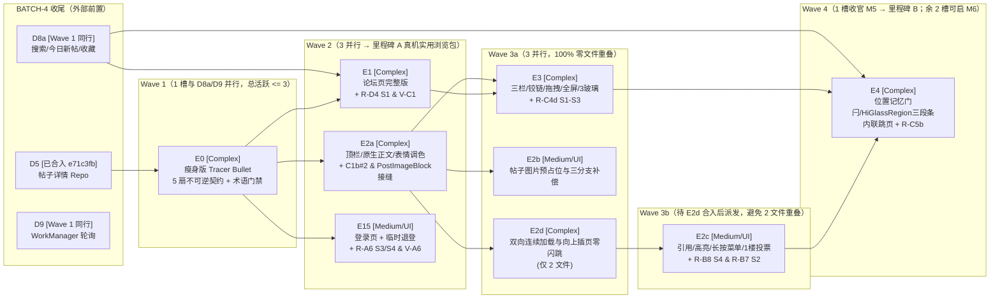

# 第五批任务计划（BATCH-5）：M5 阅读核心（E 线最短可用路径与三栏阅读闭环）

> 状态：已按 [R-BATCH5.md](file:///home/mir/Documents/hipda-next.wt/_reports/R-BATCH5.md) 修订（闭合全部 4 项阻断 B1–B4 与建议 S1–S4）。基线：`origin/main` @ `e71c3fb`（已合入 `C4d @ 21b1e3c`、`D4 @ 243aee8`、`D5 @ e71c3fb` 含修复轮 1 `ec0a5e8` 已闭合 `R-D5 S1–S4`、`D7`、`D8b`、`D2` 及全部 M2 解析器；在途 `D6`/`D8a`/`D9` 收尾中）。
> 依据：`docs/design/product-design.md`（v0.4：§3 信息架构、§4 三栏与折叠屏自适应、§5 视觉与液态玻璃、§6 动效系统、§7.1–§7.3/§7.9/§7.11/§7.12、§8 术语、§10 验收与截图矩阵）、`docs/design/copy.md`（v0.4）、`docs/design/backlog.md`（v0.4）、`docs/design/tech-plan.md`（v0.4）、`docs/agents/DISPATCH.md`（§2–§5）、`docs/agents/handoff.md`、`docs/agents/lesson.md`、`_reports/{D4,D5,R-D4,R-D5,D5-fixcheck,R-C4d,V-C4d,R-BATCH5}.md`、`team-lead` skill `references/planning.md`。

---

## 一、范围、第一性原理拆合与不可逆设计门

### 1.1 本批范围与终态目标（以及明确留待 BATCH-6 的项）
- **本批目标（M5 阅读核心 + 真机可登录浏览）**：遵循 **Tracer Bullet（曳光弹）优先**，以第一张卡 `E0` 最薄打通“**真实帖子列表 → 打开帖子阅读 → 单栏/三栏保活切换**”的端到端可运行路径，随后逐步加厚为完整的 M5 阅读核心体验（论坛透明吸顶顶栏与荧光笔版块标签、帖子详情 Compose 原生正文与连续加载、帖子图片预占位无跳动与省流模式、引用展开/楼层高亮/长按菜单/1 楼投票、三栏与铰链双栏拖拽吸附/全屏阅读/3 区域实时液态玻璃协同、阅读位置记忆与底部三段式液态玻璃工具条/原地展开内联跳页条），并将 **`E15`（登录页）前置纳入 Wave 2**（不采纳游客态替代，详见第四节与第六节）以解锁真机对 `4d4y.com` 需登录版块的完整浏览。
- **明确不纳入本批（留待 BATCH-6 / M6）**：
  - 写入与回帖链：`E5`（毛玻璃快速回复面板）、`E6`（完整编辑器）、`E7`（表情选择面板）——依赖在途 `D6` 且属 M6；本批 `E1`/`E2c`/`E4` 仅预留 `onNewThreadClick` / `onOpenReply` 与 `DetailChromeSpec.suppressBottomGlass` 回调槽位，M6 零返工接入。
  - 其余功能页：`E8`（短消息）、`E9`（提醒）、`E10`（搜索）、`E11`（我的）、`E12`（设置/账号/黑名单）、`E13`（用户资料）、`E14`（看图）、`E16`（外部链接/快捷方式/附件下载）——外壳与详情页均已预留对应回调（如 `onOpenImageViewer` 附缩略图屏幕坐标、`onOpenUserProfile`、`onManageForumsClick`），未落地一级入口先展示干净占位页；`E12` 落地前在 Wave 2 提供极简临时“退出登录”出口（S1）。
  - M7 切换与清理：不改旧启动入口 `MainFrameActivity`、不删旧 Java 页面、不升 `targetSdk`。

### 1.2 第一性原理拆合决策（遵循 `DISPATCH.md` §5 与 `planning.md`）
原 `backlog.md` 涉及 M5 范围 `E1`、`E2a`、`E2b`、`E2c`、`E3`、`E4a`、`E4b`（7 张）+ 前置 `E15`（1 张）+ 跨卡公共基座与历史审查遗留。经 R-BATCH5 审视瘦身并按风险将 `E2a` 的双向连续加载与向上插页同帧锚定拆分为独立卡 `E2d` 后，收拢为 **9 张卡、4 个波次（W3 分 W3a/W3b 串行衔接 `E2d → E2c`）**：

| 拆合决策 | 原条目 | 调整后 | 第一性原理理由 |
|---|---|---|---|
| **新增瘦身版 `E0` 作为 Wave 1 Tracer Bullet** | 无（原计划零散起步，要到 `E3` 才拼起可运行路径） | **`E0`**（最薄端到端阅读闭环 + 不可逆契约 + 术语/错误/极薄 Coil 基座；**不含**空壳占位文件与 `R-A6`/`V-A6`） | 1. **第一张卡即跑通真实链路**：直连真 `HiAdaptiveShell` + `D4` + `D5` + `NextAppActivity`，证明真实数据流与单/三栏零重建保活； 2. **一次定型 5 扇不可逆门**：锁定 `ForumChromeSpec`/`DetailChromeSpec`、`LocalPaneSnackbarController`、按 `tid` 托管 `ViewModelStoreOwner`、`LoginOverlaySlot`、`UiErrorMapper` + `CopyTerminologyScanTest`、极薄 `ImageLoaderModule` 与 `NextAppRoot` 预配 `managesGlassSource`，**立即解锁 Wave 2 三卡零重叠并行**； 3. **绝不先写再删（B1 修订）**：删去会被整文件替换的 `ThreadInteractSlots`/`ThreadBottomBarSlot`，将 `PostImageBlock` 推迟至 `E2a` 精准定型，将 `R-A6`/`V-A6` 移入轻量的 `E15`。 |
| **前置 `E15`（登录页 + `R-A6`/`V-A6` + 临时退登出口）入 Wave 2** | 原归 M6 | **`E15`**（Wave 2 与 `E1`/`E2a` 并行） | 实查 `cloudflare-research.md` §4 L118 与 `DefaultAuthRepository.kt:109-114`：游客访问默认首版块 `Discovery（fid=2）` 直接返回“无权进行当前操作”，且不经 `AuthRepository` 登录则无 `SavedAccount` 与静默重登；`E15` 依赖已全绿、体量轻量，在 Wave 2 与 `E1`/`E2a` 并行处于非关键路径（0 墙钟开销），顺带承接 `R-A6 S3/S4`、`V-A6`（Wave 2 无他卡碰 `ui/challenge/` 与 `HiStateViews.kt`）及 W2 临时退出登录出口（S1）。 |
| **按风险将 `E2a` 拆出 `E2d`（双向连续加载与向上插页零闪跳）** | 原 `E2a` 合并正文渲染与向上插页锚定 | **`E2a`**（W2：顶栏/原生正文/表情调色/`PostImageBlock` 接缝，暂沿用 `E0` 上下页）+ **`E2d`**（W3a：仅改 `ThreadDetailViewModel`/`ThreadDetailPane` 专攻双向连续加载与首帧 `≤ 1dp` 零闪跳） | 降低 W2 超时风险，让顶栏/原生正文/表情/调色与 `PostImageBlock` 接缝更快独立验收解锁里程碑 A 与 `E2b`/`E3`；高难度的“向上插页 `autoAdvance=false` 首帧零闪跳”隔离到 2 文件极小改动面的 `E2d` 独立攻坚与逐帧探针验收。 |
| **排 `E3` 在 Wave 3（晚于 `E1`/`E2a`）** | 原在 `backlog.md` 依赖 `E1`/`E2a` | **`E3`**（Wave 3a，与 `E2b`/`E2d` 并行） | `E3` 须验证“三栏 3 区域实时玻璃协同”、“铰链双栏左顶栏自动退纯色”、“`< 300dp` 窄中栏排版”与“详情顶栏圆形全屏按钮联动”；排在 `E1`/`E2a` 合入后可直接基于真实精修页面录制最终多栏基线，且因 `E0` 已锁死 `ForumChromeSpec`/`DetailChromeSpec`/`LocalPaneSnackbarController`，`E3` 零碰 `ForumPane`/`ThreadDetailPane`。 |
| **解耦 `E2b` 并按文件零重叠排布 `E2d → E2c`** | 原串行 `E2a → E2b → E2c` | **Wave 3a：`E3` ‖ `E2b` ‖ `E2d` → Wave 3b：`E2c`** | `E2a` 在写 `PostBodyRenderer` 时锁死唯一接缝 `media/PostImageBlock.kt` 与 `key = { "floor:${it.postId}" }`，使 `E2b` 严格隔离在 `feature/threaddetail/media/` 零改父文件，与 `E3`、`E2d` 100% 零重叠；经核对 `E2d` 与 `E2c` 均需改 `ThreadDetailViewModel.kt` 和 `ThreadDetailPane.kt`（`E2c` 的跨页跳楼/`只看此人`/1 楼投票需改这两文件）且 W3 总卡数超 3 并发上限，故安排 **`E2d` 在 W3a 先合入，`E2c` 紧随其后于 W3b 切出**，全程保持活跃实现卡 `≤ 3` 且同波 100% 零重叠。 |
| **合并 `E4a` + `E4b` 为 `E4`** | `E4a`（阅读位置记忆）+ `E4b`（三段工具条与内联跳页） | **`E4`**（Wave 4，复用 `HiGlassRegion`，含 `R-C5b`） | `D5` 已完成 `ReadingPositionDao` 读写，`E4a` UI 接线仅 ~80–110 行且不解锁并行，与位置栈/进度胶囊强耦合；合并省去 ~45 分钟固定开销并一次闭环验证。 |

### 1.3 不可逆设计门（One-Way Doors，全部在 `E0` 一次性代码落地并锁死签名）
1. **跨栏容器与面板契约（`feature/common/ReadingNavContracts.kt`）**：
   - `ThreadNavArgs(val tid: String, val title: String = "", val fid: Int = 0, val forumName: String? = null, val author: String? = null, val targetPid: String? = null)`；
   - `ForumChromeSpec(val showForumTabs: Boolean, val useGlassTopBar: Boolean, val externalGlassState: HiGlassState? = null)`（由容器按单栏/侧栏/三栏/铰链双栏统一下发，`E1` 按此决定显示标签行与透明/纯色顶栏，`E3` 无需改 `ForumPane.kt`）；
   - `FullScreenToggle(val isFullScreen: Boolean, val onToggle: () -> Unit)` 与 `DetailChromeSpec(val showBack: Boolean, val fullScreenState: FullScreenToggle? = null, val suppressBottomGlass: Boolean = false)`（`E2a` 渲染顶栏返回/全屏圆钮、`E4` 消费 `suppressBottomGlass` 整块卸载 `HiGlassRegion`，`E3` 与 M6 `E5` 无需反向改契约）；
   - 锁定 `ForumPane`、`ThreadDetailPane` 顶层 Composable 签名。
2. **分栏 Snackbar 控制器（`feature/common/ReadingNavContracts.kt`）**：
   - `enum class PaneSnackbarTarget { DetailPane, ContentArea }` 与 `interface PaneSnackbarController { suspend fun show(message: String, target: PaneSnackbarTarget = PaneSnackbarTarget.ContentArea, actionLabel: String? = null, onAction: (() -> Unit)? = null) }`，经 `LocalPaneSnackbarController` 向下注入；`E0` 提供单栏基础宿主，`E3` 原位升级为三栏/铰链双栏分区对齐（右栏操作居中右栏、全局操作居中内容区不跨分隔线/铰链），`E1`/`E2c`/`E4`/`E15` 统一调用，绝不各自内建全宽 `SnackbarHost`。
3. **单一状态源 + 同树保活 + 按 `tid` 托管的 `ViewModelStoreOwner`（`feature/app/NextAppState.kt`、`NextAppHostViewModel.kt`）**：
   - 选中入口（`ShellSidebarEntry` / `ShellDestination`）、当前选中帖子与右栏下钻栈由单一 `NextAppState` 托管，单栏与多栏间经 **`movableContentOf`** + `SaveableStateHolder` 原地搬移，**不 push 合成跨形态路由**；
   - `NextAppHostViewModel`（Activity 级，折叠/展开/旋转重建时存活；测试可注入离线构造）按 `tid` 托管独立的受控 `ViewModelStoreOwner`（`tid -> ViewModelStore`）：`movableContentOf` 跨单栏/三栏搬移时为 `ThreadDetailPane` 注入**同一个 `LocalViewModelStoreOwner`**，确保 `ThreadDetailViewModel` 不销毁、0 额外网络请求；中栏切换新 `tid` 或清空右栏时立刻对旧 `tid` 的 `ViewModelStore` 调 `clear()`，杜绝串帖与内存泄漏；
   - 论坛列表页同步按 `fid`（及 `TodayNew`）保活状态与滚动位置，单栏点帖再展开三栏或返回时 0 重拉、不丢滚动偏移。
4. **`HiAdaptiveShell` 玻璃采样声明与零耦合登录/账号插槽（`feature/app/NextAppRoot.kt`、`feature/common/LoginOverlaySlot.kt`）**：
   - `NextAppRoot` 从 `E0` 起即配置 `HiAdaptiveShell(managesGlassSource = { it == ShellDestination.Forum })`，且 `E0` 的 `ForumPane` `LazyColumn` 立即挂 `Modifier.shellGlassSource()`（从源头消除纯色页切回论坛页首帧的 `R-C4d S1` 父子同源采样竞态）；
   - `LoginOverlaySlot.kt` 定义 `@Immutable interface LoginOverlayRenderer`（承载登录覆盖层及 `E12` 落地前已登录态极简账号退登出口），经 Hilt `@BindsOptionalOf` 注入 `Optional<LoginOverlayRenderer>`，`E15` 在自身 `di/LoginUiModule.kt` 绑定即可零改动 `feature/app/` 接入。
5. **极薄 Coil 3 `ImageLoader` DI、统一错误映射与带白名单的 §8 术语门禁（`di/ImageLoaderModule.kt`、`feature/common/{UiErrorMapper,LocalHiImageLoader}.kt`、`CopyTerminologyScanTest.kt`）**：
   - `ImageLoaderModule` 仅绑定既有 `@Singleton OkHttpClient` + GIF 解码 + 静态默认 `500MB` 磁盘缓存目录（`cacheDir/image_cache`），**严禁在 `@Provides` 内执行 `runBlocking` 读取 `SettingsRepository`**（防冷启动主线程 ANR；动态缓存上限留给 M6 `E12` 设置项触发清/重建），经 `LocalHiImageLoader` 注入 Compose 树（零碰 `HiNextApplication.kt`，与在途 `D9` 零冲突，且测试可 100% 离线注入假 `ImageLoader`）；
   - `UiErrorMapper` 统一把 `ThreadListError`/`ThreadDetailError`/`AuthError` 映射为 `copy.md` 规范短语 + 可展开 `details`；
   - `CopyTerminologyScanTest` 扫描 `src/{main,debug}/res/values/strings_*.xml`（显式排除旧 `strings.xml`），覆盖：① `product-design.md` §8 右栏全部禁止词组；② 正则 `(?:第\s*)?(?:\d+|%\d*\$?[ds])\s*层`（防 `第N层`/`N层`，不误伤 `楼层`/`层级`）；③ 异常类名（`[A-Za-z0-9_]+(?:Exception|Throwable)`）与 HTTP 状态码错误模板（如 `HTTP\s*[45]\d{2}`、`错误代码\s*\(\s*\d{3}\s*\)`）；将现网遗留 **`src/main/res/values/strings_preference.xml`**（2 处旧命中：`pref_category_notification` `消息通知`、`pref_title_forum` `版面选择`）列入**只能缩短、M7-2 归零**的显式白名单，所有新 `strings_<功能>.xml` 严格 0 豁免。
6. **生产代码与 Debug 宿主分离**：
   - `NextAppRoot` 与全部 `feature/*` 位于 `src/main/`（每次 CI 经 `assembleRelease` 校验）；`src/debug/` 仅放薄宿主 `NextAppActivity` 并在 `PreviewActivity.kt:239` 的 **`if (onOpenShellDemo != null)`** 分支内加「进入新版」按钮（S2，保证 12 张 `theme_specimen_*.png` 0 像素变动）。

### 1.4 历史审查与验证遗留建议总账（全部闭环落位）
| 来源条目 | 具体要求 | 状态 / 本批归属卡 |
|---|---|---|
| **`R-D5 S1–S4`** | 非首页历史作者保护、收紧投票成功词、页头 `tid=parseInt` 兜底、4 处变异单测 | **已闭合合入 `main` @ `e71c3fb`**（修复轮 1 `ec0a5e8` 经 `D5-fixcheck` PASS；`E2a` 无需改 `data/threaddetail/`） |
| **`R-D4 S1`** | 调用 `observeThreadList`/`loadMore` 时固定传入由 `AppSettings.isSortByPostTime(fid)` 解析的显式 `sortByPostTime` 布尔值 | **`E0`**（初接遵守）+ **`E1`**（排序切换与单测锁定） |
| **`R-A6 S3/S4`、`V-A6`** | `ChallengeStatusView` 补未满 2s 加载指示插槽；`ComposeChallengeInteractionPresenter` 接用户主题；复用 `ChallengeState.effectiveAt` 并公开去重 `HiLoadingSpinner`；`340dp`+`2x` 验证面板副行省略 | **`E15`**（Wave 2，唯一授权改 `ui/challenge/` 与 `HiStateViews.kt`，按 B1 移出 `E0`） |
| **`V-C1`** | 深色模式下已读标题与未读标题区分度偏弱（`10.05:1` vs `13.23:1`），拉大已读弱化并守住 WCAG ≥ 4.5:1 | **`E1`**（Wave 2，单测 + 深色截图核验） |
| **`C1b#2`** | `B8` `InlineSpan.Emoji.normalizedKey` 直接传 `EmojiMap.drawableForImageSrc` / `codeForImageSrc` | **`E2a`**（Wave 2） |
| **`R-C4d S1–S3`** | `S1` 加固 `HiAdaptiveShell.kt` 未传 `managesGlassSource` 首帧门控并对齐 KDoc；`S2` `HiNavigationSidebar.kt` 仅在 `expanded` 翻转时同步滚动位并补偏移断言；`S3` `HiAdaptiveShellTest.kt` 补拖拽预选视觉态断言 | **`E3`**（Wave 3，唯一授权改 `ui/shell/` 与 `HiAdaptiveShellTest.kt`） |
| **`R-B8 S4` + `R-B7 S2`** | `R-B8 S4`：`ThreadPoll`（`PollModels.kt:26-41`）补纯文本 `titleText` / `timerText`；`R-B7 S2`：`ThreadListParserTest` 补伪静态 `forum-2-5.html` 与 `page=+5` 页码回退夹具 | **`E2c`**（Wave 3，唯一授权改 `:core-parser`） |
| **`R-Dkudo`（E4b 提示）** | 内联跳页条滑块用 `Modifier.weight(1f)` 自适应填充，**勿写死最小宽（如 `widthIn(min = 140.dp)`）**，确保 `340dp` + `1.25×` 零挤压 | **`E4`**（Wave 4） |
| **`V-C4d` 进度条配色提示** | 进度填充优先用 `primaryContainer`（浅 `≤ 0.50` / 深 `≤ 0.45`）；若选用 `primary @ 0.22f` 浅色分支，前景仅用 `onSurface`/`onSurfaceVariant`，**严禁放 `cs.primary` 文字** | **`E4`**（Wave 4，对比度单测锁定全 20 预设 `≥ 4.5:1`） |
| **`R-C5b`**（第三批遗留） | `HiPressFeedbackNode.onDetach` 复位 `anim`、`HiRollingNumber` `displayedCount`/`displayedChar` 改普通引用 | **`E4`**（Wave 4，唯一授权改 `ui/designsystem/feedback/`） |
| **`R-M0-2 R4`** | 真机 120Hz 帧时间与卡顿率实测 | **M5 阶段真机验收**（第四节） |

---

## 二、本批 9 张卡清单（目标、依据、文件集合、验证、风险档、依赖与 B4 闭合验收）

> 风险档与检查路由（按 `planning.md` 与 `DISPATCH.md` §5）：
> - 本批全部 9 张卡均为 **界面卡（含可见 UI/交互）**，每张卡均配 **Hydrogen 视觉或逐帧行为探针复验**；
> - **Complex（6 张：`E0`、`E1`、`E2a`、`E2d`、`E3`、`E4`）**：**Carbon 独立代码审查 + Hydrogen 独立探针与视觉复验**（同 commit 并行派发）；
> - **Medium（3 张：`E15`、`E2b`、`E2c`）**：**Carbon 独立代码审查 + Hydrogen 截图视觉与关键行为复验**；
> - 每张卡严格遵守 `DISPATCH.md` §5 界面卡条款、`MotionTokenScanTest`（白名单 0 增长）与 `CopyTerminologyScanTest`（新字符串 0 豁免）。

---

### Wave 1（可立即基于 `main @ e71c3fb` 启动，与在途 BATCH-4 Wave 5 `D8a`/`D9` 并行；全仓活跃实现卡 = 3）

#### 1. `E0` — 阅读核心端到端 Tracer Bullet 与 E 线不可逆公共基座（瘦身版）
- **目标**：以最薄端到端代码打通“打开新版入口 → 真实论坛帖子列表（`D4`）→ 点帖阅读真实楼层（`D5`）→ 单栏/三栏零重建保活切换（`HiAdaptiveShell` + `movableContentOf` + 按 `tid` `ViewModelStoreOwner`）”，一次锁死 5 扇不可逆设计门（`ForumChromeSpec`/`DetailChromeSpec`、`LocalPaneSnackbarController`、按 `tid` `ViewModelStoreOwner`、`LoginOverlaySlot`、`managesGlassSource` 预配、极薄 `ImageLoaderModule`、`UiErrorMapper` 与带只减不增白名单的 `CopyTerminologyScanTest`）。**不建提前猜测的空壳文件（`ThreadInteractSlots`/`ThreadBottomBarSlot`/`PostImageBlock`），不碰 `ui/challenge/` 与 `HiStateViews.kt`**。
- **依据**：`product-design.md` §4.1–§4.3、§5（兄弟采样拓扑）、§8、§9、§10.1；`tech-plan.md` §4–§5、§7；`copy.md`；`_reports/{D4,D5,R-C4d,R-BATCH5}.md`。
- **改动文件集合**：
  - 生产（新增，预计 ~600–850 行）：
    - `hipda/src/main/java/net/jejer/hipda/feature/common/{UiError,UiErrorMapper,HiThemeSettingsAdapter,LocalHiImageLoader,ReadingNavContracts,LoginOverlaySlot}.kt`
    - `hipda/src/main/java/net/jejer/hipda/di/{ImageLoaderModule,AppShellBindingModule}.kt`（极薄 `ImageLoaderModule`：仅绑既有 `@Singleton OkHttpClient` + GIF 解码 + 静态默认 `500MB` 缓存目录，**严禁 `@Provides` 中 `runBlocking` 读 `SettingsRepository`**；**零改动 `HiNextApplication.kt`、`HttpClientModule.kt`、`SettingsModule.kt`、`DatabaseModule.kt`**）
    - `hipda/src/main/java/net/jejer/hipda/feature/app/{NextAppHostViewModel,NextAppState,NextAppRoot,BasicMultiPaneContainer}.kt`（`NextAppRoot` 预配 `HiAdaptiveShell(managesGlassSource = { it == ShellDestination.Forum })`；`BasicMultiPaneContainer` 用 `movableContentOf` + `SaveableStateHolder` + 按 `tid` `LocalViewModelStoreOwner` 真保活）
    - `hipda/src/main/java/net/jejer/hipda/feature/forum/{ForumViewModel,ForumPane}.kt`（最薄真实版：接真 `D4`、显式 `isSortByPostTime(fid)`、`LazyColumn` 挂 `Modifier.shellGlassSource()`、消费 `ForumChromeSpec` 与 `LocalPaneSnackbarController`、基础列表+点帖+骨架/空/错/`ChallengeStatusView`）
    - `hipda/src/main/java/net/jejer/hipda/feature/threaddetail/{ThreadDetailViewModel,ThreadDetailPane}.kt`（最薄真实版：接真 `D5`、消费 `DetailChromeSpec` 与 `LocalPaneSnackbarController`、基础标题/楼层头/纯文本段落+上下页+`ChallengeStatusView`）
    - `hipda/src/main/res/values/strings_common.xml`
  - Debug 入口（不进入 release）：
    - `hipda/src/debug/AndroidManifest.xml`（注册 `NextAppActivity`，`exported="false"`、`windowSoftInputMode="adjustResize"`）
    - `hipda/src/debug/java/net/jejer/hipda/debug/next/NextAppActivity.kt`（`@AndroidEntryPoint` 薄宿主）
    - `hipda/src/debug/java/net/jejer/hipda/ui/designsystem/PreviewActivity.kt`（**仅在 `L239` `if (onOpenShellDemo != null)` 分支内**新增「进入新版」按钮，零影响 12 张 `theme_specimen_*.png`）
    - `hipda/src/debug/res/values/strings_preview.xml`
  - 测试与截图基线：
    - `hipda/src/test/java/net/jejer/hipda/feature/common/{UiErrorMapperTest,CopyTerminologyScanTest,HiThemeSettingsAdapterTest,FeatureScreenshotQualifiers}.kt`
    - `hipda/src/test/java/net/jejer/hipda/feature/app/NextAppTracerBulletTest.kt`
    - 截图基线：**0 张新增/改动**（既有 `theme_specimen_*`/`shell_*`/`glass_*`/`challenge_*` 全量 0 漂移）。
- **核心验收（含 B4 反例闭合）**：
  - **单/三栏真保活（闭合 B4-E0）**：`NextAppTracerBulletTest` 将列表与详情均滚至非首项并记录假 Repo 调用计数，断言 `411dp → 749dp → 411dp` 切换前后 `loadPage` 请求增量 `== 0`、同一 `ThreadDetailViewModel` 实例未销毁重建且 `LazyListState` 首项索引与像素偏移完全不变；切换不同 `tid` 或清空右栏时旧 `tid` 的 `ViewModelStore` 确已 `clear()`；
  - **术语与错误扫描门禁（闭合 B1-1）**：`CopyTerminologyScanTest` 扫描 `src/{main,debug}/res/values/strings_*.xml`，将 `strings_preference.xml` 两处旧命中放只减不增白名单（过期即报错）、排除 `strings.xml`，并经自测验证能检出禁止词组、`第3层`/`5层`/`%d层`（不误报 `楼层`/`层级`）、异常类名与 HTTP 状态码模板；
  - **无阻塞 Coil 接线与零快照漂移（闭合 B1-2、S2）**：`ImageLoaderModule` 零 `runBlocking`、复用 `@Singleton OkHttpClient`；`git diff --name-status -- hipda/src/test/snapshots/` 为空。
- **验证方法**：`:hipda:testDebugUnitTest`（含 `MotionTokenScanTest`、`CopyTerminologyScanTest`、`verifyRoborazziDebug`）+ `:hipda:assembleDebug :hipda:assembleRelease :hipda:lintDebug`；**Carbon 独立审查 + Hydrogen 独立探针与视觉复验**（重点核验真保活反伪造、`managesGlassSource` 拓扑、无阻塞 Coil 与零快照漂移）。
- **风险档**：**Complex**（5 扇不可逆 E 线契约 + `movableContentOf`/按 `tid` `ViewModelStoreOwner` 状态保活 + Coil 3 DI + 术语门禁）。
- **依赖**：`C4d` ✅、`C5a` ✅、`C5b` ✅、`A6` ✅、`D2` ✅、`D3a` ✅、`D4` ✅、`D5` ✅（`e71c3fb`）；**解锁** `E1`、`E2a`、`E15`、`E3`。

---

### Wave 2（`E0` 合入后，3 张并行 — **本波收尾即可交付里程碑 A 首个真机实用浏览包！**）

#### 2. `E1` — 论坛页完整版（透明吸顶顶栏、荧光笔版块标签、`今日新帖`、刷新对比与窄中栏适配）
- **目标**：将 `E0` 的最薄 `ForumPane` 加厚为完整论坛页：按 `ForumChromeSpec` 渲染 `< 600dp`/矮屏透明液态玻璃顶栏（`HiGlassStyle.TopBar` + `Modifier.shellGlassSource()` 严格兄弟拓扑）、下滚仅收起上行标题/`发新帖`/`更多`而**版块标签行吸顶不隐藏**、`BalancedTabRow` 自适应排布 + 主题色横向渐变荧光笔选中高光（严禁 `#FFB003`，遵守 `HiGlassTokens.TabHighlighter*` 峰值 alpha 上限）+ 固定尾钮 `管理版块`、`≥ 600dp` 侧栏态隐藏标签行且中栏顶栏启用透明玻璃、铰链双栏按 `useGlassTopBar = false` 保持纯色顶栏守 3 区域上限；排序菜单持久化并锁定 **`R-D4 S1`** 显式 `sortByPostTime`；下拉刷新按 `tid` 原地 diff 并在顶部有新帖时出 `有 N 条新帖` 胶囊；中栏 `< 300dp` 取消独立大头像列改为紧凑副行排版；校准 **`V-C1`** 深色模式已读标题对比度（保证 WCAG ≥ 4.5:1 且与未读清晰可辨）；接入 `D8a` `SearchRepository.getNewPosts` 承载固定第一项 `今日新帖`（按 S4：`E0` 合入时若 `D8a` 仍在审但接口已定，`E1` 可直接基于合并 `D8a` 分支的起点切出开发，不空等槽位）。
- **依据**：`product-design.md` §3.1、§4.2、§5（顶栏与荧光笔）、§6.3（栏随滚动/刷新/选择指示器/按压）、§7.1、§9、§10.1–§10.4；`copy.md`；`backlog.md` E1；`_reports/{D4,R-D4,R-C4d,R-BATCH5}.md`；`_cards/D8a.md`；`handoff.md` §4（`R-D4 S1`、`V-C1`）。
- **改动文件集合**：
  - 生产（独占 `feature/forum/`）：
    - `hipda/src/main/java/net/jejer/hipda/feature/forum/{ForumViewModel,ForumPane,ForumTopBar,BalancedForumTabRow,ThreadListRow,NewThreadsPill}.kt`
    - `hipda/src/main/res/values/strings_forum.xml`
  - 测试与截图基线（独占 `forum_*`）：
    - `hipda/src/test/java/net/jejer/hipda/feature/forum/{ForumViewModelTest,ForumTopBarScrollTest,ForumListBehaviorTest,ForumScreenshotTest}.kt`
    - `hipda/src/test/snapshots/images/forum_*.png`（约 16 张：6 宽 × 浅/深 + `891×411`、`340×800`、`411×891` 第 5 档×1.3、下滚折叠上行后透明吸顶标签行+荧光笔高光专项、空/错/骨架 `411` & `933dp`）
- **核心验收（含 B4 反例闭合）**：
  - **账号异步水合与登录自动恢复（闭合 B4-E1 ①）**：单测模拟 `AuthRepository.currentAccount` 初始为 `null`（冷启动 Tink 异步加载中）触发 `AuthRequired`，随后变为 `SavedAccount`（或 `sessionEpoch` 递增模拟 `E15` 登录成功），断言列表**自动重新拉取并渲染真实帖子**，不卡死在“需要登录”页；
  - **顶栏折叠零布局跳动（闭合 B4-E1 ②）**：滚动测试断言上行标题展开态与完全折叠态下 `LazyColumn` 的 `contentPadding(top)` 差值严格 `== 0dp`（不动态压缩顶内边距抽高列表）；
  - **`今日新帖` 翻页与响应式过滤（闭合 B4-E1 ③）**：断言 `今日新帖` 加载第 2 页时原样携带第 1 页返回的 `searchId`，且 `BlacklistRepository` 隐藏与 `BrowseHistoryDao` 已读变灰均即时响应；
  - **`R-D4 S1`、`V-C1` 与玻璃拓扑**：显式传入 `AppSettings.isSortByPostTime(fid)`；深色/纯黑已读标题对比度 `≥ 4.5:1` 且与未读明显区分；透明顶栏与外壳胶囊 `assertGlassSurfaceCountAtMost(2)` 且滚动重组增量为 0。
- **验证方法**：`:hipda:testDebugUnitTest --tests "net.jejer.hipda.feature.forum.*"` + 全套扫描与 Roborazzi 校验；**Carbon 独立审查 + Hydrogen 独立探针与逐张视觉复验**。
- **风险档**：**Complex**（透明吸顶兄弟拓扑 + 上行折叠/标签吸顶嵌套滚动 + 异步账号水合 + 6 宽核心截图矩阵 + 重组门禁）。
- **依赖**：`E0`、`D4` ✅、`D8a`（可基于 `D8a` 分支切出，见 S4）；**解锁** `E3` 与里程碑 A 真机浏览包。

#### 3. `E2a` — 帖子详情核心完整版（透明极简顶栏、Compose 原生正文、表情调色与 `PostImageBlock` 接缝）
- **目标**：将 `E0` 的最薄 `ThreadDetailPane` 加厚为完整原生读帖页（注：`R-D5 S1–S4` 已于 `e71c3fb` 合入闭环，本卡**不碰 `data/threaddetail/`**；翻页先沿用 `E0` 的上一页/下一页按钮，双向连续加载与向上插页同帧锚定拆出至 Wave 3 `E2d`）：
  1. 按 `DetailChromeSpec` 渲染透明液态玻璃极简顶栏（1 个 `TopBar` 玻璃区域 + 轻底纯色圆形动作按钮 `返回` / `全屏阅读` / `只看楼主`，**严禁嵌套 `HiGlassSurface`**，楼层 `LazyColumn` 挂自持 `detailGlassState` 为严格兄弟节点并设固定顶部留白）；`只看楼主` 切换与顶栏下方常驻 `只看楼主 ×` 过滤胶囊（退出定位回原楼）；
  2. 楼层头部（圆形头像、`{N}楼` 角标、作者、时间、黑名单遮蔽）与 **Compose 原生正文**（`AnnotatedString` + `InlineTextContent` 消费 `:emoji` `EmojiMap.drawableForImageSrc` 闭合 **`C1b#2`** + `LinkAnnotation` + 跳楼文本标记 + `T6` 渲染期深浅色/OLED 动态文字可读性调色）；
  3. **锁死 Wave 3 并行接缝（闭合 B2-2）**：创建 `feature/threaddetail/media/PostImageBlock.kt`（最小静态占位实现），锁定签名包含 `image: ContentBlock.Image`、`floorPostId: String`、`listState: LazyListState`、`onOpenImageViewer: (ImageViewerLaunchArgs) -> Unit`，并锁定楼层 `LazyColumn` 固定键 `items(..., key = { "floor:${it.postId}" })`，使 `E2b` 在 Wave 3 无需修改父文件。
- **依据**：`product-design.md` §5（详情透明顶栏与轻底圆钮）、§6.3（内容替换/主题切换）、§7.3、§10.1、§10.3；`tech-plan.md` §5（T6 原生正文）；`copy.md`；`backlog.md` E2a；`_reports/{B8,D5,R-BATCH5}.md`；`handoff.md` §4（`C1b#2`）。
- **改动文件集合**：
  - 生产（独占 `feature/threaddetail/`）：
    - `hipda/src/main/java/net/jejer/hipda/feature/threaddetail/{ThreadDetailViewModel,ThreadDetailPane,ThreadDetailTopBar,FilterCapsuleBar,PostFloorCard}.kt`
    - `hipda/src/main/java/net/jejer/hipda/feature/threaddetail/body/{PostBodyRenderer,TextColorContrastAdjuster,InlineEmojiContent}.kt`
    - `hipda/src/main/java/net/jejer/hipda/feature/threaddetail/media/PostImageBlock.kt`（唯一并行接缝，最小占位实现，按 B1/B2 由 `E2a` 精准定型）
    - `hipda/src/main/res/values/strings_thread_detail.xml`
  - 测试与截图基线（独占 `thread_detail_*`）：
    - `hipda/src/test/java/net/jejer/hipda/feature/threaddetail/{ThreadDetailViewModelTest,PostBodyRendererTest,TextColorContrastAdjusterTest,ThreadDetailScreenshotTest}.kt`
    - `hipda/src/test/snapshots/images/thread_detail_*.png`（约 12–14 张，不含连续加载头尾态：单栏 `411×891`/`559×749`/`640×1024` 与大屏详情宽 `411`/`448`/`680dp` × 浅/深、透明顶栏圆钮与只看过滤胶囊、原生富文本+表情+深浅色/OLED 调色、第 5 档×1.3 大字号、空/错/骨架 `411` & `933dp`）
- **核心验收（含 B4 反例闭合）**：
  - **极端文字色 × 浅/深/OLED 纯黑对比度（闭合 B4-E2a ②）**：`TextColorContrastAdjusterTest` 对 `#000000`、`#000080`、`#FFFF00`、`#FFFFFF` × 浅色 / 深色 / OLED 纯黑（`#000000`）全部断言输出 `wcagContrastRatio ≥ 4.5:1`；
  - **原生渲染、玻璃拓扑与并行接缝**：使用 B8 真机样本验证表情/链接/跳楼；`detailGlassState` 严格兄弟 + `HiGlassMarker == 1` + 顶栏圆钮零嵌套玻璃；滚动重组增量为 0；沿用 `E0` 上下页按钮可用；`PostImageBlock` 签名与 `key = "floor:${it.postId}"` 精确落地。
- **验证方法**：`:hipda:testDebugUnitTest --tests "net.jejer.hipda.feature.threaddetail.*"` + Roborazzi 校验；**Carbon 独立审查 + Hydrogen 独立探针与逐张视觉复验**。
- **风险档**：**Complex**（`T6` Compose 原生富文本/Emoji/三主题动态调色 + 详情透明顶栏玻璃拓扑 + `E2b` 并行接缝）。
- **依赖**：`E0`、`C1b` ✅、`D5` ✅（`e71c3fb`）；**解锁** `E2b`、`E2d`、`E2c`、`E3` 与里程碑 A 真机浏览包。

#### 4. `E15` — 登录页 + 临时退登出口 + `R-A6 S3/S4` & `V-A6` 收口
- **目标**：
  1. 实现完整登录页并经 `E0` 的 `LoginOverlayRenderer` 插槽自动接入 `NextAppRoot`（单栏全屏推入，`≥ 600dp` 居中模态最大宽 `480dp`）：用户名、密码（显隐切换）、安全提问下拉（默认 `无安全提问`，选中具体提问后以 `hiExpandVertically` 展开 `提问回答`；切回 `无安全提问` 时清空并净化提交载荷）、点 `登录` 0ms 变 `HiLoadingSpinner` 留在本页、失败保留全部输入并在对应出错字段下方原地显示规范文案且精确聚焦该字段、遇到 Cloudflare 复用 `ChallengeStatusView`、成功后关闭并继续原操作；
  2. **临时真机退出登录出口（采纳 S1）**：在 `E12`（账号管理页）落地前，通过 `LoginOverlayRenderer` 同时处理已登录态点左栏/顶栏账号入口——弹出极简临时操作菜单/弹窗提供 `退出登录`（调 `authRepository.logout()` 并经 `LocalPaneSnackbarController` 提示 `已退出登录`），让用户在里程碑 A 真机包上能实测“手动退登不再静默重登”与换号重登；
  3. **集中收口 `R-A6 S3/S4` 与 `V-A6`（按 B1 从 `E0` 移入）**：为 `ChallengeStatusView` 补齐未满 2s 时的 `pendingLoadingSlot` 插槽、令 `ComposeChallengeInteractionPresenter` 读取 `SettingsRepository` 接入用户主题、复用 `ChallengeState.effectiveAt` 并公开去重 `HiStateViews.kt` 的 `HiLoadingSpinner`、`ChallengePanelHeader` 在 `340dp`+`2x` 下副行省略不挤占内容区。
- **依据**：`product-design.md` §2（原则 2/6/7）、§4.2（登录宽屏居中 `≤ 480dp`）、§7.11、§7.12、§10.1、§10.4；`copy.md`；`backlog.md` E15；`_reports/{D2,R-A6,V-A6,R-BATCH5}.md`；`handoff.md` §4（`R-A6 S3/S4`、`V-A6`）。
- **改动文件集合**：
  - 生产（独占 `feature/login/` + 独立 DI + 授权收口 `ui/challenge/` 与 `HiStateViews.kt`，**零改动 `feature/app/`**）：
    - `hipda/src/main/java/net/jejer/hipda/feature/login/{LoginViewModel,LoginScreen,LoginOverlayRendererImpl}.kt`
    - `hipda/src/main/java/net/jejer/hipda/di/LoginUiModule.kt`（绑定 `LoginOverlayRenderer`）
    - `hipda/src/main/res/values/strings_login.xml`
    - 显式授权收口 `R-A6 S3/S4`、`V-A6`：`hipda/src/main/java/net/jejer/hipda/ui/challenge/{ChallengeStatusView,ChallengePanel,ComposeChallengeInteractionPresenter}.kt`、`hipda/src/main/java/net/jejer/hipda/ui/designsystem/state/HiStateViews.kt`
  - 测试与截图基线（独占 `login_*` + 受 `V-A6` 影响的 `challenge_*` 340dp）：
    - `hipda/src/test/java/net/jejer/hipda/feature/login/{LoginViewModelTest,LoginScreenTest,LoginScreenshotTest}.kt`
    - `hipda/src/test/java/net/jejer/hipda/ui/challenge/ChallengeStatusAndPresenterTest.kt`（补 `R-A6 S3/S4` 单测）
    - `hipda/src/test/snapshots/images/login_*.png`（6 张：`411`/`749`/`1280dp` × 浅/深，含安全提问展开态、字段报错态与 `340dp`）及受 `V-A6` 更新的 `challenge_*` 340dp PNG（其余基线 0 漂移）
- **核心验收（含 B4 反例闭合）**：
  - **条件字段净化与精确焦点路由（闭合 B4-E15 ①②）**：① 单测模拟选安全提问填答 `"王芳"` 再切回 `无安全提问` 后提交，断言传给 `AuthRepository.login` 的 `securityQuestionId == 0 && securityAnswer == ""`；② 分别注入用户名/密码错与安全提问错，断言错误文案各自挂载在对应字段下方且精确将输入焦点移至该出错输入框；
  - **临时退登与 `R-A6`/`V-A6` 闭环**：已登录点账号可触发 `authRepository.logout()` 并出 `已退出登录`；`ChallengeStatusView` 未满 2s 展示 `pendingLoadingSlot`、满 2s 切换 `正在检查安全环境…`；`340dp`+`2x` 验证面板副行省略不挤占 WebView 区。
- **验证方法**：`:hipda:testDebugUnitTest --tests "net.jejer.hipda.feature.login.*" --tests "net.jejer.hipda.ui.challenge.*" --tests "net.jejer.hipda.ui.designsystem.state.*"` + Roborazzi 校验；**Carbon 独立审查 + Hydrogen 截图视觉与交互复验**。
- **风险档**：**Medium**（标准表单页 + 明确小范围 `R-A6`/`V-A6` 遗留收口，依赖已完备；含可见 UI 故配 Hydrogen 视觉复验）。
- **依赖**：`E0`、`D2` ✅、`C5a` ✅、`A6` ✅；**解锁** 里程碑 A 真机实用浏览包。

---

### Wave 3（Wave 2 全部合入后；因 `E2d` 与 `E2c` 均需修改 `ThreadDetailViewModel.kt` / `ThreadDetailPane.kt` 且并发上限 `≤ 3`，排为 **Wave 3a：`E3` ‖ `E2b` ‖ `E2d`** → **Wave 3b：`E2c`**，同波 100% 零文件重叠！）

#### 5. `E3` — 多栏内容容器与全形态连续性（三栏/铰链双栏/分隔线拖拽/全屏阅读/3 区域玻璃协同 + `R-C4d S1–S3`）
- **目标**：将 `E0` 的 `BasicMultiPaneContainer` 加厚为完整多栏阅读引擎（通过 `E0` 锁定的 `ForumChromeSpec`/`DetailChromeSpec`/`LocalPaneSnackbarController` 驱动 `E1`/`E2a`，**零修改 `feature/forum/` 与 `feature/threaddetail/`**）：
  1. **中右分隔线与拖拽吸附（`≥ 680dp`）**：`1dp` 分隔线 + `48dp` 跨边热区，复用 Compose `AnchoredDraggable` 跟手拖拽、松手带初速以 `spatialSnap` 吸附至 `calculateShellPaneLayout` 可用档位（`列表收起` / `默认` / `均衡`；右栏为空时锚点集严格不含 `0dp` 且不可恢复 `列表收起`），按横竖方向持久化 `paneSplitPortrait`/`paneSplitLandscape`；暴露 `CustomAccessibilityAction`（`默认宽度` / `均衡` / `收起列表`）与键盘焦点 `Enter`/方向键切换；
  2. **详情顶栏 `全屏阅读 / 显示列表` 联动**：一键同时隐藏/恢复左栏与中栏（进入真全屏，正文最大 `680dp` 居中；铰链双栏下收起/显示列表）；
  3. **三栏 3 区域实时玻璃协同与铰链双栏配额守卫**：真实 `E1` + `E2a` 协同下硬断言 `HiGlassMarker ≤ 3`、独立 `layerBackdrop` 采样源 `≤ 2`（中栏 `middleGlassState` + 右栏 `detailGlassState` 跨栏隔离）、静止 `drawBackdrop` pass `≤ 5`；铰链双栏通过 `ForumChromeSpec(showForumTabs = true, useGlassTopBar = false)` 强制左列表顶栏保持纯色，守住 3 区域上限；
  4. **竖向物理铰链双栏与全形态返回栈（§4.2）**：`≥ 280/360dp` 对齐 `hingeBounds`，不足退单栏居中较宽侧；左栏切版块/入口替换中栏根并重置右栏占位、中栏连点 5 帖替换右栏根不压栈、右栏下钻独立压栈、系统返回 5 级优先级；
  5. **全形态无损迁移与多栏 Snackbar 对齐**：`411 ↔ 559 ↔ 640 ↔ 749 ↔ 860 ↔ 1280dp` 及展平三栏 ↔ 半折铰链双栏（含非论坛入口如 `History`/`Notify` 的左栏晋升与回退语义）无损迁移 + `StateRestorationTester` 进程回收恢复；升级 `LocalPaneSnackbarController` 实现右栏操作居中右栏、全局操作居中内容区不跨线/铰链；
  6. **顺带闭合 `R-C4d S1–S3`**（`HiAdaptiveShell.kt` 加固未传 `managesGlassSource` 首帧门控与 KDoc、`HiNavigationSidebar.kt` 仅在 `expanded` 翻转时同步滚动位并补偏移断言、`HiAdaptiveShellTest.kt` 补底部胶囊拖拽预选视觉态断言）。
- **依据**：`product-design.md` §3.2、§4.1–§4.4、§5（玻璃拓扑表与多栏 Snackbar）、§6.3（布局变化/左侧栏开合/同级换内容/右栏下钻）、§10.1–§10.3；`tech-plan.md` §7；`backlog.md` E3；`_reports/{R-C4d,R-BATCH5}.md`。
- **改动文件集合**：
  - 生产（独占 `feature/app/` + 授权 `ui/shell/` 收口 `R-C4d S1/S2`，**零碰 `feature/forum/`、`feature/threaddetail/`**）：
    - `hipda/src/main/java/net/jejer/hipda/feature/app/{MultiPaneReadingContainer,PaneDividerHandle,MultiPaneBackStack,MultiPaneSnackbarHost,NextAppState,NextAppRoot}.kt`
    - 显式授权收口 `R-C4d S1/S2`：`hipda/src/main/java/net/jejer/hipda/ui/shell/{HiAdaptiveShell,HiNavigationSidebar}.kt`
    - `hipda/src/main/res/values/strings_app.xml`
  - 测试与截图基线（独占 `multipane_*` + 授权 `HiAdaptiveShellTest.kt` 收口 `R-C4d S2/S3`）：
    - `hipda/src/test/java/net/jejer/hipda/feature/app/{MultiPaneDividerGestureTest,MultiPaneBackStackTest,MultiPaneStateMigrationTest,MultiPaneGlassBudgetTest,MultiPaneScreenshotTest}.kt`
    - `hipda/src/test/java/net/jejer/hipda/ui/shell/HiAdaptiveShellTest.kt`
    - `hipda/src/test/snapshots/images/multipane_*.png`（约 18 张：6 宽 × 浅/深真实列表+详情协同 + `749×559` 浮层展开 + `933×696` 左栏收起 + 全屏阅读态 + 模拟 `FoldingFeature` 展平三栏 / 铰链双栏 / 铰链退单栏）
- **核心验收（含 B4 反例闭合）**：
  - **空右栏拖动锚点硬底线（闭合 B4-E3 ①）**：`hasDetailContent == false` 时向左大幅拖动中右分隔线，逐帧断言中栏宽度恒 `≥ M_default`（`AnchoredDraggable` 锚点集合严格不含 `0dp`，拖拽中也不露出空白）；
  - **非论坛入口展平↔半折晋升与回退（闭合 B4-E3 ②）**：显式测试从 `History` 与 `Notify` 入口选中帖子后执行展平三栏 ↔ 半折铰链双栏 ↔ 按返回键，断言左栏承接原来源子列表（不硬编码跳回论坛）且返回后准确退回 `我的` / 原副列表；
  - **手势物理、返回栈、玻璃预算与 `R-C4d S1–S3`**：拖动每帧位置等于手指、松手初速继承 `spatialSnap`；`StateRestorationTester` 进程回收恢复通过；三栏 `HiGlassMarker ≤ 3`、采样源 `≤ 2`、铰链双栏左顶栏纯色；`R-C4d S1–S3` 单测变红验证闭环。
- **验证方法**：`:hipda:testDebugUnitTest --tests "net.jejer.hipda.feature.app.*" --tests "net.jejer.hipda.ui.shell.*"` + Roborazzi 校验；**Carbon 独立审查 + Hydrogen 独立探针与逐张视觉复验**。
- **风险档**：**Complex**（多形态状态机 + 物理铰链与拖拽吸附手势 + 进程回收恢复 + 3 区域实时玻璃预算门禁 + `ui/shell/` 跨区收口）。
- **依赖**：`E0`、`E1`、`E2a`、`C4d` ✅；**解锁** `E4` 及 M5 真机多栏验收。

#### 6. `E2b` — 帖子图片渲染（预占位、淡入、滚上无跳动补偿与省流点击加载）
- **目标**：严格在 `E2a` 锁定的 `feature/threaddetail/media/PostImageBlock.kt` 接缝内加厚实现，**零修改 `ThreadDetailViewModel.kt`、`ThreadDetailPane.kt`、`PostFloorCard.kt`、`PostBodyRenderer.kt`**（与同波 `E2c`、`E3` 100% 零文件交集）：
  1. **预先占位、缓存复用与精准无跳动补偿**：优先查 `ImageAspectRatioCache` → 读图片头/解码尺寸 → 默认 `4:3` 占位；按容器显示尺寸解码（不解原图），加载完以 `effectsDefault` 淡入；借助 `E2a` 固定的 `floorPostId` 与 `LazyColumn` `key = "floor:${it.postId}"` 判断位置——仅当该楼层位于当前可见首项**上方**时补偿 `LazyListState` 滚动距离（首楼距顶偏差 `≤ 1dp`），位于首楼**自身或下方**时绝不误滚（`== 0dp`）并以 `spatialFast` 平滑改高；滑出回收再滚回时首帧直接命中 `ImageAspectRatioCache` 真实比例不二次跳动；
  2. **自动流量节省模式（§7.9）**：系统“流量节省程序”开启且当前为计费网络时自动切点击加载，占位显示 `点击加载图片（{size}）`（未知大小时 `点击加载图片`），点击后显示确定进度圈并支持再点取消；否则默认自动加载缩略图/常规尺寸；
  3. **错误重试与看图接缝**：失败原地显示 `图片加载失败` + `重试`；点击图片采集缩略图窗口边界经 `onOpenImageViewer` 上报（为 M6 `E14` 共享缩略图进退预留）。
- **依据**：`product-design.md` §6.3（图片占位）、§6.4（按显示尺寸解码）、§7.9、§10.1（无布局跳动）；`copy.md`；`backlog.md` E2b；`_reports/{B8,R-BATCH5}.md`。
- **改动文件集合**：
  - 生产（严格独占 `feature/threaddetail/media/`，**零改任何父文件**）：
    - `hipda/src/main/java/net/jejer/hipda/feature/threaddetail/media/{PostImageBlock,ImageLoadingPolicy,ImageAspectRatioCache,ImageSizeFormatter}.kt`
    - `hipda/src/main/res/values/strings_thread_media.xml`
  - 测试与截图基线（独占 `thread_image_*`）：
    - `hipda/src/test/java/net/jejer/hipda/feature/threaddetail/media/{PostImageBlockTest,ImageLoadingPolicyTest,ImageScrollCompensationTest,PostImageScreenshotTest}.kt`
    - `hipda/src/test/snapshots/images/thread_image_*.png`（6 张：`411`/`749`/`1280dp` × 浅/深，覆盖占位态、已加载态与省流点击加载态）
- **核心验收（含 B4 反例闭合）**：
  - **三分支无跳动与缓存回收（闭合 B4-E2b）**：`ImageScrollCompensationTest` 注入离线可控 `LocalHiImageLoader` 同测覆盖三分支——① 首楼**上方**图片由 `4:3` 变真长图：首楼距顶偏差 `≤ 1dp`；② 首楼**自身或下方**图片变高：首楼距顶偏差 **`== 0dp`（0 误滚）**；③ 滚出视口回收再滚回：首帧直接按 `ImageAspectRatioCache` 真实比例布局不二次跳动；
  - **省流模式、失败重试与看图回调**：流量节省+计费网络显示 `点击加载图片（{size}）`、点击显示进度可取消；失败原地重试；点击上报非零缩略图窗口边界。
- **验证方法**：`:hipda:testDebugUnitTest --tests "net.jejer.hipda.feature.threaddetail.media.*"` + Roborazzi 校验；**Carbon 独立审查 + Hydrogen 截图视觉与三分支滚动补偿复验**。
- **风险档**：**Medium**（独立子包、遵循 `E2a` 既定接缝；含可见 UI 与滚动补偿故配 Hydrogen 视觉与行为复验）。
- **依赖**：`E2a`；与 `E3`、`E2c` **零文件重叠并行**；**解锁** M6 `E14` 与真机带图阅读。

#### 7. `E2d` — 详情双向连续加载与向上插页零闪跳（Wave 3a，与 `E3` / `E2b` 零重叠并行；**须先于 `E2c` 合入**）
- **目标**：取代 `E2a` 沿用的 `E0` 临时上下页按钮，实现双向自动连续预取加载（距页尾 5 楼自动预取下一页；首载页 `> 1` 滚近顶部自动预取上一页；头尾失败原地整行 `HiListFooter(Failed)` 可点重试），并彻底解决向上插入上一页楼层时的**同帧零闪跳锚定**（严禁滞后一帧的 `LaunchedEffect` 补偿）。
- **依据**：`product-design.md` §6.3（连续加载）、§7.3、§10.1；`copy.md`；`_reports/{E0,E2a,D5,R-BATCH5}.md`。
- **改动文件集合**：
  - 生产（**严格仅 2 个文件**，与 `E2b`、`E3` 零重叠；与 `E2c` 有重叠故分 W3a/W3b 串行）：
    - `hipda/src/main/java/net/jejer/hipda/feature/threaddetail/{ThreadDetailViewModel,ThreadDetailPane}.kt`
  - 测试与截图基线：
    - `hipda/src/test/java/net/jejer/hipda/feature/threaddetail/ContinuousPagingAnchorTest.kt`
    - 截图基线：**0 张新增/改动**（既有 `thread_detail_*.png` 0 漂移）。
- **核心验收（含 B4 反例闭合）**：
  - **向上插页逐帧零闪跳（闭合 B4-E2a ①）**：`ContinuousPagingAnchorTest` 置 `mainClock.autoAdvance = false` 逐帧推进向上加载上一页全过程，断言**每一帧（含数据合入首帧）**原首可见楼层距屏幕顶部偏移变化均 `≤ 1dp`；**反例红线**：使用 `LaunchedEffect` 滞后补偿的实现必须被 Hydrogen 逐帧探针判 FAIL；
  - **向下 5 楼预取、并发防重与头尾失败重试**：距尾 5 楼自动预取下一页不重复发包，头尾失败各自整行点击重试恢复，末页展示 `没有更多了`。
- **验证方法**：`:hipda:testDebugUnitTest --tests "net.jejer.hipda.feature.threaddetail.*"` + Roborazzi 校验；**Carbon 独立审查 + Hydrogen 独立 `autoAdvance=false` 逐帧探针验证**。
- **风险档**：**Complex**（`LazyColumn` 向上 prepend 同帧锚定，反例红线明确）。
- **依赖**：`E2a`；与 `E3`、`E2b` **零文件重叠并行（W3a）**；**解锁** `E2c`（W3b）与 `E4`。

#### 8. `E2c` — 引用展开、楼层高亮、长按菜单与 1 楼投票（含 `R-B8 S4`、`R-B7 S2` 收口；Wave 3b，待 `E2d` 合入后派发）
- **目标**：加厚 `feature/threaddetail/interact/` 与楼层交互（显式含 `PostFloorCard.kt`、`body/PostBodyRenderer.kt` 接线，闭合 B2-1）：
  1. **引用折叠/展开与跨页跳楼高亮**：长引用默认折叠，点开展开（`spatialDefault`）不引起上方跳动；点击引用或 `GoToFloor` 标记定位目标楼层（本页直接滚、跨页经 `D5.loadByPostId` 加载并精准按 `key == "floor:$targetPid"` 滚动到视口内，绝不用楼层号减 1 当索引），触发目标楼层高亮（`effectsDefault` → `highlightHold(1000ms)` → `effectsSlow`；减动效静态高亮）；
  2. **楼层长按菜单与 `只看此人`**：长按楼层触发轻微触感并弹出菜单（`引用回复`/`回复`/`只看此人`/`复制`，本人楼层另有 `编辑`/`删除`，绝无“举报”）；`只看此人` 显示 `只看 {用户名} ×` 过滤胶囊并退出回原楼；`复制` 经 `LocalPaneSnackbarController(DetailPane)` 弹 `内容已复制`；
  3. **1 楼投票展示与提交**：单/多选（`最多选 {N} 项`）、0ms 进度圈调用 `D5.submitPollVote`、成功刷新结果柱条以 `spatialDefault` 从 0 增长、未登录原地 `登录后即可操作` + `登录`；
  4. **顺带清零 `:core-parser` 遗留**：闭合 **`R-B8 S4`**（`PollModels.kt` 补纯文本 `titleText`/`timerText`，UI 不解析 HTML）与 **`R-B7 S2`**（`ThreadListParserTest` 补伪静态 `forum-2-5.html` 与 `page=+5` 页码回退夹具）。
- **依据**：`product-design.md` §6.3（引用高亮/尺寸变化/按压）、§7.1、§7.3（引用/只看过滤/楼层长按菜单）、§10.1、§10.4；`copy.md`；`backlog.md` E2c；`_reports/{B8,D5,R-B8,R-B7,R-BATCH5}.md`；`handoff.md` §4（`R-B8 S4`、`R-B7 S2`）。
- **改动文件集合**：
  - 生产（独占 `feature/threaddetail/interact/` + 授权修改楼层渲染与状态文件 + `:core-parser`，**零碰 `feature/threaddetail/media/*`**）：
    - `hipda/src/main/java/net/jejer/hipda/feature/threaddetail/interact/{QuoteBlock,ThreadPollCard,FloorContextMenu,FloorHighlightModifier}.kt`
    - `hipda/src/main/java/net/jejer/hipda/feature/threaddetail/{ThreadDetailViewModel,ThreadDetailPane,PostFloorCard}.kt`（按 B2-1 显式补列 `PostFloorCard.kt`）
    - `hipda/src/main/java/net/jejer/hipda/feature/threaddetail/body/PostBodyRenderer.kt`（按 B2-1 显式补列，接入 `QuoteBlock` 与 `GoToFloor` 点击跳楼）
    - `hipda/src/main/res/values/strings_thread_detail.xml`
    - 显式授权收口 `R-B8 S4`：`core-parser/src/main/kotlin/net/jejer/hipda/parser/threaddetail/{PollModels,ThreadDetailParser}.kt`
  - 测试与截图基线（独占 `thread_interact_*` + `:core-parser` 单测）：
    - `core-parser/src/test/kotlin/net/jejer/hipda/parser/threaddetail/PollParserTest.kt`（`R-B8 S4`）
    - `core-parser/src/test/kotlin/net/jejer/hipda/parser/threadlist/ThreadListParserTest.kt`（`R-B7 S2`）
    - `hipda/src/test/java/net/jejer/hipda/feature/threaddetail/interact/{QuoteAndHighlightTest,FloorContextMenuTest,ThreadPollCardTest,ThreadInteractScreenshotTest}.kt`
    - `hipda/src/test/snapshots/images/thread_interact_*.png`（6 张：`411`/`933dp` × 浅/深）
- **核心验收（含 B4 反例闭合）**：
  - **跨页缺号楼层视口可见性（闭合 B4-E2c）**：构造 `targetPid` 位于目标页第 15+ 楼（首屏外）且前置楼层号不连续（含删楼缺号）的跨页夹具，断言点击引用跳转完成后 `listState.layoutInfo.visibleItemsInfo` **实际包含 `key == "floor:$targetPid"`** 且该楼层节点带高亮语义；
  - **长按菜单、投票提交与 `:core-parser` 闭环**：本人/他人楼层菜单项精确区分且无“举报”；单/多选投票提交与结果刷新全部离线通过；`ThreadPoll.titleText`/`timerText` 零 HTML 标签与 `R-B7 S2` 变异自证全绿。
- **验证方法**：`:core-parser:test` + `:hipda:testDebugUnitTest --tests "net.jejer.hipda.feature.threaddetail.*" --tests "net.jejer.hipda.parser.*"` + Roborazzi 校验；**Carbon 独立审查 + Hydrogen 截图视觉与交互复验**。
- **风险档**：**Medium**（遵循既定 `D5`/`B8` 契约的详情交互增强，含可见 UI 与 `:core-parser` 敏感区微调故配 Carbon 审查 + Hydrogen 视觉复验）。
- **依赖**：`E2a`、`E2d`（因共同修改 `ThreadDetailViewModel.kt` / `ThreadDetailPane.kt`，须待 `E2d` 合入后于 W3b 派发，与在途 `E3`/`E2b` 仍 100% 零文件重叠）；**解锁** `E4`。

---

### Wave 4（Wave 3 全部合入后，收官 M5 阅读核心 — 另空出 2 槽位可同步启动 BATCH-6/M6 独立页如 `E8`/`E10`/`E12`）

#### 9. `E4` — 阅读位置记忆、位置栈、底部三段式液态玻璃工具条与原地展开内联跳页条（合并 `E4a` + `E4b`，复用 `HiGlassRegion`，含 `R-C5b`）
- **目标**：完成 M5 帖子详情最后一块拼图：
  1. **阅读位置记忆（带首轮恢复门闩）与位置栈（原 `E4a`）**：打开帖子从 `D5.getReadingPosition(tid)` 恢复 `(page, pid, offsetPx, filterMode)`，**仅在首轮恢复完成（hydration gate 打开）后**才启用去抖自动保存，严防慢网加载前把 `(1, 0)` 写进 Room 冲掉历史进度；任何跳页、点击引用跳楼或查看新回复前压入位置栈，按系统返回先出栈回到跳前位置；
  2. **底部三段式液态玻璃工具条（原 `E4b` 上半，按 S3 复用 `HiGlassRegion`）**：使用既有 `@Composable fun HiGlassRegion`（`HiGlassSurface.kt:217`）包裹左/中/右 3 枚 `HiGlassSurface(style = HiGlassStyle.Toolbar)` 共享同一 `detailGlassState`（整块仅记 1 个 `HiGlassMarker`；当 `DetailChromeSpec.suppressBottomGlass == true` 时**整块从组合树卸载 `HiGlassRegion`** 令该子树 `HiGlassMarker == 0` 供 M6 `E5` 面板复用）：
     - 左段 `回复` 胶囊（超宽缩为纯图标 `48×48dp`）；
     - 中段阅读进度胶囊（`第 N / M 页` / 紧凑 `{N}/{M}`，`HiRollingNumber` 滚页码；进度填充**按 `V-C4d` 提示优先用 `primaryContainer` 浅 `≤ 0.50` / 深 `≤ 0.45` + `onSurface` 文字**，严禁在 `primary @ 0.22f` 上直接放 `cs.primary` 文字）；
     - 右段双 `48×48dp` 按钮胶囊：`收藏`（直连 `D8a` `FavoriteRepository`，立即切换 + `LocalPaneSnackbarController(DetailPane)` 可撤销 Snackbar）+ `更多`（`刷新`/`关注`/`复制链接`/`在浏览器中打开`/`分享`，严格去重 `收藏` 与 `只看楼主`）；
     - 按自然总宽 `> 详情容器宽 − 32dp` 单/多栏通用切紧凑态；三栏与铰链双栏居中置于**右栏底部**不跨分隔线；
  3. **中段原地展开内联跳页条（原 `E4b` 下半）**：点中段进度胶囊原地展开（左右段 `exit(effectsFast)` 滑离淡出，中段 `spatialDefault` 扩至详情容器宽不跨线）；**容器可用宽 `< 480dp` 统一紧凑双行**，`≥ 480dp` 单行；**按 `R-Dkudo` 提示滑块用 `Modifier.weight(1f)` 严禁写死最小宽（如 `widthIn(min = 140.dp)`）**，确保 `340dp` + `1.25×` 零挤压且全部控件 `≥ 48dp`；拖动滑块仅本地预览不滚屏；聚焦输入框经 `imePadding()` 仅上移跳页条自身，**底层楼层列表偏移变化严格 `0dp`**；任何跳转先压位置栈并自动收起；TalkBack 聚焦播报、减动效 0ms、展开/收起可打断逐帧连续；
  4. **顺带闭合第三批遗留 `R-C5b`**（`HiPressFeedbackNode.onDetach` 复位 `anim`、`HiRollingNumber` `displayedCount`/`displayedChar` 改普通引用，~15 行）。
- **依据**：`product-design.md` §4.1、§5（三段工具条/单 `HiGlassMarker`/进度填充峰值 alpha）、§6.3（内联跳页与键盘联动）、§7.3、§10.1–§10.4；`copy.md`；`backlog.md` E4a、E4b；`_reports/{R-Dkudo,V-C4d,D5,D8a,R-BATCH5}.md`；`handoff.md` §3–§4（`R-C5b`、`R-Dkudo`）。
- **改动文件集合**：
  - 生产（独占 `feature/threaddetail/chrome/` + `ThreadDetailViewModel`/`ThreadDetailPane` + `strings_thread_detail.xml` + 授权 `ui/designsystem/feedback/`）：
    - `hipda/src/main/java/net/jejer/hipda/feature/threaddetail/chrome/{ThreadBottomToolbar,InlinePageJumpBar,ReadingPositionController,PositionStack}.kt`
    - `hipda/src/main/java/net/jejer/hipda/feature/threaddetail/{ThreadDetailViewModel,ThreadDetailPane}.kt`
    - `hipda/src/main/res/values/strings_thread_detail.xml`
    - 显式授权收口 `R-C5b`：`hipda/src/main/java/net/jejer/hipda/ui/designsystem/feedback/{HiPressFeedback,HiRollingNumber}.kt`
  - 测试与截图基线（独占 `thread_chrome_*`）：
    - `hipda/src/test/java/net/jejer/hipda/feature/threaddetail/chrome/{ReadingPositionAndStackTest,ThreadBottomToolbarTest,InlinePageJumpBarTest,ThreadChromeScreenshotTest}.kt`
    - `hipda/src/test/snapshots/images/thread_chrome_*.png`（约 10 张：标准三段态 `411`/`749`/`1280dp` × 浅/深、窄容器紧凑态 `340dp` & `360dp` 右栏 + `1.25×`、内联跳页条 `< 480dp` 双行与 `≥ 480dp` 单行）
- **核心验收（含 B4 反例闭合）**：
  - **首轮恢复门闩防慢载冲写（闭合 B4-E4 ①）**：用 `CompletableDeferred` 挂起首次 `loadPage(5)` 并推进虚拟时钟（及模拟中途退出），断言在首次恢复就绪前 `saveReadingPosition` 调用次数严格 `== 0`，恢复完成后滚动才触发去抖落盘；
  - **`suppressBottomGlass` 整块卸载 `HiGlassRegion`（闭合 B4-E4 ②）**：断言 `DetailChromeSpec.suppressBottomGlass = true` 时工具条子树（含外层 `HiGlassRegion`）`HiGlassMarker` 节点数 `== 0`，且无其他消费者时 `detailGlassState.hasSourceDemand == false`；
  - **三栏满配预算、IME 零滚底、可打断与对比度**：三栏满载断言 `HiGlassMarker == 3` / 独立采样源 `≤ 2` / 静止 `drawBackdrop` pass `≤ 5`；模拟 IME 上移跳页条时底层 `LazyColumn` 滚动偏移 `== 0dp`；展开/收起中途反向点击 `assertFrameContinuity` 连续；`340dp`+`1.25×` 零挤压；全 20 预设进度填充对比度 `≥ 4.5:1`。
- **验证方法**：`:hipda:testDebugUnitTest --tests "net.jejer.hipda.feature.threaddetail.*" --tests "net.jejer.hipda.feature.app.MultiPaneGlassBudgetTest" --tests "net.jejer.hipda.ui.designsystem.feedback.*"` + Roborazzi 校验；**Carbon 独立审查 + Hydrogen 独立探针与逐张视觉复验**。
- **风险档**：**Complex**（`HiGlassRegion` 复合玻璃与卸载门禁 + 三栏满载 5 pass 预算 + 内联跳页可打断与 IME 隔离 + 慢载恢复门闩与位置栈状态机）。
- **依赖**：`E2c`、`E3`、`D1` ✅、`D5` ✅、`D8a`（收藏/关注）；**解锁** **M5 阅读核心收官**与 M6 `E5`。

---

## 三、文件零重叠检查与在途 BATCH-4 卡冲突核对

### 3.1 与在途 BATCH-4 卡（`D6`、`D8a`、`D9`）冲突检查（结论：**零冲突**）
| 在途卡 | 其改动范围（核自 `_cards/{D6,D8a,D9}.md`） | 与 BATCH-5（9 张卡）的交集 |
|---|---|---|
| **`D6`**（`card/D6-post-upload-repo`） | `data/post/*`、`di/PostModule.kt`、`test/.../data/post/*` | **0 个文件**。BATCH-5 不含 `E5`/`E6` 写操作，不碰 `data/post/`。 |
| **`D8a`**（`card/D8a-search-favorite-repo`） | `data/search/*`、`data/favorite/*`、`di/SearchAndFavoriteModule.kt`、`test/.../data/{search,favorite}/*` | **0 个文件**。`E0` 不依赖 `D8a`；`E1`/`E4` 仅只读注入 `SearchRepository` / `FavoriteRepository`。 |
| **`D9`**（`card/D9-notification-polling`） | `service/*`、`di/NotificationWorkModule.kt`、**`ui/HiNextApplication.kt`**、**`src/main/AndroidManifest.xml`**、`data/message/{DefaultSmsRepository,DefaultNotifyRepository}.kt`、`test/.../{service,data/message}/*` | **0 个文件**。BATCH-5 全部卡**严禁修改 `HiNextApplication.kt` 与主 `AndroidManifest.xml`**（Coil 3 走独立 `di/ImageLoaderModule.kt` + `LocalHiImageLoader`，debug 入口走 `src/debug/AndroidManifest.xml`），零碰 `service/` 与 `data/message/`。 |

### 3.2 BATCH-5 批内并行卡与共享热点零重叠检查（结论：**同波全零重叠**）
| 潜在热点 / 共享区域 | 本批归属规则 | 重叠检查结果 |
|---|---|---|
| `feature/common/*`、`di/{ImageLoaderModule,AppShellBindingModule}.kt`、`strings_common.xml`、`CopyTerminologyScanTest.kt`、`src/debug/*` | **仅 `E0`（Wave 1）创建/修改**；Wave 2–4 只读复用 | **无重叠** |
| `feature/forum/*`、`strings_forum.xml`、`snapshots/images/forum_*.png` | `E0` 建最薄壳后，**Wave 2 仅 `E1` 独占修改** | **无重叠** |
| `feature/threaddetail/{ThreadDetailViewModel,ThreadDetailPane,ThreadDetailTopBar,FilterCapsuleBar,PostFloorCard}.kt`、`body/*`、`media/PostImageBlock.kt`、`strings_thread_detail.xml`、`snapshots/images/thread_detail_*.png` | `E0` 建最薄壳后，**Wave 2 仅 `E2a` 独占修改**（且锁死 `media/PostImageBlock.kt` 签名与 `key = "floor:${it.postId}"`） | **无重叠** |
| `feature/login/*`、`di/LoginUiModule.kt`、`strings_login.xml`、`ui/challenge/*`、`ui/designsystem/state/HiStateViews.kt`、`snapshots/images/login_*.png`（+ 受 `V-A6` 影响 `challenge_*` 340dp） | **Wave 2 仅 `E15` 独占修改** | **无重叠** |
| `feature/app/*`、`strings_app.xml`、`ui/shell/{HiAdaptiveShell,HiNavigationSidebar}.kt`、`HiAdaptiveShellTest.kt`、`snapshots/images/multipane_*.png` | `E0` 建基础壳后，**Wave 3a 仅 `E3` 独占修改**（零碰 `feature/forum/`、`feature/threaddetail/`） | **无重叠** |
| `feature/threaddetail/media/*`、`strings_thread_media.xml`、`snapshots/images/thread_image_*.png` | **Wave 3a 仅 `E2b` 独占修改**（零碰任何父文件） | **无重叠** |
| `feature/threaddetail/{ThreadDetailViewModel,ThreadDetailPane}.kt`、`ContinuousPagingAnchorTest.kt` | **Wave 3a 仅 `E2d` 独占修改**（与 `E2b`/`E3` 0 重叠；**⚠️ 与 `E2c` 重叠此 2 文件**，故 `E2d` 先行合入、W3b 再派 `E2c`） | **W3a/W3b 串行隔离，同波无重叠** |
| `feature/threaddetail/interact/*`、`PostFloorCard.kt`、`body/PostBodyRenderer.kt`、`ThreadDetailViewModel.kt`、`ThreadDetailPane.kt`、`strings_thread_detail.xml`、`core-parser/.../{PollModels,ThreadDetailParser}.kt`、`core-parser/.../{PollParserTest,ThreadListParserTest}.kt`、`snapshots/images/thread_interact_*.png` | **Wave 3b 仅 `E2c` 独占修改**（待 `E2d` 合入后切出；零碰 `feature/threaddetail/media/*`、`feature/app/*`） | **同波无重叠** |
| `feature/threaddetail/chrome/*`、`ui/designsystem/feedback/{HiPressFeedback,HiRollingNumber}.kt`、`snapshots/images/thread_chrome_*.png` | **Wave 4 仅 `E4` 独占修改**（全波唯一改 `ThreadDetailViewModel`/`ThreadDetailPane`/`strings_thread_detail.xml` 与 `feedback/`） | **无重叠** |
| 共享测试热点（`MotionTokenScanTest.kt`、`HiScreenshotTestSupport.kt`、`HiThemeScreenshotTest.kt`、`HiGlassScreenshotTest.kt`、`HiShellScreenshotTest.kt`、`HiDatabaseDaoTest.kt`、`HttpClientModuleTest.kt`） | **本批全部 9 张卡零修改** | **无重叠** |

---

## 四、真机可用 Debug 包里程碑与真机验收清单

本批设置 **两个明确的真机 debug 包交付点**（以 CI 产出 `assembleDebug` APK 为准；打包前确保 `main` CI 全绿）：

### 里程碑 A（最快交付给用户的真机实用浏览包）：**Wave 2 收尾（`E0` + `E15` + `E1` + `E2a` 合入 `main`）**
- **为何不可靠游客态提前到 Wave 1（不采纳“游客态替代 `E15`”）**：实查 `cloudflare-research.md` §4 L118，未登录访问默认首版块 `Discovery（fid=2）` 即返回“无权进行当前操作”（`Buy & Sell`、`今日新帖` 同理），默认关注 `[2, 6, 7]` 几乎无法浏览；而 `E15` 在 Wave 2 与 `E1`/`E2a` 并行处于非关键路径（0 额外墙钟等待），合入后还能直接提供 Tink 凭据、静默重登、左栏头像与临时退登出口（S1）。*(注：W1 `E0` 合入后内部如需冒烟，可临时借 `SampleExportActivity` WebView 写入 `cdb_auth` 验证通路，不作为交付用户的正式试用包。)*
- **本里程碑需要用户在真机（Galaxy Z Fold8）上验证什么**：
  1. **真实登录、手动退登与 Cloudflare 首次验证闭环**（闭合 `handoff.md` §3 待观察风险）：新装环境用真实账号登录，验证冷启动恢复不卡死“需要登录”；通过临时退登出口点 `退出登录` 验证不再静默重登并能重新登录；若触发 Cloudflare 验证，核实 2 秒出 `正在检查安全环境…`、人工验证面板（已同步用户主题）过盾后自动续行；
  2. **真实帖子列表与原生正文可读性**：核对 `Discovery` / `Buy & Sell` / `Geek Talks` / `今日新帖` 中的补充平面 Emoji、3 套论坛表情（浅/深切换）、彩色文字在浅/深/OLED 纯黑下均清晰可读、深色已读/未读标题区分度（`V-C1`）；
  3. **透明玻璃顶栏与交互手感**：API 33+ 真机检视论坛透明吸顶顶栏 + 吸顶版块荧光笔标签行、帖子详情透明极简顶栏轻底圆钮、底部胶囊跟手拖拽预选，确认滚动零闪烁、零 `libhwui.so` 崩溃；
  4. **Fold8 基础单/三栏保活**：外屏 ↔ 展开竖拿（`559×749dp`）↔ 自然横展（`749×559dp`）切换，确认阅读中的帖子不断链、不丢滚动位置、不重复刷网。

### 里程碑 B（M5 阅读核心完整阶段验收包）：**Wave 4 收尾（`E3` + `E2b` + `E2c` + `E4` 合入 `main`）**
- **本里程碑需要用户在真机上完成的 M5 正式验收项（`product-design.md` §10.1–§10.3、`tech-plan.md` §8）**：
  1. **三栏 3 区域实时液态玻璃 120Hz 滚动帧率实测**：在 Fold8 自然横展三栏（中栏透明顶栏 + 右栏透明顶栏 + 右栏底部三段工具条 = 3 区域）下快速滚动 300 楼以上带图长帖，确认 120Hz 下 P90 帧时间 `< 8.3ms`、卡顿率 `≤ 1%`；不达标则按 §5 预定 **4 级回退顺序**逐级降级复测并记录达标档位；
  2. **极端样张人工可读性验收 (c) 与玻璃参数最终定值**：含纯黑/纯白/高饱和配图长帖滚过 `TopBar` 与 `Toolbar` 后方确认可读不花眼；在调参面板确定最终参数以派发“毛玻璃定稿”小卡回写 §5；
  3. **全形态物理连续性与完整读帖交互验收**：展平三栏 ↔ 半折铰链双栏（左纯色顶栏+紧凑胶囊居中列表侧，右详情透明顶栏+三段工具条）↔ 单栏来回切换；中右分隔线跟手拖拽吸附与 `全屏阅读` 一键还原；点击中段进度胶囊原地展开内联跳页条、弹键盘底层楼层 `0dp` 偏移、位置栈返回；带图长帖上下滚动零跳动、省流点击加载、引用跨页跳楼高亮与 1 楼投票展示（真实投票仅由用户亲自确认）；杀进程冷启确认阅读位置与 Android Keystore Tink 凭据/Cookie 自动恢复。

---

## 五、派发顺序、并行度与依赖图（实现卡并发严格 ≤ 3）

### 逐波调度建议
| 波次 | 并行实现卡（≤ 3） | 全仓活跃实现总数 | 本波后置检查路由 | 本波完成后的里程碑收益 |
|---|---|---|---|---|
| **Wave 1** | `E0` | 3（含在途 `D8a`、`D9`；`D5` 已合入 `e71c3fb` 可立即开 `E0`） | Carbon 审查 + Hydrogen 探针与视觉复验 | **第一条端到端真保活阅读路径跑通**；5 扇不可逆契约与术语/动效双门禁落地；解锁 `E1`/`E2a`/`E15` 并行 |
| **Wave 2** | `E1`（须等 `D8a` 合入后派）、`E2a`、`E15` | 3 | `E1`/`E2a`：Carbon + Hydrogen 探针与视觉复验；`E15`：Carbon + Hydrogen 视觉/交互复验 | **达成里程碑 A：交付首个真机开箱登录刷论坛与读帖的 debug 包（含临时退登出口）**；收口 `R-D4 S1`、`V-C1`、`C1b#2`、`R-A6`/`V-A6` |
| **Wave 3a** | `E3`、`E2b`、`E2d` | 3 | `E3`/`E2d`：Carbon + Hydrogen 探针/视觉复验；`E2b`：Carbon + Hydrogen 视觉/交互复验 | 完整三栏/铰链双栏/全屏阅读、帖内带图三分支无跳动、双向连续加载与向上插页首帧零闪跳落地；收口 `R-C4d S1–S3` |
| **Wave 3b** | `E2c`（待 `E2d` 合入后切出；另 2 槽可并跑在途 `E3`/`E2b` 或预热 M6） | ≤ 3 | Carbon 审查 + Hydrogen 视觉/交互复验 | 引用跨页跳楼高亮、长按菜单、`只看此人` 与 1 楼投票落地；收口 `R-B8 S4`、`R-B7 S2` |
| **Wave 4** | `E4`（另空出 2 槽可启动 BATCH-6/M6 独立页如 `E8`/`E10`） | 1（或 3 含 M6） | Carbon 审查 + Hydrogen 探针与视觉复验 | **达成里程碑 B：M5 阅读核心收官**，交付完整真机验收包（Fold8 120Hz 3 玻璃 + 极端样张 + 全形态连续性）；收口 `R-C5b` |

### 关键执行提醒（供建卡时带入）
1. **8 代理上限与串行编译**：Wave 2/3 复核阶段按“最多 3 实现 + 3 审查/验证 + 1 OPS-1 = 7”错峰派发；本地录制 Roborazzi 必须按 `DISPATCH.md` §2 与 `lesson.md` 用 `flock /tmp/hipda-gradle.lock` + `--tests <本卡截图测试类>` 限定录制，结束后 `./gradlew --stop`。
2. **离线与只读红线（`DISPATCH.md` §0）**：`E2c` 投票、`E4` 收藏/关注、`E15` 登录/退登在全部自动化测试中严格使用假 Repository / `MockWebServer` 离线验证，绝不用真实账号对论坛发起写操作。
3. **CI `emulator=true` 触发时机**：本批零改 Gradle 依赖、`proguard-rules.txt` 与 `HiNextApplication.kt`；Wave 4 `E4` 合入后触发一次 CI `emulator=true`（`assembleRelease` 冒烟确认 M5 R8 full mode 冷启动零回归）。
4. **界面卡代码体量自查（`DISPATCH.md` §5、`lesson.md`）**：优先用 Compose / M3 标准组件（`AnchoredDraggable`、`LazyColumn`、`AnnotatedString` + `InlineTextContent` + `LinkAnnotation`、`HiGlassRegion`），超估计行数 1.5 倍先自查简化再提审。

---

## 六、R-BATCH5 审查条目 → 修订落地对照表

| R-BATCH5 条目 | 性质 | 处置结论 | 落地位置（卡号与章节） |
|---|---|---|---|
| **B1-1**（`CopyTerminologyScanTest` 撞上遗留 `strings_preference.xml` + 补 `\d+层`/异常类名/状态码检查） | 阻断 | **已吸收** | §1.3 第 5 条、§2 卡 1 **`E0`**（核心验收）、§3.2 |
| **B1-2**（`E0` 瘦身：留 `UiErrorMapper` 与无 `runBlocking` 极薄 `ImageLoaderModule`；删 `ThreadInteractSlots`/`ThreadBottomBarSlot`；`PostImageBlock` 推迟至 `E2a`；`R-A6`/`V-A6` 移入 `E15`） | 阻断 | **已吸收** | §1.2、§1.3 第 5 条、§1.4、§2 卡 1 **`E0`**、卡 3 **`E2a`**、卡 4 **`E15`**、§3.2 |
| **B2-1**（`E2c` 补列 `PostFloorCard.kt`、`body/PostBodyRenderer.kt`） | 阻断 | **已吸收** | §1.2、§2 卡 7 **`E2c`**（改动文件集合）、§3.2 |
| **B2-2**（`E2a` 锁死 `PostImageBlock` 含 `floorPostId`/`listState` 与 `LazyColumn` `key = "floor:${it.postId}"`） | 阻断 | **已吸收** | §1.2、§2 卡 3 **`E2a`**（目标/改动文件/验收）、卡 6 **`E2b`**（目标/文件）、§3.2 |
| **B3-1**（`E0` 在 `ReadingNavContracts` 锁死 `ForumChromeSpec`、`DetailChromeSpec`、`LocalPaneSnackbarController`） | 阻断 | **已吸收** | §1.3 第 1–2 条、§2 卡 1 **`E0`**、卡 2 **`E1`**、卡 3 **`E2a`**、卡 5 **`E3`**、卡 8 **`E4`** |
| **B3-2**（`E0` `NextAppRoot` 预配 `managesGlassSource = { it == ShellDestination.Forum }` 且 `ForumPane` 预挂 `shellGlassSource()`） | 阻断 | **已吸收** | §1.3 第 4 条、§2 卡 1 **`E0`**（目标/改动文件） |
| **B3-3**（`E0` 按 `tid` 托管 `ViewModelStoreOwner` 配合 `movableContentOf` 保活并切 `tid` `clear()`） | 阻断 | **已吸收** | §1.3 第 3 条、§2 卡 1 **`E0`**（改动文件/核心验收） |
| **B4 (`E0`)**（防 `if/else` 销毁重建冒充保活） | 阻断 | **已吸收** | §2 卡 1 **`E0`**（核心验收第 1 条） |
| **B4 (`E1`)**（账号 `null→SavedAccount` 自动恢复、顶栏折叠 `contentPadding(top)` 差 `== 0dp`、`今日新帖` 带 `searchId` + 黑名单/已读） | 阻断 | **已吸收** | §2 卡 2 **`E1`**（核心验收第 1–3 条） |
| **B4 (`E2a`/`E2d`)**（`mainClock.autoAdvance = false` 逐帧含首帧 `≤ 1dp`；极端字色 × 浅/深/OLED `≥ 4.5:1`） | 阻断 | **已吸收** | §2 卡 3 **`E2a`**（对比度）与卡 7 **`E2d`**（逐帧零闪跳，反例 `LaunchedEffect` 必判 FAIL） |
| **B4 (`E15`)**（切回 `无安全提问` 清空载荷；用户名/密码错与安全提问错精确挂对应字段并聚焦） | 阻断 | **已吸收** | §2 卡 4 **`E15`**（核心验收第 1 条） |
| **B4 (`E3`)**（空右栏向左大幅拖动逐帧 `≥ M_default`；`History`/`Notify` 展平↔半折晋升与返回退回 `我的`） | 阻断 | **已吸收** | §2 卡 5 **`E3`**（核心验收第 1–2 条） |
| **B4 (`E2b`)**（上方变高 `≤ 1dp`、首楼自身/下方 `== 0dp` 零误滚、回收再入命中缓存） | 阻断 | **已吸收** | §2 卡 6 **`E2b`**（核心验收第 1 条） |
| **B4 (`E2c`)**（跨页第 15+ 楼且前置缺号夹具，断言 `visibleItemsInfo` 含 `key == "floor:$targetPid"` 及高亮语义） | 阻断 | **已吸收** | §2 卡 7 **`E2c`**（核心验收第 1 条） |
| **B4 (`E4`)**（`CompletableDeferred` 慢载门闩 `saveReadingPosition == 0`；`suppressBottomGlass = true` 整块卸载 `HiGlassRegion` 致 `HiGlassMarker == 0`） | 阻断 | **已吸收** | §2 卡 8 **`E4`**（核心验收第 1–2 条） |
| **S1**（W2 增加临时“退出登录”出口） | 建议 | **已采纳** | §1.1、§1.3 第 4 条、§2 卡 4 **`E15`**（目标第 2 条/核心验收）、§4 里程碑 A |
| **S2**（`PreviewActivity` 新入口放入 `L239` `if (onOpenShellDemo != null)` 分支） | 建议 | **已采纳** | §1.3 第 6 条、§2 卡 1 **`E0`**（Debug 入口与核心验收第 3 条） |
| **S3**（同步基线并让 `E4` 复用 `HiGlassRegion`） | 建议 | **已采纳** | 文首基线（`e71c3fb`）、§1.4（`R-D5` 已闭环）、§2 卡 8 **`E4`**（目标第 2 条/核心验收第 2 条） |
| **S4**（`E1` 可基于含 `D8a` 分支切出开发） | 建议 | **已采纳** | §2 卡 2 **`E1`**（目标/依赖）、§5 依赖图与逐波调度表 |
| **游客态替代 `E15`** | 核查议题 | **不采纳** | §1.1、§1.2、§4 里程碑 A（`E15` 保留在 Wave 2） |
