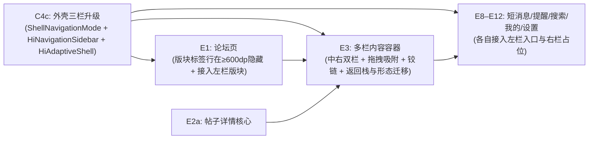

# 设计卡 D-3pane 调研、演算与代码影响报告

> 对应分支：`design/three-pane`（worktree `/home/mir/Documents/hipda-next.wt/D-3pane`）
> 对应设计稿更新：`docs/design/product-design.md`（v0.3 定稿）、`docs/design/copy.md`（v0.3）、`docs/design/tech-plan.md`（v0.3）、`docs/design/backlog.md`（v0.3）
> 调研与修订日期：2026-11-25（含 R-D3pane 修订轮 1）

---

## 一、调研明细

### 1.1 主流折叠屏内屏与常见平板窗口宽度（dp）

> **口径约定**：
> - Android 应用窗口 dp 由逻辑密度决定：$\text{dp} = \text{px} \div (\text{densityDpi} \div 160)$。
> - **Galaxy Z Fold8 以用户真机实测为准**（用户当前显示缩放下最小宽 `559dp`，按物理分辨率宽高比推算另一边），网上数据仅作对照。
> - 凡公开渠道查不到可靠默认逻辑 `densityDpi` 或实测 dp 的机型，严格标注**“默认逻辑 dp：未知”**，并写出物理分辨率来源与按合理密度区间的推算过程；不采信未核实的估算站（如 `yesviz.com` 机械按 `2.0x` 计算 Fold7 的 `984×1092`）。

| 机型 | 物理内屏参数 | 默认逻辑 dp 状态 | 内屏竖拿（宽 × 高 dp） | 内屏横拿（宽 × 高 dp） | 推算过程 / 证据来源 |
|---|---|---|---|---|---|
| **Samsung Galaxy Z Fold8（用户设备，4:3 自然横展）** | 7.6"，4:3，`1828 × 2448 px`（~403 ppi；部分媒体作 `1848 × 2448 px`）；外屏 5.5" 10:16 `1248 × 1972 px` | **用户实测为准**（网上公开默认 `densityDpi`：**未知**） | **实测 `559 × 749`**（按 1848 对照：`559 × 740`） *网上推算对照：400dpi `731×979`；420dpi `696×933`；450dpi `649×869`；480dpi `609×816`* | **实测推算 `749 × 559`（自然展开）**（按 1848 对照：`740 × 559`） *网上推算对照：400dpi `979×731`；420dpi `933×696`；450dpi `869×649`；480dpi `816×609`* | **实测推导**：短边实测 `559dp`，对应密度 $1828/559 \approx 3.270\times$（~523dpi）；长边 $= 559 \times (2448/1828) = 748.59 \approx 749\text{dp}$（按 `1848`：$559 \times 2448/1848 = 740.49 \approx 740\text{dp}$）。 **物理规格来源**：三星开发者官网 [galaxy-z.html](https://developer.samsung.com/galaxy-emulator-skin/galaxy-z.html)（`Galaxy Z Fold8 New: 7.6 inches, 1828 x 2448 pixels, ~403 ppi`）；[Wikipedia Samsung Galaxy Z Fold 8](https://en.wikipedia.org/wiki/Samsung_Galaxy_Z_Fold_8)（`2448 × 1848, 4:3, 403 ppi`，外屏 `1972 × 1248, 10:16`）。 |
| **Samsung Galaxy Z Fold8 Ultra** | 8.0"，10:9，`2256 × 2504 px`（~422 ppi） | **未知**（仅公开物理像素，Emulator Skin 需登录） | 推算：`859 × 954`（420dpi）/ `802 × 890`（450dpi）/ `752 × 835`（480dpi 保守） | 推算：`954 × 859`（420dpi）/ `890 × 802`（450dpi）/ `835 × 752`（480dpi 保守） | 按硬件 422 ppi 对应 `420dpi (2.625×)`、`450dpi (2.8125×)`、`480dpi (3.0×)` 计算：`px ÷ (dpi/160)`。来源：三星开发者官网 [galaxy-z.html](https://developer.samsung.com/galaxy-emulator-skin/galaxy-z.html)。 |
| **Samsung Galaxy Z Fold7** | 8.0"，10:9，`1968 × 2184 px`（~368 ppi） | **未知**（官方未公开逻辑 `densityDpi`） | 推算：`875 × 971`（360dpi）/ `787 × 874`（400dpi，对齐 Fold6）/ `750 × 832`（420dpi 保守） | 推算：`971 × 875`（360dpi）/ `874 × 787`（400dpi）/ `832 × 750`（420dpi 保守） | 物理规格来源：三星开发者官网 [galaxy-z.html](https://developer.samsung.com/galaxy-emulator-skin/galaxy-z.html)（`8.0 inches, 1968 x 2184, ~368 ppi`）；[Wikipedia Samsung Galaxy Z Fold 7](https://en.wikipedia.org/wiki/Samsung_Galaxy_Z_Fold_7)。 |
| **Samsung Galaxy Z Fold6** | 7.6"，`1856 × 2160 px`（~374 ppi） | **实测/官方定义** | **`744 × 860`**（`vertical-spanned`） | **`860 × 744`**（`horizontal-spanned`） | 来源：Chromium DevTools `EmulatedDevices.ts:1831-1860`（SM-F956U，commit `ab4bdbd3c9e214646ad41ddad9a0519e2b385cf2`，见 `docs/design/foldable-research.md:462`）；物理像素核对自三星 [galaxy-z.html](https://developer.samsung.com/galaxy-emulator-skin/galaxy-z.html)。 |
| **Google Pixel 9 Pro Fold** | 8.0"，`2076 × 2152 px` @ `390dpi` | **Android 16 实测** | **`852 × 883`**（实测 `851.69 × 882.87`；Chrome DevTools `836 × 842`） | **`883 × 852`**（实测 `882.87 × 851.69`；Chrome DevTools `842 × 836`） | 来源：[screens.guide devices.json](https://screens.guide/data/v1/devices.json)（Android 16 build `BE2A.250530.026.F3`）；AOSP `nexus.xml:4768-4794`（commit `e42834169b1946ec9e0124e096c67f0be0c05f72`，见 `docs/design/foldable-research.md:460`）。 |
| **Google Pixel 10 Pro Fold** | 8.0"，`2076 × 2152 px` @ `390dpi` | **官方定义推算** | **`852 × 883`**（推算） | **`883 × 852`**（推算） | 来源：AOSP `nexus.xml:5256-5282`（同时给出 `2076×2152` 与 `pixel-density = 390dpi`，见 `docs/design/foldable-research.md:461`）。 |
| **Google Pixel Fold（初代）** | 7.6"，`1840 × 2208 px` @ `420dpi`（自然横展） | **Android 16 实测** | **`701 × 841`**（实测 `700.95 × 841.14`） | **`841 × 701`**（自然展开，实测 `841.14 × 700.95`） | 来源：[screens.guide devices.json](https://screens.guide/data/v1/devices.json)；AOSP `nexus.xml:3804-3830`（`docs/design/foldable-research.md:459`）。 |
| **荣耀 Magic V3 / Magic V5** | V3：7.92" `2156 × 2344 px`（402 ppi）； V5：7.95" `2172 × 2352 px`（403 ppi） | **未知**（官方适配门户未公开默认 `densityDpi`） | 推算：V3 `821×893`（420dpi）/ `767×833`（450dpi）/ `719×781`（480dpi）； V5 `827×896`（420dpi）/ `724×784`（480dpi） | 推算：V3 `893×821`（420dpi）/ `833×767`（450dpi）/ `781×719`（480dpi）； V5 `896×827`（420dpi）/ `784×724`（480dpi） | 物理规格来源：荣耀官网 [Magic V3 参数](https://www.honor.com/cn/phones/honor-magic-v3/spec/)、[Magic V5 官方信息](https://www.honor.com/)（`docs/design/foldable-research.md:464`）。 |
| **vivo X Fold（初代 V2178A）** | 8.03"，`1916 × 2160 px` @ `480dpi` | **官方指南推算** | **`639 × 720`** | **`720 × 639`** | 来源：vivo 官方《vivo X Fold 折叠屏适配指南》明确 `wm size 1916x2160`、`wm density 480`（IT 之家转载 [ithome.com/0/616/094.htm](https://www.ithome.com/0/616/094.htm)，`docs/design/foldable-research.md:465`）。 |
| **vivo X Fold3 / X Fold3 Pro / X Fold5** | 8.03"，`2200 × 2480 px`（~412 ppi） | **未知** | 推算：`838 × 945`（420dpi）/ `800 × 902`（440dpi）/ `733 × 827`（480dpi 保守） | 推算：`945 × 838`（420dpi）/ `902 × 800`（440dpi）/ `827 × 733`（480dpi 保守） | 物理规格来源：vivo 官网 X Fold3 / X Fold5 规格页（`2480 × 2200, 8.03", 412 PPI`）。 |
| **OPPO Find N3（OnePlus Open）/ Find N5** | N3：7.82" `2268 × 2440 px`（426 ppi）； N5：8.12" `2248 × 2480 px`（412 ppi） | **未知** | 推算：N3 `864×930`（420）/ `825×887`（440）/ `756×813`（480）； N5 `856×945`（420）/ `817×902`（440）/ `749×827`（480） | 推算：N3 `930×864`（420）/ `887×825`（440）/ `813×756`（480）； N5 `945×856`（420）/ `902×817`（440）/ `827×749`（480） | 物理规格来源：OPPO 官网 Find N3 / Find N5 规格页与 DeviceSpecifications（`docs/design/foldable-research.md:467`）。 |
| **常见平板：Pixel Tablet / AOSP Medium Tablet (10.1–10.95")** | `2560 × 1600 px` @ `320dpi (xhdpi)` | **Android 16 实测 / AOSP 定义** | **`800 × 1280`** | **`1280 × 800`** | 来源：[screens.guide devices.json](https://screens.guide/data/v1/devices.json)；AOSP `devices.xml`（commit `e4283416`）。 |
| **常见平板：Samsung Galaxy Tab S9 / S10 / S11（11" / 12.4" / 14.6"）** | 11" `1600×2560`；12.4" `1752×2800`；14.6" `1848×2960` | 社区实测 One UI 默认档 + 缩放推算 | 11" 默认约 **`711 × 1138`**（320dpi 档 `800 × 1280`）；12.4" 约 `800–876 × 1280–1400`；14.6" Ultra 约 `800–924 × 1280–1480` | 11" 约 **`1138 × 711`**（或 `1280 × 800`）；12.4" `1280–1400 × 800–876`；14.6" Ultra `1280–1480 × 800–924` | 物理分辨率核对自三星开发者官网 [galaxy-tab.html](https://developer.samsung.com/galaxy-emulator-skin/galaxy-tab.html)；One UI 默认 `sw711dp`–`sw800dp` 来源于 r/GalaxyTab 与 XDA 实测汇报。 |
| **常见平板：小平板 8.8"（Lenovo Legion Tab）/ 小米 Pad 6 (11")** | Legion Tab `1600×2560`；Xiaomi Pad 6 `1800×2880` | 社区实测默认 `smallestWidth` | Legion Tab **`640 × 1024`**；Xiaomi Pad 6 **`641 × 1026`**（最高约 `672dp`） | Legion Tab **`1024 × 640`**；Xiaomi Pad 6 **`1026 × 641`** | 来源于 XDA Forums（Legion Tab `sw640dp`）与 GSMArena / 社区实测（Xiaomi Pad 6 `sw641–672dp`）。 |
| **对照参考：Apple iPad（mini / 11" / Pro 13"，单位 pt）** | 2× Retina | **实测（screens.guide）** | mini A17 Pro `744 × 1133`；11" `820 × 1180`；Pro 11" `834 × 1210`；Pro 13" `1032 × 1376` | mini `1133 × 744`；11" `1180 × 820`；Pro 11" `1210 × 834`；Pro 13" `1376 × 1032` | 来源：[screens.guide devices.json](https://screens.guide/data/v1/devices.json)。 |

---

### 1.2 Material 3 Adaptive 规范与 Compose 组件能力与限制

源码均直接核实自 `androidx/androidx`（`androidx-main` commit **`c39ad4ebe3fb0e8656ff7286cfa29b3b7222e750`**）与 Android Developers 官方文档：

1. **5 档宽度断点与 3 档高度断点**（[Use window size classes](https://developer.android.com/develop/ui/compose/layouts/adaptive/use-window-size-classes)）：
   - 宽度：**Compact** `< 600dp`、**Medium** `600–839dp`（官方标注覆盖 93.73% 平板竖屏与绝大多数展开折叠屏竖拿）、**Expanded** `840–1199dp`（97.22% 平板横屏与多数展开折叠屏横拿）、**Large** `1200–1599dp`、**Extra-large** `≥ 1600dp`。
   - 高度：**Compact** `< 480dp`（99.78% 手机横屏，官方明确提示此时即便宽度为 Medium 也不应分双栏）、**Medium** `480–899dp`、**Expanded** `≥ 900dp`。
2. **`ListDetailPaneScaffold` 与 `PaneScaffoldDirective` 的能力与限制**（[List-detail](https://developer.android.com/develop/ui/compose/layouts/adaptive/list-detail)；`PaneScaffoldDirective.kt:48-106, 127-148, 345-348`；`ListDetailPaneScaffold.kt:81-104, 226-258`）：
   - **默认分栏**：Compact / Medium 均仅 `maxHorizontalPartitions = 1`；Expanded（`840–1199dp`）为 `2` 栏（`spacer = 24dp`，`DefaultPreferredWidth = 360dp`）；**Large / XL（`≥ 1200dp`）才开 `3` 栏**（`DefaultPreferredWidthXL = 412dp`）。另提供 `calculatePaneScaffoldDirectiveWithTwoPanesOnMediumWidth` 使 Medium 变 `2` 栏。
   - **关键限制**：`ListDetailPaneScaffold` 的三槽位固定语义为 `List (Secondary) + Detail (Primary) + Extra (Tertiary)`，用于“列表 + 详情 + 详情的辅助面板”，**不是**“常驻导航/版块侧栏 + 列表 + 详情”；且默认 `1200dp` 才出 3 栏、`24dp` 固定大间距与 `360/412dp` 偏好宽对 `~680–900dp` 折叠屏明显过宽。
3. **`SupportingPaneScaffold`**（[Build a supporting pane layout](https://developer.android.com/develop/ui/compose/layouts/adaptive/build-a-supporting-pane-layout)）：面向“主内容 + 辅助工具/目录/相关推荐（+ 可选 Extra）”，不适用于论坛“版块导航 | 帖子列表 | 帖子正文”三层筛选浏览结构。
4. **`NavigationSuiteScaffold` / `WideNavigationRail` / `PermanentNavigationDrawer`**（[Build adaptive navigation](https://developer.android.com/develop/ui/compose/layouts/adaptive/build-adaptive-navigation)；`NavigationSuiteScaffold.kt:1136-1207`；`WideNavigationRail.kt:162, 525, 1467-1472`；`NavigationRailCollapsedTokens.kt:30-44`；`NavigationRailExpandedTokens.kt:30-34`；`NavigationDrawerTokens.kt:67-68`）：
   - `NavigationSuiteScaffoldDefaults.navigationSuiteType()` 在 Compact 宽/高或 Tabletop 时返回 `ShortNavigationBar`，**在 Medium / Expanded / Large / XL 一律默认返回 `WideNavigationRailCollapsed`**（源码 L1140 注释明确建议用 `WideNavigationRailExpanded` 取代旧 `PermanentDrawerSheet`）。
   - 官方宽度 Token：`NavigationRailCollapsedTokens.ContainerWidth = 96dp`（`NarrowContainerWidth = 80dp`），`NavigationRailExpandedTokens.ContainerWidthMinimum = 220dp`（最大 `360dp`），`NavigationDrawerTokens.ContainerWidth = 360dp`（`PermanentNavigationDrawer` 默认 360dp 远超折叠屏可承受范围）。
   - **`ModalWideNavigationRail`（`WideNavigationRail.kt:525`）** 提供了“收起时为常驻窄图标轨、点开后以带遮罩浮层展开完整文字列表而不挤压内容区”的官方交互范式——这正是本方案在 `600–839dp` 采用的交互原型（但因项目已自研毛玻璃胶囊与高密度中文侧栏，且需在 `680dp` 紧区间压缩至 `64dp` 收起轨与 `176–220dp` 展开宽，由自研 `HiNavigationSidebar` 实现更可控、更轻量）。

---

### 1.3 成熟产品在折叠屏内屏（~560–900dp）的三栏/左栏形态

| 产品 | ~700–900dp 折叠屏内屏形态 | 左栏形态与切换方式 | 证据来源 |
|---|---|---|---|
| **Gmail（Android）** | 折叠屏展开态多为**左 Rail + 列表 + 详情**；支持拖拽中右分隔条调宽，推至边缘可退回单栏全屏阅读。 | 最左常驻竖向图标轨（Mail/Chat/Spaces/Meet + 撰写按钮），点左上角菜单按钮以模态抽屉展开标签/文件夹列表。 | [Google Workspace Updates 2025-04-25](https://workspaceupdates.googleblog.com/2025/04/release-notes-04-25-2025.html)（可拖拽分隔条）；[2023-10-20](https://workspaceupdates.googleblog.com/2023/10/release-notes-10-20-2023.html)；[Android Developers Adaptive Quality](https://developer.android.com/docs/quality-guidelines/adaptive-app-quality)。 |
| **Microsoft Outlook（Android）** | 竖拿展开态为**双栏**（邮件列表 + 阅读窗格）；横拿展开态升级为**完整三栏**（文件夹列表 + 邮件列表 + 阅读窗格）。 | 竖拿时文件夹收进左上角抽屉；横拿时左栏常驻显示文件夹列表。 | [Microsoft Support: Outlook for Android tablets & foldables](https://support.microsoft.com/)（官方明确记载“In landscape view, you can see a three-pane layout: list of folders, list of emails, and selected email”）。 |
| **Telegram（Android）** | 折叠屏展开态进入**双栏**（左会话列表 + 右聊天区）；仅在更宽平板/桌面端出现左侧聊天文件夹图标轨。 | 聊天文件夹默认置于列表顶部横向标签，无常驻全功能文字侧栏；且因**未提供收起列表的全屏阅读开关**长期受折叠屏用户诟病（反例）。 | [Telegram Blog 2026-02-09](https://telegram.org/blog/crafting-android-design-and-more)；`docs/design/foldable-research.md:290-310`。 |
| **Slack（Android）** | 长期以拉伸版单栏手机界面为主，横屏与折叠屏内屏缺少稳定的多栏常驻频道侧栏（反例）。 | 频道列表仍需通过返回或抽屉访问，重度用户需靠修改系统 DPI 强迫平板模式。 | [Android Authority](https://www.androidauthority.com/) / r/GalaxyFold 社区反馈汇总。 |
| **Reddit 客户端（Sync / Relay / Infinity）** | Sync 为左导航轨 + 双栏列表详情；Relay 主打双栏（横/展开自动分栏）；Infinity 侧重多列瀑布流（折叠屏独立列数设置）。 | Sync 采用可收起/常驻左轨承载订阅子版块与功能入口；其余多以双栏+模态抽屉为主。 | [9to5Google Sync Material You 报道](https://9to5google.com/)、r/GalaxyFold 与 Infinity 开源设置文档。 |

---

## 二、fluxdo 的做法（源码深度剖析）

> 源码仓库：`https://github.com/Lingyan000/fluxdo`（Flutter / Discourse 客户端）
> 核实 Commit：**`8cf5cf291f39b5a685c379c0eea14f479c594563`**

### 2.1 分档宽度、断点值与栏数规则
1. **设备宽度三档**（`lib/utils/responsive.dart:5-16, 66, 75-91, 108-116`）：
   - `mobile`（`width < 600`）：底部导航栏（可选悬浮毛玻璃胶囊，最大宽 `420dp`，`lib/widgets/layout/adaptive_navigation.dart:493`）；
   - `tablet`（`600 ≤ width < 1200`）：`Responsive.showNavigationRail()` 返回 `true`，底栏切为左侧常驻 `AdaptiveNavigationRail`；
   - `desktop`（`width ≥ 1200`）：同样使用左侧 Rail（且桌面平台 `PlatformUtils.isDesktop` 下无视 600 强制显示 Rail，`lib/widgets/layout/adaptive_scaffold.dart:68-70`）；
   - 内容最大阅读宽：`Breakpoints.maxContentWidth = 800`（`responsive.dart:15`）。
2. **左侧 Rail 形态与宽度**（`lib/widgets/layout/adaptive_navigation.dart:35-181`、`adaptive_scaffold.dart:44, 82, 110-178`、`category_shortcuts.dart:15-129`）：
   - 组件虽预留了 `extendedRail` 参数（`extended ? 180.0 : 72.0`），但线上主入口 `lib/main.dart:1812-1821` **从未传入 `extendedRail: true`**，实际全宽段恒为 **`72dp` 纯图标轨**（右侧 `1px VerticalDivider`），**无文字、仅悬停/长按 Tooltip**。
   - **Rail 内容结构**：顶部固定 1 个（桌面 2 个）主导航图标 + 中间 `Expanded(SingleChildScrollView)` 内嵌 `CategoryShortcuts`（用户收藏的版块快捷图标）+ `+` 管理版块图标 + 底部其余导航图标（通知、我的等）。
3. **Master-Detail 双栏门槛（核心亮点：扣除 Rail 宽再判定）**（`lib/utils/responsive.dart:24-38`、`lib/utils/nav_chrome_metrics.dart:17-29`、`lib/widgets/layout/master_detail_layout.dart:155-167`）：
   - 公式：`contentWidth = screenWidth - NavChromeMetrics.reservedWidth(showRailByBreakpoint: !isMobile)`，满足 `contentWidth >= masterWidth + minDetailWidth && !isMobile` 才开双栏。
   - 由于 `railWidth` 恒为 `72dp`，各宿主的**实际整窗双栏门槛**分化为三套：
     - 首页话题 / 私信 / 草稿 / 我的话题 / 浏览历史：`72 + 380 + 400 =` **`852dp`**（`PaneBreakpoints.masterWidth = 380, minDetailWidth = 400`）；
     - 设置页：`72 + 380 + 480 =` **`932dp`**；
     - 搜索 / 追觅：`72 + 440 + 480 =` **`992dp`**。
4. **栏宽规则与可拖动分隔线**（`master_detail_layout.dart:48-63, 205-226, 318-348`、`draggable_divider.dart:24-144`、`topics_screen.dart:187-193`）：
   - 左侧 `72dp` Rail 固定不可拖动；
   - Master（列表）栏可拖动（`DraggableDivider`，热区 `16px`，拖动量化至 `8px` 网格防止高频重算图片尺寸引发 429）：
     - 列表态默认宽 `max(totalWidth * 0.25, 380)`，占比上限 `0.30`，绝对下限 `240dp`（`minPaneAbsoluteWidth = 240`），上限同时受 `totalWidth - minDetailWidth` 约束；
     - 压栈进入深层平行视界（左栏变“上一层预览”）时，默认比例自动放宽至 `0.50`、上限 `0.80`；
     - **不提供“列表收起（0dp）”或“一键全屏阅读”吸附档**。

### 2.2 在 `~560–900dp` 宽度时的实际样貌与切换方式
- **`560–599dp`（含用户 Fold8 实测竖拿 `559dp`）**：纯单栏 + 底部导航栏。点击列表项走全屏真路由 push。完整分类列表通过顶栏 `☰` 按钮或在首页“全部”Tab 左缘右滑跟手拖出 `304dp` 模态抽屉 `ControlledCategoryDrawer`（`lib/widgets/topic/category_drawer.dart:61-252`、`lib/pages/topics_page.dart:720-727, 1282-1287`）。
- **`600–851dp`（涵盖 Fold8 实测自然横展 `749dp`、Z Fold6 竖拿 `744dp`、Pixel Fold 竖拿 `701dp`、Pixel Tablet 竖屏 `800dp`）**：
  - 显示 **“左侧 `72dp` 纯图标轨（内含收藏版块图标）+ 右侧单栏内容”**（1 图标轨 + 1 单栏），**不会出现“列表 + 帖子内容”双栏**；
  - 点击话题仍全屏 push 路由；看完整文字分类树仍要点 `☰` 拉出 `304dp` 模态抽屉。
- **`852–900dp`（如 Z Fold6 横拿 `860dp`、Pixel 9/10 Pro Fold `852 / 883dp`）**：
  - 首页终于进入 **“左侧 `72dp` 纯图标轨（含版块图标）+ `380dp` 话题列表 + `400–448dp` 话题内容”** 的实质三栏形态，但搜索与设置在此区间依然是单栏，且左栏仍无文字。

### 2.3 返回栈、选中态与折叠/展开/旋转的状态保持
- **单一状态真相栈**（`lib/providers/selected_topic_provider.dart:85-397`、`docs/parallel-view-conventions.md:11-26`）：每个宿主页持有独立 `SelectedTopicProvider`（`List<PaneEntry>`，支持 `topic / profile / settings` 混插），列表点击调 `select()` 替换整栈，详情内点链调 `push()` 压栈，返回调 `isStacked ? pop() : clear()`。
- **同树内联投影 + 胶片带恒定树形**（`master_detail_layout.dart:14-26, 236-314`、`pane_projection_back_scope.dart:12-217`、`docs/parallel-view-conventions.md:58-87, 103-124`）：
  - 宽屏 → 窄屏时**不 push 合成全屏路由**，而是在同一棵 Widget 树中开启 `projectDetailWhenNarrow`，将栈顶详情全宽投影并把列表收进 `Offstage` 保活（滚动位、输入框、视频零重置）；`PaneProjectionBackScope` 统一接管系统返回、Android 预测返回跟手与隐藏底栏。
  - 窄屏点列表走真路由 push；若此时展开大屏，`TopicDetailPage._maybeSwitchToMasterDetail()`（`lib/pages/topic_detail_page/topic_detail_page.dart:1146-1230`）携带原 `instanceId` 将自己写回栈并退场，实现无重载接管。
- **无折叠屏物理铰链感知**：仓库中未检测到 Jetpack `FoldingFeature` / Flutter `DisplayFeature` 铰链避让逻辑。
- **README 与截图核查**：`README.md:25` 仅有一张 4 台手机竖屏合成图（`screenshots/preview.png`），无大屏或折叠屏截图；大屏规范全部沉淀在 `docs/parallel-view-conventions.md`。

### 2.4 我们的借鉴与取舍
- **借鉴**：(1) 从 `600dp`（M3 `Medium`）起以常驻左侧图标轨取代底栏，并在轨内嵌入关注版块快捷图标，直接消除 `600–839dp` 底栏与工具条重叠；(2) 栏宽判定轴先扣左栏宽，杜绝中间宽度挤压振荡；(3) 单一状态源 + 同树保活（Compose 用 `movableContentOf` + 共享状态），折叠/旋转不走合成路由、不丢状态。
- **不借鉴**：(1) `852–992dp` 才开双栏导致 `680–851dp` 折叠屏（含 Fold8 `749dp`）全变单栏；(2) 全宽段锁定 `72dp` 纯图标无常驻文字侧栏；(3) 无物理铰链避让、无“列表收起 / 全屏阅读”沉浸切换；(4) 首页无限层叠胶片带与按宿主分裂三套双栏门槛。

---

## 三、三栏通用方案与逐台设备演算

### 3.1 通用分档规则摘要（详见 `docs/design/product-design.md` §4.1）
严格按 **高度 → 竖向物理铰链 → 宽度（`600 / 680 / 840dp`）** 通用分档，不针对任何机型特判，整数取整顺序统一为先 `L`（`roundToInt`）→ `S = W − L` → `M`（`roundToInt`）→ `R = S − M`（保证任意整宽 `L + M + R == W`）：
1. **高 `< 480dp`**：单栏 + 底部紧凑胶囊（高 ≥48dp，滚隐）。
2. **竖向物理铰链分隔（`isSeparating == true`）**：按 `hingeBounds` 计算 `leftW` / `rightW`；满足 **`leftW ≥ 280dp && rightW ≥ 360dp`** 时启用铰链双栏（对齐铰链、列表侧居中紧凑胶囊、保留版块标签行，不启三栏）；任一侧不足时退回单栏铺满窗口，紧凑胶囊居中于铰链外较宽一侧（等宽取左；该侧 `< 280dp` 则整窗居中）。
3. **宽 `< 600dp`**：单栏 + 底部悬浮毛玻璃胶囊（高 ≥64dp，`<360dp` 仅选中项显示文字，滚隐）。
4. **宽 `600–679dp`**：**2 栏（图标轨 + 单栏）**——左 `64dp` 常驻图标轨（纯色 `surfaceContainerLow`，取代底栏，点顶部 `展开侧栏` 按钮或 `我的` 图标以 **`240dp` 浮层**展开完整文字侧栏覆盖内容，不设左缘右滑；支持左滑抽屉/点罩/返回/`Escape` 收回）+ 内容单栏（`536–615dp`），隐藏版块标签行。
5. **宽 `680–839dp`**：**紧凑三栏（图标轨 + 列表 + 正文）**——左 `64dp` 常驻图标轨（同上可浮层展开 `240dp` 不重排中右两栏）+ 中栏 `M = clamp(0.40×(W−64), 256, 380).roundToInt()` + 右栏 `R = W − 64 − M`（**恒 ≥ 360dp**），隐藏版块标签行。
6. **宽 `≥ 840dp`**：**完整三栏（完整左栏 + 列表 + 正文）**——左栏默认常驻展开 `L = clamp(0.20×W, 176, 220).roundToInt()`（可主动原地收起为 `64dp` 图标轨，按方向记忆）+ 中栏 `M = clamp(0.40×(W−L), 256, 380).roundToInt()` + 右栏 `R = W − L − M`（展开恒 ≥ `398dp`，收起恒 ≥ `466dp`），隐藏版块标签行。
- 左侧栏上方收拢为 5 行（`今日新帖`、`搜索`、`短消息`、`提醒`、`我的` 折叠组[高 `< 760dp` 默认收起、`≥ 760dp` 默认展开]，展开态底部固定 `设置`，收起态底部固定头像），确保 Fold8 横展 `749 × 559dp` 首屏直接可见 3 个默认关注版块；`64dp` 轨版块采用 `18dp` 矢量图标 + `10sp` 短标，无图标或图标碰撞时自动回退为 `28×28dp` 圆角短标/首字徽标。
- 中右分隔线 `1dp` 不占宽（热区 `48dp`），吸附 3 档：`0dp`（列表收起，仅右栏有内容时可用）/ 默认宽 $M$ / 均衡 $\min(0.50\times S,\ S - 360,\ 480).\text{roundToInt}()$（与默认差 `< 24dp` 时合并），暴露无障碍 `CustomAccessibilityAction` 与键盘切换。右栏窄宽+大字号下底部工具条自动切紧凑态（图标回复 + `{N}/{M}` + 更多）。详情顶栏“全屏阅读”一键隐藏左栏与中栏。

### 3.2 逐台设备演算全表（含竖/横栏数、每栏宽与吸附档位）

| 设备与口径 | 竖拿（宽 × 高 dp） | 竖拿结果（形态 \| 左/中/右 \| 吸附档） | 横拿（宽 × 高 dp） | 横拿结果（形态 \| 左/中/右 \| 吸附档） |
|---|---|---|---|---|
| **★ Galaxy Z Fold8（用户实测，官方 1828×2448）** | `559 × 749` | 单栏 \| `内容 559` \| — | **`749 × 559`（自然展开）** | **紧凑三栏** \| `64 \| 274 \| 411` \| `[0, 274, 325]` |
| *★ Galaxy Z Fold8（用户实测，媒体 1848×2448 对照）* | `559 × 740` | 单栏 \| `内容 559` \| — | `740 × 559` | **紧凑三栏** \| `64 \| 270 \| 406` \| `[0, 270, 316]` |
| *Galaxy Z Fold8（网上 420dpi 推算对照）* | `696 × 933` | 紧凑三栏 \| `64 \| 256 \| 376` \| `[0, 256]` | `933 × 696` | **完整三栏** \| `187 \| 298 \| 448` \| `[0, 298, 373]` |
| *Galaxy Z Fold8（网上 400dpi 推算对照）* | `731 × 979` | 紧凑三栏 \| `64 \| 267 \| 400` \| `[0, 267, 307]` | `979 × 731` | **完整三栏** \| `196 \| 313 \| 470` \| `[0, 313, 392]` |
| **Galaxy Z Fold8 Ultra**（420dpi 推算） | `859 × 954` | **完整三栏** \| `176 \| 273 \| 410` \| `[0, 273, 323]` | `954 × 859` | **完整三栏** \| `191 \| 305 \| 458` \| `[0, 305, 382]` |
| *Galaxy Z Fold8 Ultra（480dpi 保守）* | `752 × 835` | 紧凑三栏 \| `64 \| 275 \| 413` \| `[0, 275, 328]` | `835 × 752` | **紧凑三栏** \| `64 \| 308 \| 463` \| `[0, 308, 386]` |
| **Galaxy Z Fold7**（400dpi 推算） | `787 × 874` | **紧凑三栏** \| `64 \| 289 \| 434` \| `[0, 289, 362]` | `874 × 787` | **完整三栏** \| `176 \| 279 \| 419` \| `[0, 279, 338]` |
| *Galaxy Z Fold7（420dpi 保守）* | `750 × 832` | 紧凑三栏 \| `64 \| 274 \| 412` \| `[0, 274, 326]` | `832 × 750` | **紧凑三栏** \| `64 \| 307 \| 461` \| `[0, 307, 384]` |
| **Galaxy Z Fold6**（Chromium 实测） | `744 × 860` | **紧凑三栏** \| `64 \| 272 \| 408` \| `[0, 272, 320]` | `860 × 744` | **完整三栏** \| `176 \| 274 \| 410` \| `[0, 274, 324]` |
| **Pixel 9 / 10 Pro Fold**（实测 / AOSP） | `852 × 883` | **完整三栏** \| `176 \| 270 \| 406` \| `[0, 270, 316]` | `883 × 852` | **完整三栏** \| `177 \| 282 \| 424` \| `[0, 282, 346]` |
| **Pixel Fold 初代**（Android 16 实测） | `701 × 841` | **紧凑三栏** \| `64 \| 256 \| 381` \| `[0, 256]` | `841 × 701` | **完整三栏** \| `176 \| 266 \| 399` \| `[0, 266, 305]` |
| **荣耀 Magic V3**（420dpi 推算 / 480dpi 保守） | `821` / `719` | 紧凑三栏 \| `64\|303\|454` / `64\|262\|393` | `893` / `781` | **完整三栏** `179\|286\|428` / **紧凑三栏** `64\|287\|430` |
| **荣耀 Magic V5**（420dpi 推算 / 480dpi 保守） | `827` / `724` | 紧凑三栏 \| `64\|305\|458` / `64\|264\|396` | `896` / `784` | **完整三栏** `179\|287\|430` / **紧凑三栏** `64\|288\|432` |
| **vivo X Fold3 / X Fold5**（440 / 480dpi 推算） | `800` / `733` | 紧凑三栏 \| `64\|294\|442` / `64\|268\|401` | `902` / `827` | **完整三栏** `180\|289\|433` / **紧凑三栏** `64\|305\|458` |
| **vivo X Fold 初代**（官方 480dpi 推算） | `639 × 720` | 2 栏（图标轨+单栏） \| `64 \| 575` \| — | `720 × 639` | **紧凑三栏** \| `64 \| 262 \| 394` \| `[0, 262, 296]` |
| **OPPO Find N3**（440 / 480dpi 推算） | `825` / `756` | 紧凑三栏 \| `64\|304\|457` / `64\|277\|415` | `887` / `813` | **完整三栏** `177\|284\|426` / **紧凑三栏** `64\|300\|449` |
| **OPPO Find N5**（440 / 480dpi 推算） | `817` / `749` | 紧凑三栏 \| `64\|301\|452` / `64\|274\|411` | `902` / `827` | **完整三栏** `180\|289\|433` / **紧凑三栏** `64\|305\|458` |
| **Pixel Tablet / Tab S9+/S10+** | `800 × 1280` | 紧凑三栏 \| `64 \| 294 \| 442` \| `[0, 294, 368]` | `1280 × 800` | **完整三栏** \| `220 \| 380 \| 680` \| `[0, 380, 480]` |
| **Galaxy Tab S9 11"（711dp 档）** | `711 × 1138` | 紧凑三栏 \| `64 \| 259 \| 388` \| `[0, 259, 287]` | `1138 × 711` | **完整三栏** \| `220 \| 367 \| 551` \| `[0, 367, 459]` |
| **Galaxy Tab Ultra 14.6"（924dp 档）** | `924 × 1480` | **完整三栏** \| `185 \| 296 \| 443` \| `[0, 296, 370]` | `1480 × 924` | **完整三栏** \| `220 \| 380 \| 880` \| `[0, 380, 480]` |
| **Lenovo Legion Tab 8.8" / Xiaomi Pad 6** | `640–641 × 1024` | 2 栏（图标轨+单栏） \| `64 \| 576–577` \| — | `1024–1026 × 640` | **完整三栏** \| `205 \| 328 \| 491–493` \| `[0, 328, 410]` |

---

## 四、已合并代码影响清单（含精确 `文件:行号`）

### 4.1 生产代码（`hipda/src/main/` 与 `src/debug/`）

| 文件与行号 | 现状 | 三栏方案下的改动要求 |
|---|---|---|
| `hipda/src/main/java/net/jejer/hipda/ui/shell/ShellNavigationMode.kt:16-87` | 常量 `SHELL_RAIL_WIDTH_BREAKPOINT_DP = 840f`（L18）；`enum ShellNavigationMode { BottomPill, CompactPill, Rail }`（L22-26）；`ShellDestination` 仅 4 项（L29-54）；`shellNavigationMode()` 在 `≥840dp` 返回 `Rail`（L63-72）；`HiShellTestTags` 含 `NavigationRail`（L79-87）。 | 1. 新增断点常量 `SHELL_SIDEBAR_COLLAPSED_WIDTH_BREAKPOINT_DP = 600f`、`SHELL_THREE_PANE_WIDTH_BREAKPOINT_DP = 680f`、`SHELL_SIDEBAR_EXPANDED_WIDTH_BREAKPOINT_DP = 840f`、`HINGE_LEFT_MIN_WIDTH_DP = 280`、`HINGE_RIGHT_MIN_WIDTH_DP = 360`； 2. 将 `ShellNavigationMode.Rail` 替换为 `SidebarCollapsed`（`600–839dp`）与 `SidebarExpanded`（`≥840dp`）； 3. 新增纯函数 `calculateShellPaneLayout(widthDp, heightDp, hingeBounds, leftCollapsedPref, hasDetailContent)` 按整数顺序（`L → S = W − L → M → R = S − M`）输出布局形态、左/中/右栏宽、铰链双栏/退单栏胶囊落点与吸附档位列表； 4. 新增宽屏左栏条目模型 `ShellSidebarEntry`（5 行主入口含可折叠 `我的` 组 + 底部 `设置` + 动态关注版块列表）及与 `ShellDestination` 的确定性双向映射纯函数； 5. `HiShellTestTags` 替换 `NavigationRail` 为 `NavigationSidebar`、`SidebarModalDrawer`、`SidebarToggleButton`、`PaneDivider` 等语义标签。 |
| `hipda/src/main/java/net/jejer/hipda/ui/shell/HiNavigationRail.kt:25-73` | 固定 `80dp` 左侧毛玻璃导航轨，仅渲染 4 个 `ShellDestination`（L41-71）。 | **退役删除**，由同包新组件 `HiNavigationSidebar.kt` 取代（纯色 `surfaceContainerLow` + `1dp` 右分隔线，顶部固定区未滚动同为 `surfaceContainerLow`、滚动后渐变 `surfaceContainer` + `1dp` 底线；支持 `64dp` 收起图标轨、`240dp` 浮层展开[锁焦、`Escape`、无左缘右滑]与 `176–220dp` 常驻展开；可折叠 `我的` 分组[高 `<760dp` 默认收起、`≥760dp` 默认展开]；消费同包新建的 21 版块静态元数据表 `ForumMetadata.kt` 实现矢量图标 + `10sp` 短标与碰撞/未知回退）。 |
| `hipda/src/main/java/net/jejer/hipda/ui/shell/HiAdaptiveShell.kt:45-193` | L62-71 读窗口尺寸与 `hingeSeparating`；L90-95 仅用 `isRail` 判断关闭 `barState` 滚动隐藏；L105-108 算底部留白；L115-146 用 `padding(start = if (isRail) 80.dp else 0.dp)` 并按 `ShellDestination` 做 `AnimatedContent`；L148-177 渲染 `HiNavigationRail` 或 `HiNavigationPill`。 | 1. 将 `isRail` 替换为 `isSidebar = mode == SidebarCollapsed || mode == SidebarExpanded`； 2. 侧栏态不再用 `80.dp` 固定边距，改按 `animatedSidebarWidthDp`（`64dp` 或 `clamp(0.20×W, 176, 220).roundToInt()`，`HiMotion.spatialSlow()` 过渡，且在全屏阅读态缩至 `0dp`）为内容区让位； 3. 在 `600–839dp` 挂载浮层 `240dp` 侧栏（优先复用 M3 `ModalNavigationDrawer` / `ModalWideNavigationRail`；仅按钮/`我的` 展开，支持内区左滑收回、焦点锁定、返回与 `Escape` 关闭，打开居中模态框时同步收起浮层）； 4. 仅在底部胶囊形态启用 `hiGlassSource(glassState)` 与 `nestedScroll(destinationScrollConnection)`，侧栏态 `contentPadding` 底部只需 `navigationBars` inset；铰链退单栏时按 `calculateShellPaneLayout` 将紧凑胶囊对齐较宽一侧避开铰链； 5. 声明左/中/右栏 `isTraversalGroup = true` 与 `paneTitle`。 |
| `hipda/src/main/java/net/jejer/hipda/ui/shell/ShellIndicatorLayout.kt:45-250` | L49-55 定义 Rail 间距常量；L90、L111-121、L149-157、L187-248 包含 `ShellNavigationMode.Rail` 纵向指示器与导航项分支。 | 删除 `Rail` 分支与 `Rail*` 私有常量，瘦身为只服务 `BottomPill` / `CompactPill` 的横向指示器布局。 |
| `hipda/src/main/java/net/jejer/hipda/ui/shell/ShellBarState.kt:34-164` | L38 注释写“导航轨形态下为 `0f`”；实现逻辑完全通用。 | 无需逻辑大改，仅更新文档注释（L38 改为“侧栏形态下为 `0f`”）。 |
| `hipda/src/main/java/net/jejer/hipda/ui/shell/HiNavigationPill.kt:17-62` | 标准/紧凑底部毛玻璃胶囊。 | **无需改动**（`< 600dp`、矮屏与铰链分隔形态完整复用）。 |
| `hipda/src/main/java/net/jejer/hipda/ui/designsystem/glass/HiGlassSurface.kt:130-138` | L131 定义 `HiGlassBorderMode.EndEdgeOnly`（专供旧 `HiNavigationRail` 使用），L134 注释提及“导航轨”。 | 更新注释去掉“导航轨”；若 `EndEdgeOnly` 已无其他调用方可一并清理（若 `designsystem` 单测已测则保留枚举仅更新注释）。 |
| `hipda/src/main/java/net/jejer/hipda/ui/designsystem/HiTypography.kt:14, 152` | L14、L152 注释写“导航胶囊、导航轨与底部工具条”。 | 同步更新注释为“导航胶囊、左侧栏与底部工具条”，保持术语一致。 |
| `hipda/src/main/java/net/jejer/hipda/ui/designsystem/feedback/HiSnackbarHost.kt:77-83` | L77-83 当前整窗底部居中（`SNACKBAR_MAX_WIDTH = 600.dp`），三栏下会横跨中右分隔线与铰链。 | 在 `E3` 中支持按锚定区域（右栏 / 内容区 / 整窗）水平居中并接收对应 `bottomClearance` 与最大宽约束（不跨分隔线或铰链）。 |
| `hipda/src/main/java/net/jejer/hipda/data/settings/AppSettings.kt:24-28, 57-58` `SettingsRepository.kt:42-43` `DataStoreSettingsRepository.kt:53-54, 130-134, 181-190` | 卡 `D3a` 已合入，仅持久化 `paneSplitPortrait` / `paneSplitLandscape`，缺少左栏展开/收起偏好字段。 | 经跨线授权由 **`C4c` 唯一写入**，新增 `sidebarCollapsedPortrait: Boolean = false` 与 `sidebarCollapsedLandscape: Boolean = false` 字段、Preference Key 及读写方法，满足 §4.1/§4.3 按方向持久化左栏收起偏好与进程回收恢复要求。 |
| **新增共享元数据**：`ui/shell/ForumMetadata.kt`（参考旧版 `utils/HiUtils.java:84-106`） | 新代码尚无 21 个内置版块的 Compose 图标与短标映射，且未引入 `material-icons-extended`。 | 在 `C4c` 一次性建立 21 个内置版块静态元数据表（`fid`、全名、唯一 Compose 矢量图标、1–2 字短标）及撞车/未知 `fid` 首字徽标回退纯函数，供 `C4c`、`PreviewActivity` 与 `E1` 共用。 |
| `hipda/src/main/res/values/strings_shell.xml:1-7` | 仅含 4 个 `shell_nav_*` 字符串。 | 补齐左侧栏与多栏文案资源（`收起侧栏`、`展开侧栏`、`今日新帖`、`搜索`、`短消息`、`提醒`、`我的`、`收藏与关注`、`我的帖子`、`我的回复`、`浏览历史`、`设置`、`版块`、`管理版块`、`登录`、`去管理版块添加关注的版块`、`默认宽度`、`均衡`、`收起列表`），全部取自 `docs/design/copy.md`。 |
| `hipda/src/debug/java/net/jejer/hipda/ui/designsystem/PreviewActivity.kt:774-882` | `ShellPreviewScreen` 仅演示 4 目的地单列表（L775-882）。 | 更新演示入口，展示左侧栏 `我的` 分组与示例版块、未读数，并在 `≥ 680dp` 预览中右双栏占位，便于真机/折叠屏直验三栏与左栏开合。 |

### 4.2 已有测试与截图基线（`hipda/src/test/`）

| 文件与行号 | 影响点与修改内容 |
|---|---|
| `hipda/src/test/java/net/jejer/hipda/ui/shell/ShellNavigationModeTest.kt:10-91` | L12-40 原断言 `600/700/744/839dp → BottomPill`、`840/900/1280dp → Rail` 全部更新为 `<600dp → BottomPill`、`600–839dp → SidebarCollapsed`、`≥840dp → SidebarExpanded`；新增 `calculateShellPaneLayout` 覆盖全断点（含 `559 / 600 / 640 / 679 / 680 / 701 / 744 / 749 / 800 / 839 / 840 / 852 / 860 / 883 / 900 / 933 / 1024 / 1100 / 1280dp`）、整数 `L + M + R == W` 闭合、矮屏、铰链双栏（`749dp`）与铰链退单栏（`701dp` 及 `260|440dp`）、单栏断言 `rightPaneWidth == 0dp` / 多栏断言 `≥ 360dp` 与吸附合并。 |
| `hipda/src/test/java/net/jejer/hipda/ui/shell/HiAdaptiveShellTest.kt:75-97, 282-326, 457-460, 615-636, 695-775, 844-888` | 1. L82-85（`w700dp`）、L94-97（`w900dp`）：改断言侧栏存在且外壳自身毛玻璃为 `0` 块（全屏 ≤ 2 块）； 2. L282-326、L457-460、L695-775：旧 `NavigationRail` 用例迁移为 `NavigationSidebar` 测试（含 `64dp` 收起、`176–220dp` 展开、`1.25×` 字体钳制、`我的` 组高度自适应收起/展开、`749×559dp` 首屏可见 ≥3 关注版块、`240dp` 浮层按钮展开/焦点锁定/返回与 `Escape` 关闭、`contentDescription` 含未读数与 `paneTitle`）； 3. L615-636（`w700dp` 胶囊居中）调整到 `w559dp`（Fold8 竖拿）验证底部胶囊居中且上限 `420dp`； 4. L844-888 水平 Tabletop 铰链用例：`w700dp` 改断言 `SidebarCollapsed`，`w900dp` 改断言 `SidebarExpanded`。 |
| `hipda/src/test/java/net/jejer/hipda/ui/shell/HiShellBoundsGuardTest.kt:31-160` | 移除 `Rail` 分支，将 `SidebarCollapsed`（`600–839dp`）与 `SidebarExpanded`（`≥840dp`）纳入多宽高 × 字号缩放越界/重叠/48dp 触摸目标守卫测试。 |
| `hipda/src/test/java/net/jejer/hipda/ui/shell/HiShellScrollAndPressTest.kt:183-211, 690-694, 754-796` | L183-211、L754-796 改断言 `NavigationSidebar` 不随滚动隐藏且底部仅留 `navigationBars` inset；L690-694（原 `w700dp` 胶囊滚底）改用 `w559dp` 验证大屏窄单栏胶囊滚底。 |
| `hipda/src/test/java/net/jejer/hipda/ui/shell/HiShellScrollScreenshotTest.kt:79-82, 117-120, 147-154` | 此前遗漏；须补齐 `≥ 600dp` 侧栏态（如 `749×559` 或 `933×696`）滚底截图用例，直接对应产品设计 §10.3“侧栏态下底部无胶囊重叠”验收。 |
| `hipda/src/test/java/net/jejer/hipda/ui/shell/HiShellScreenshotTest.kt:49-212`（特别含 **L204-208**）及 `hipda/src/test/snapshots/images/shell_*.png` | 1. **必须修改 L204-208 硬编码断言**（原 `assertEquals(1, glassCount)`）：`≥ 600dp` 侧栏态改为纯色 `surfaceContainerLow` 后外壳自身毛玻璃数变为 `0`，按形态区分断言（胶囊态 `1`、侧栏态 `0`）； 2. 按 §10.1 新截图矩阵更新：删除/替换旧 `shell_w700_h900_*`、`shell_w900_h1120_*` 基线，按新矩阵录制 `411×891`、`559×749`（Fold8 竖）、`640×1024`（图标轨单栏）、`749×559`（Fold8 紧凑三栏，含浮层展开态）、`933×696`（完整三栏，含主动收起态）、`1280×800`（平板完整三栏）、`891×411`、`340×800` 及最大字号（`411` 与 `840dp`）。 |
| `hipda/src/test/java/net/jejer/hipda/data/settings/DataStoreSettingsRepositoryTest.kt:92-93, 202, 205, 253-254, 328-329` | 随 `C4c` 新增 `sidebarCollapsedPortrait` / `sidebarCollapsedLandscape` 偏好同步补齐默认值、读写与损坏回退测试断言。 |

---

## 五、实现卡拆分建议、依赖关系与验证方法

按 `docs/agents/DISPATCH.md §5` 第一性原理（判定方式、是否解锁并行、审查状态量，单卡不切碎且无文件重叠）拆分如下：

### 卡 1：`C4c` — 自适应外壳三栏升级与 `HiNavigationSidebar`（开发线 C）
- **改动范围**：`hipda/src/main/java/net/jejer/hipda/ui/shell/*`、`hipda/src/main/java/net/jejer/hipda/ui/designsystem/HiTypography.kt`、`hipda/src/main/java/net/jejer/hipda/ui/designsystem/glass/HiGlassSurface.kt`、`hipda/src/main/res/values/strings_shell.xml`、`hipda/src/debug/java/net/jejer/hipda/ui/designsystem/PreviewActivity.kt`、`hipda/src/test/java/net/jejer/hipda/ui/shell/*`、`hipda/src/test/snapshots/images/shell_*.png`；**经跨线授权唯一修改** `hipda/src/main/java/net/jejer/hipda/data/settings/{AppSettings,SettingsRepository,DataStoreSettingsRepository}.kt` 及 `DataStoreSettingsRepositoryTest.kt`（补 `sidebarCollapsedPortrait/Landscape` 偏好，不与 D 线其他卡并行冲突；不碰 `feature/`）。
- **组件复用原则**：优先使用 Compose / Material 3 现成组件（如 `Column`/`Row`/`LazyColumn` + `ModalNavigationDrawer`/`ModalWideNavigationRail`），确需自写 `Layout`/`Modifier.Node` 时须说明理由。
- **交付行为**：
  1. 重写 `ShellNavigationMode` 与纯函数 `calculateShellPaneLayout`（覆盖 `600 / 680 / 840dp`、整数取整顺序 `L → S → M → R`、矮屏 `<480dp`、竖向物理铰链 `leftW ≥ 280dp && rightW ≥ 360dp` 与退单栏胶囊落点、吸附档位与合并逻辑）；
  2. 新增 `ForumMetadata.kt`（21 个内置版块静态矢量图标 + 1–2 字短标 + 碰撞/未知 `fid` 回退）与 `HiNavigationSidebar` 取代 `HiNavigationRail`（`64dp` 收起图标轨、`240dp` 浮层展开[仅按钮/`我的` 展开、支持内区左滑/遮罩/返回/`Escape` 关闭、无障碍焦点锁定]、`176–220dp` 常驻展开、可折叠 `我的` 分组[高 `<760dp` 默认收起、`≥760dp` 默认展开]、顶部/底部固定区、纯色 `surfaceContainerLow`[顶部固定区未滚动同为 `surfaceContainerLow`，滚动后渐变 `surfaceContainer` + `1dp` 底线]、`1.25×` 字体钳制、`contentDescription` 含未读数）；
  3. 精简 `ShellIndicatorLayout` 移除旧 Rail 分支，更新 `HiAdaptiveShell`（声明三栏 `isTraversalGroup` / `paneTitle`）、修复 `HiShellScreenshotTest.kt:204-208` 侧栏态 `0` 块毛玻璃断言，并补齐 `HiShellScrollScreenshotTest.kt` 侧栏滚底截图与 `sidebarCollapsedPortrait/Landscape` 持久化。
- **依赖**：依赖已合并的 `C4a` / `C4b`（及 `C5b` 数字角标）。解锁 `E1`、`E3` 与 `E8–E12` 并行开发。
- **验证方法**：
  - 本地按 DISPATCH §2 串行跑 `:hipda:testDebugUnitTest --tests "net.jejer.hipda.ui.shell.*" --tests "net.jejer.hipda.data.settings.DataStoreSettingsRepositoryTest"` 与 `:hipda:recordRoborazziDebug --tests "net.jejer.hipda.ui.shell.HiShell*ScreenshotTest"`；
  - CI 证据：`assembleDebug`、`testDebugUnitTest`（含全断点整数闭合与铰链双栏/退单栏单测、越界/触摸目标参数化测试、重组断言、减少动态效果一帧到位、浮层焦点锁定/返回/`Escape`、`749×559dp` 首屏 ≥3 版块断言、`StateRestorationTester`）、`lint`、`verifyRoborazziDebug`；
  - 探针验证（Hydrogen 视觉复验）：核对 `559×749`、`640×1024`、`749×559`（含浮层展开与首屏版块可见性）、`933×696`（含主动收起）、`840×900` 最大字号 `1.3×`、`1280×800` 及侧栏滚底截图无裁字无重叠。

### 卡 2：`E3` — 中右双栏容器、拖拽吸附、物理铰链与跨形态状态迁移（开发线 E，替换原 `backlog.md` 的 E3）
- **改动范围**：`hipda/src/main/java/net/jejer/hipda/feature/pane/`（或 `ui/pane/` 新目录，与 C 线 `ui/shell/` 零文件重叠）、`HiSnackbarHost.kt` 多栏对齐参数及对应单测/UI 逐帧测试/截图测试。
- **组件复用原则**：优先使用 Compose / Material 3 现成组件（如 `Row` + `AnchoredDraggable` 或自定义 `PaneScaffoldDirective` 的 `ListDetailPaneScaffold`），确需自写 `Layout`/`Modifier.Node` 时须说明理由。
- **交付行为**：
  1. 实现中右内容双栏容器（接收 `calculateShellPaneLayout` 输出），挂载 `1dp` 分隔线 + `48dp` 拖拽热区，支持跟手拖拽、速度继承 `spatialSnap` 3 档吸附（含右栏空时禁用列表收起）、分隔线 `CustomAccessibilityAction`（`默认宽度`/`均衡`/`收起列表`）与键盘焦点切换、按方向持久化中右吸附档位；
  2. 实现详情顶栏“全屏阅读 / 显示列表”一键隐藏与恢复左中两栏；支持多栏 Snackbar 锚定对齐（右栏操作居中右栏，全局/列表操作居中内容区，不跨分隔线/铰链）；
  3. 实现竖向物理铰链分隔（`leftW ≥ 280dp && rightW ≥ 360dp` 启用铰链双栏并支持 `我的` 子页选帖后左栏晋升子列表、右栏保活帖子详情；不足时退单栏并将紧凑胶囊置于较宽一侧避开铰链）；
  4. 实现三栏、铰链双栏与 `600–679dp` 图标轨单栏返回栈，以及单栏 ↔ 图标轨单栏 ↔ 紧凑三栏 ↔ 完整三栏及 **展平三栏 ↔ 半折铰链双栏** 的 `movableContentOf` 同树无损状态迁移。
- **依赖**：`C4c`、`E1`、`E2a`（可与 `E2b`、`E2c` 并行）。
- **验证方法**：
  - 拖拽与甩动逐帧手势测试 + 分隔线无障碍自定义动作与键盘方向键测试；
  - 模拟 `FoldingFeature` 截图测试（展平三栏、铰链双栏、铰链退单栏各一张）；
  - 三栏、铰链双栏与 `600–679dp` 图标轨单栏返回栈 UI 测试；
  - 窗口尺寸动态变更（`411 ↔ 559 ↔ 640 ↔ 749 ↔ 860 ↔ 1280dp`）+ **展平三栏 ↔ 半折铰链双栏**（覆盖 `浏览历史 / 我的帖子 / 收藏与关注` 正看帖+快速回复输入与 `设置` 子页）+ `StateRestorationTester` 断言零丢失；
  - 探针验证（Hydrogen 视觉与状态机复验）+ CI 全绿。

### 卡 3：各业务页面适配接入（不单拆碎卡，直接并入既有 `E1`、`E4b`、`E6`、`E8–E15` 卡片验收）
- **`E1`（论坛页）**：在 `≥ 600dp` 侧栏态隐藏横向版块标签行，由左栏版块列表驱动当前版块与 `管理版块`；中栏宽 `< 300dp` 时列表项不设独立左侧大头像列（改用 `20–24dp` 副信息行内嵌头像，作者名优先截断）；
- **`E4b`（底部工具条）**：右栏窄宽+大字号自然宽度超 `右栏宽 − 32dp` 时自动切紧凑工具条态（图标回复 + `{N}/{M}` + 更多）；
- **`E8 / E9`（短消息 / 提醒）**：三栏中栏直出单列表隐藏冗余分段标签，左栏独立消费两项未读角标；
- **`E10 / E11 / E12`（搜索 / 我的 / 设置）**：三栏中右两栏与铰链双栏分工按 §4.2 表格落地（`设置` 默认选中 `外观与阅读`）；
- **`E14 / E15 / E6`（看图 / 登录账号 / 完整编辑器）**：看图盖住全部三栏，登录/账号居中 `≤ 480dp`，完整编辑器在 `600–1159dp`（右栏 `< 560dp`）一律覆盖全部栏居中 `≤ 680dp`、`≥ 560dp` 右栏内打开。
- **理由**：上述逻辑均属于各页面自身的布局契约（每项不足 50–80 行），并入原定页面卡验收可避免多出数张高固定开销的碎卡（遵循 `DISPATCH.md §5`）。

---

## 六、未查实的事实与用户已拍板定稿

### 未查实的事实
1. **默认逻辑密度（`densityDpi`）未公开机型**：Galaxy Z Fold8（已用用户真机实测 `559dp` 兜底）、Galaxy Z Fold8 Ultra、Galaxy Z Fold7、荣耀 Magic V3/V5、vivo X Fold3/X Fold5、OPPO Find N3/Find N5 的出厂默认逻辑 `densityDpi` 均无官方静态公开数据（三星 Emulator Skin 包需登录下载，国产三厂开发者平台无静态表），报告中对应数值已显式标“推算”并给出保守到宽松区间。
2. **Galaxy Z Fold8 物理短边微小口径差**：三星开发者官网 `galaxy-z.html` 标注 `1828 × 2448 px`（据此由 `559dp` 推出横拿 `749dp`），而 Wikipedia 与部分媒体作 `1848 × 2448 px`（推出 `740dp`），差值 `9dp` 不影响任何分档结论（均稳落 `680–839dp` 紧凑三栏）。
3. **One UI 平板默认最小宽**：Galaxy Tab S9/S10/S11 与小米/联想平板默认 `sw` 取自社区实测，因 One UI 屏幕缩放滑块档位不同存在差异。

### 用户已拍板定稿（2026-11-25，无待拍板项）
1. **左栏功能入口保留 `搜索`**：已作为定稿写入 `product-design.md` §3.2、§4.2、`copy.md` 与 `backlog.md`。
2. **接受 `680–839dp` 紧凑三栏（`64dp` 图标轨 + `240dp` 浮层展开）及 `600–679dp` 图标轨 + 单栏**：已作为定稿写入 `product-design.md` §4.1、`tech-plan.md` §7 与 `backlog.md`。

---

## 七、R-D3pane 修订轮 1 修改明细（基于 `71b20fd` 审查报告）

### 阻断项修复（B1–B4）
1. **B1（铰链双栏最小宽、退单栏导航、窄栏工具条与 §10.2 单测断言）**：
   - `product-design.md` §4.1：竖向物理铰链双栏门槛由单侧 `260dp` 改为 **`leftW ≥ 280dp && rightW ≥ 360dp`**（守住右栏 `360dp` 硬底线及左栏紧凑胶囊 `1.25×` 不裁切；Fold8 横展 `749dp` 单侧 `~374dp`、Fold6 `860dp` 单侧 `~430dp` 均照常启用；`701dp` 等不足时退回单栏铺满窗口，紧凑胶囊居中置于铰链外较宽一侧、较宽侧 `< 280dp` 时整窗居中）。
   - `product-design.md` §4.1/§5 & `copy.md`：补齐右栏窄宽+大字号下底部工具条自动切换**紧凑工具条态**（图标回复 `48×48dp` + `{N}/{M}` 页码 + 更多）。
   - `product-design.md` §10.2：按形态区分栏宽单测断言（单栏 / `600–679dp` / 矮屏 / 铰链退单栏断言 `rightPaneWidth == 0dp`；三栏与启用铰链双栏断言 `rightPaneWidth ≥ 360dp`，并补 `701dp` / `749dp` / `260|440dp` 铰链用例）。
2. **B2（铰链双栏 `我的` 子页落点、展平↔半折状态迁移与 `600–679dp` 返回栈）**：
   - `product-design.md` §4.2：补齐铰链双栏下 `浏览历史 / 我的帖子 / 我的回复 / 收藏与关注` 选帖（或由三栏半折带入）后**左栏晋升为对应子列表（顶栏带返回 `我的` 箭头）、右栏保活帖子详情**，`设置` 为 `左 5 分组（带返回箭头）| 右子页`；补齐 **`600–679dp` 图标轨单栏**点左栏清空详情栈并替换根列表及 3 级返回栈。
   - `product-design.md` §4.3 & §10.2：新增 **展平三栏（`isSeparating=false`）↔ 半折铰链双栏（`isSeparating=true`）** 双向无损迁移规则（含 `浏览历史/我的帖子/收藏与关注` 正在看帖+快速回复与铰链退单栏分支）及对应自动化迁移测试。
3. **B3（§5 左栏/顶栏底色统一、§6.3 切换版块单一动效与 `tech-plan.md`/`backlog.md` 同步）**：
   - `product-design.md` §5 & §10.3：左侧栏与顶部固定区未滚动时统一为 **`surfaceContainerLow`**（消除异色补丁），滚动后与中右顶栏统一用 `effectsDefault` 渐变为 `surfaceContainer` + `1dp outlineVariant` 底线；补齐多栏 Snackbar 对齐规则（不跨分隔线或铰链）。
   - `product-design.md` §6.2 & §6.3：`同级换内容` 删去“另一个版块”仅用于右栏换详情，**切换版块**全应用统一仅走 `内容替换`（`exit(effectsDefault)` + `effectsDefault` + `spatialDefault` 下方 8dp 移入）；更新 `spatialSlow` 表述为 `分栏出现、消失或左栏伸缩`。
   - 同步更新 `docs/design/tech-plan.md`（§1/§4/§7/§8，未触碰 §6 UA）与 `docs/design/backlog.md`（新增 `C4c`、更新 `E1` 与 `E3`）。
4. **B4（Fold8 横屏 `559dp` 高首屏版块可见、`64dp` 版块短标/回退与无冲突展开触发）**：
   - `product-design.md` §3.2 & §7.10：左栏上方收拢为 5 行（`今日新帖`、`搜索`、`短消息`、`提醒`、`我的` 可折叠分组[窗口高 `< 760dp` 默认收起、`≥ 760dp` 默认展开]），底部固定 `设置`（展开态）/ 头像（收起态），Fold8 `749 × 559dp` 下 `64dp` 轨首屏完整露出至少 3 个默认关注版块、`240dp` 浮层露出 `版块` 标题 + 2–3 个版块。
   - `product-design.md` §3.2 & 报告 §4–§5：弃用旧 FontAwesome，在 `C4c` 建 21 版块统一静态元数据表；`64dp` 轨采用 `18dp` 矢量图标 + `10sp` 短标，无内置图标或关注版块图标相同时自动回退为 `28×28dp` 圆角短标/首字徽标。
   - `product-design.md` §4.1/§6.3/§7.1：彻底取消“自左栏右滑”展开触发，改为仅由顶部 `展开侧栏` 按钮或 `我的` 图标触发 `240dp` 浮层，收回支持内区左滑/点罩/返回/`Escape`，打开居中模态框时同步收起浮层。

### 建议项修复（S1–S5）
- **S1（整数取整顺序）**：`product-design.md` §4.1/§10.2 明确 `L` → `S = W − L` → `M` → `R = S − M`（`roundToInt`），保证 `840`、`1024dp` 等任意整宽 `L + M + R == W`。
- **S2（确定性措辞与文案补齐）**：`product-design.md` §3.1 补齐二级页面列表，§3.2 固定窄→宽“我的”恢复规则（优先本次会话最近访问子项，否则 `收藏与关注`），§4.2 统一 `600–679dp` 完整编辑器为覆盖全部栏居中 `≤ 680dp`；`copy.md` 更新 L31 为 `双栏 / 三栏详情顶栏的切换按钮`，明确 `选一篇帖子开始阅读` 覆盖搜索/历史/我的帖子/收藏与关注，补齐 `我的` 折叠组、`去管理版块添加关注的版块`、紧凑页码 `{N}/{M}` 与分隔线无障碍动作文案。
- **S3（窄中栏排版）**：`product-design.md` §4.2/§10.2 与 `backlog.md` `E1` 明确中栏 `< 300dp` 列表项不设独立大头像列，改用 `20–24dp` 副信息行内嵌头像。
- **S4（无障碍与键盘）**：`product-design.md` §4.1/§10.1/§10.2 补齐分隔线 `CustomAccessibilityAction` 与键盘切换、`240dp` 浮层焦点锁定与 `Escape`、`64dp` 轨 `contentDescription` 合并未读数、三栏 `isTraversalGroup = true` + `paneTitle`。
- **S5（影响清单与组件原则）**：报告 §4 补全 `AppSettings.kt` / `SettingsRepository.kt` / `DataStoreSettingsRepository.kt` / `DataStoreSettingsRepositoryTest.kt`、`HiShellScrollScreenshotTest.kt`、`HiShellScreenshotTest.kt:204-208`、`HiTypography.kt`、`HiSnackbarHost.kt` 与 `ForumMetadata.kt`；`C4c` 与 `E3` 及 `tech-plan.md`/`backlog.md` 均采用“优先使用 Compose / Material 3 现成组件，确需自写 `Layout`/`Modifier.Node` 时须说明理由”。
